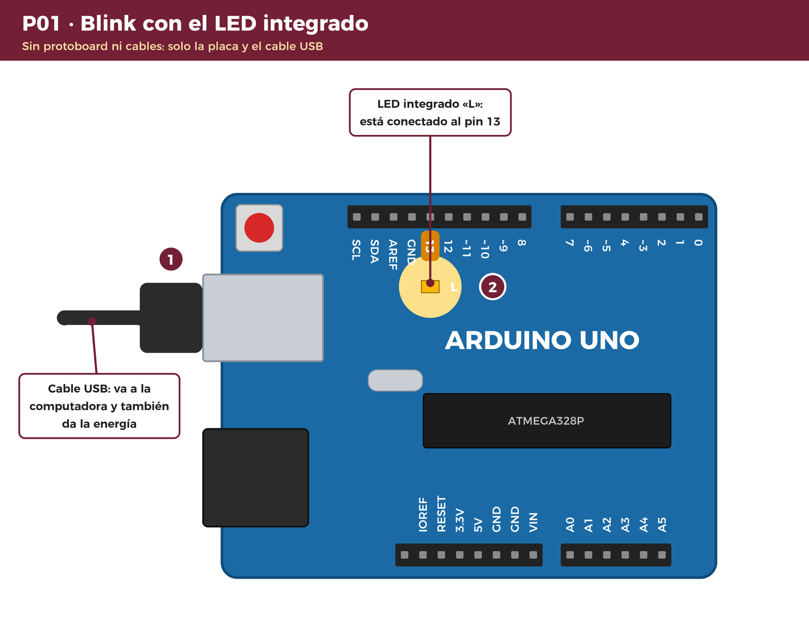
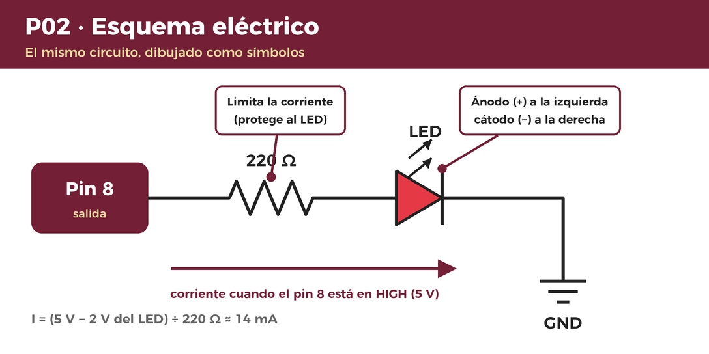
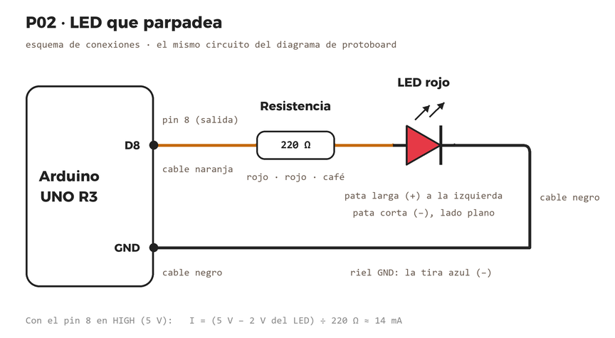
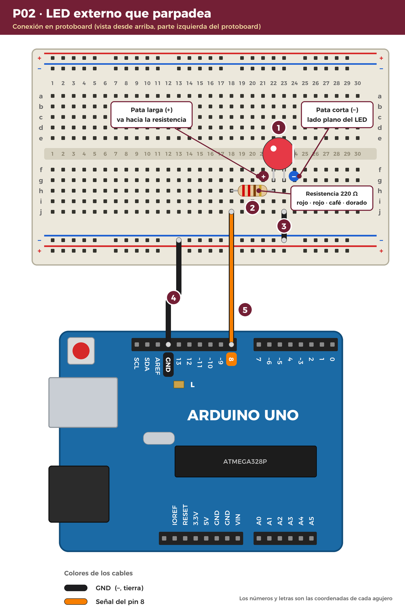

# Sesión 1 · Hola, Arduino

**Guía de práctica para el instructor** (de aquí saldrán después las láminas y las fichas de los alumnos)
**Prácticas:** P01 Blink con el LED integrado · P02 LED externo que parpadea
**Sketch:** `curso-arduino/sketches/P02_led_parpadeo/P02_led_parpadeo.ino` (P01 usa el ejemplo del IDE); reto SOS resuelto en `curso-arduino/sketches/P02_SOS/P02_SOS.ino`
**Idea nueva de la sesión:** un programa se sube a la placa y hace que un pin entregue 5 V o 0 V.

## Materiales (del kit)

| Cantidad | Material |
|---|---|
| 1 | Placa Arduino UNO R3 y cable USB |
| 1 | Protoboard de 830 puntos |
| 1 | LED rojo de 5 mm |
| 1 | Resistencia de 220 Ω (**rojo, rojo, café**, dorado) |
| 3 | Cables jumper macho-macho (dos para GND, uno para la señal; si tienes negro y de color, úsalos como en el diagrama) |

**Cuidado con las resistencias:** el kit trae 9 valores distintos. Revisa los colores: 220 Ω es rojo-rojo-café. Si dudas, mídela con el multímetro.

## Antes de empezar

- Arduino IDE abierto, placa conectada por USB.
- Elige la placa: **Herramientas → Placa → Arduino AVR Boards → Arduino Uno** (o en la lista desplegable de arriba del IDE 2.x).
- Elige el puerto: **Herramientas → Puerto**. Es el que aparece cuando conectas la placa; si no sabes cuál es, desconecta y vuelve a conectar y fíjate cuál aparece.

## P01 · Blink con el LED integrado (≈10 min)

La placa trae un LED pequeño marcado con una **L**, conectado al pin 13. Sirve para comprobar que la placa, el cable y el puerto funcionan **sin armar nada**.

**Pasos**

1. Conecta la placa a la computadora con el cable USB (**1**). Debe encenderse el LED verde de «ON».
2. Abre el ejemplo: **Archivo → Ejemplos → 01.Basics → Blink**.
3. Presiona **Subir** (flecha →). Espera el mensaje «Subido».
4. Observa el LED «L» (**2**): parpadea, un segundo encendido y uno apagado.

**Qué observar:** el programa es el mismo que vas a escribir en P02, pero con el LED que ya viene en la placa.

**Si no funciona**

| Síntoma | Causa probable |
|---|---|
| No aparece ningún puerto | Cable que solo carga (sin datos), o el driver. Prueba otro cable. Si hace falta driver, usa el del chip que veas en el Administrador de dispositivos; **no instales «drivethelife»** (ver `revision-kit-arduino.md`, F7) |
| Error `avrdude… not in sync` o `programmer is not responding` | Placa o puerto mal elegidos |
| Sube pero no parpadea | Sketch equivocado o la placa no es la que elegiste |

## P02 · LED externo que parpadea (≈35 min)

### Idea de la práctica

Un pin de Arduino entrega 5 V (`HIGH`) o 0 V (`LOW`). Con 5 V el LED se enciende; con 0 V se apaga. La **resistencia** es obligatoria: limita la corriente. Sin ella, el LED se puede quemar.

Cuenta rápida (para el pizarrón): un LED rojo se queda con unos 2 V, así que la resistencia recibe los 3 V restantes: **I = 3 V ÷ 220 Ω ≈ 14 mA**, una corriente segura para el LED y para el pin.

### Esquema eléctrico

### Esquema de conexiones (con colores de cable)

El mismo circuito, dibujado como lo vas a armar: con los **colores reales de los cables** y el **riel GND** como una línea. Sirve para entender por qué hay dos cables negros que llegan al mismo riel.

### Conexión en el protoboard

**Con el USB desconectado**, arma el circuito en este orden. Los números del diagrama son los de esta tabla.

| Paso | Qué | De | A |
|---|---|---|---|
| 1 | LED rojo | pata **larga (+)** en **g22** | pata **corta (−)** en **g23** |
| 2 | Resistencia 220 Ω | **h18** | **h22** |
| 3 | Cable negro | **j23** | riel azul **−** |
| 4 | Cable negro | **GND** de la placa | riel azul **−** |
| 5 | Cable naranja | **pin 8** de la placa | **j18** |

Cómo leer las coordenadas: las **columnas** son los números y las **filas** las letras. Los cinco agujeros de una misma columna **y de una misma mitad** (a–e arriba, f–j abajo) están conectados entre sí por dentro. Por eso la pata de la resistencia en **h22** queda unida a la pata larga del LED en **g22**.

**Revisa antes de conectar el USB**

- [ ] La pata **larga** del LED va del lado de la resistencia; la **corta** (lado plano del LED) va hacia GND.
- [ ] La resistencia queda **entre** el pin 8 y el LED.
- [ ] El cable negro del LED llega al riel azul (−) y otro cable negro lleva ese riel a **GND** de la placa.
- [ ] Ninguna pata de metal toca otra pata o cable. La placa no está sobre una superficie metálica.

El diagrama muestra solo la parte izquierda del protoboard. Tu protoboard es más largo y puede traer los rieles rojo y azul en otro orden o dividido en el centro: **usa siempre el que esté marcado con − (azul) como GND**.

### Código

Abre `curso-arduino/sketches/P02_led_parpadeo/P02_led_parpadeo.ino` desde el IDE (**Archivo → Abrir**), presiona **Subir** y observa. El pin 8 es el mismo que conectaste en el paso 5.

### Qué debes ver

El LED rojo se enciende 1 segundo y se apaga 1 segundo, sin parar.

### Modifica (retos)

1. **Básico:** quita todo lo que hay dentro de `loop()` y deja solo `digitalWrite(pinLed, HIGH);`. El LED queda encendido fijo.
2. **Básico:** cambia los dos `delay(1000)` por otros valores (por ejemplo 200 y 2000). ¿Qué cambia?
3. **Medio:** que el LED esté encendido poco tiempo y apagado mucho (un destello).
4. **Desafío:** escribe una señal de **SOS** en código Morse: 3 destellos cortos, 3 largos y 3 cortos. Para que se lea como SOS y no como nueve destellos seguidos, respeta estas reglas (todo se mide en una «unidad» de tiempo; con 200 ms por unidad se ve bien):

   | Parte | Unidades | Con 200 ms |
   |---|---|---|
   | Destello corto (punto) | 1 | 200 ms |
   | Destello largo (raya) | 3 (el triple del corto) | 600 ms |
   | LED apagado entre destellos de una misma letra | 1 | 200 ms |
   | LED apagado entre letras (S → O → S) | 3 | 600 ms |
   | LED apagado antes de repetir todo el SOS | 7 | 1400 ms |

   **Para guardar tu versión:** usa **Archivo → Guardar como…** y ponle otro nombre (por ejemplo `P02_SOS`). El IDE crea una carpeta nueva para ella. **No copies un segundo `.ino` dentro de la carpeta del sketch:** el IDE junta todos los `.ino` de una carpeta en un solo programa y marca el error `redefinition of 'int pinLed'`.

   *Solución del instructor:* `curso-arduino/sketches/P02_SOS/P02_SOS.ino` (nueve bloques `digitalWrite`/`delay` y los tiempos en variables; en la Sesión 2 se puede retomar para reducirlo con una función).

### Rompe y arregla

Con el USB desconectado, **cambia el cable naranja del pin 8 al pin 7**. Conecta y sube el mismo programa: el LED **no parpadea**. El equipo debe descubrir que el número del código (`pinLed = 8`) tiene que coincidir con el pin donde está conectado el cable. Es un fallo seguro: no daña nada.

**No uses el LED al revés como fallo planeado.** El datasheet de los LED del kit dice que soportan **5 V como máximo en inversa**, y el pin entrega justo unos 5 V: no hay margen. Si un equipo lo conecta al revés por error, desconecta y gíralo; no lo dejes así.

### Evidencia para la bitácora

- El LED parpadea y el equipo explica **qué hace cada línea** de `setup()` y `loop()` con sus palabras.
- Dos cambios que hizo el equipo (por ejemplo el tiempo y el patrón de SOS) y qué pasó. Si hicieron el SOS: ¿se distingue la S de la O? ¿Qué pausa lo logró?

## Tu práctica: anota lo que encuentres

Haz las dos prácticas como lo haría un alumno y llena esto. Sirve para ajustar la sesión y las láminas.

| Dato | Anota aquí |
|---|---|
| Tiempo real de P01 | |
| Tiempo real de P02 (armado) | |
| Tiempo real de los retos | |
| ¿El diagrama se entiende sin ayuda? ¿Qué cambiarías? | |
| ¿Los colores de cable del diagrama coinciden con los jumpers del kit? | |
| ¿La resistencia de 220 Ω se distingue bien de las demás? | |
| ¿Tu protoboard tiene los rieles como en el diagrama? | |
| Dudas o errores que tuviste | |
| Foto del circuito armado con tu kit (vista desde arriba) | |

## Para recompilar o regenerar

- Los sketches se verifican con `curso-arduino/compilar-sketches.ps1`.
- Los diagramas se generan con `python curso-arduino/diagramas/generar_diagramas.py` (necesita Pillow). Hay dos estilos: protoboard (`diagrama.py`) y cableado con colores de cable (`esquema.py`). El script **comprueba las conexiones** al dibujar: si un cable o componente no corresponde al circuito, se detiene en lugar de dibujar algo equivocado.
