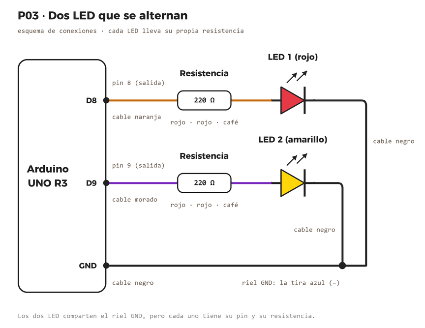
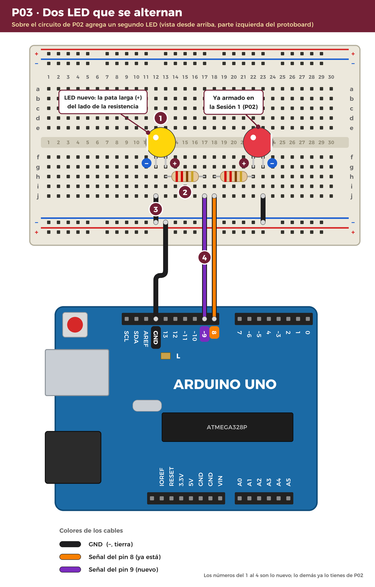
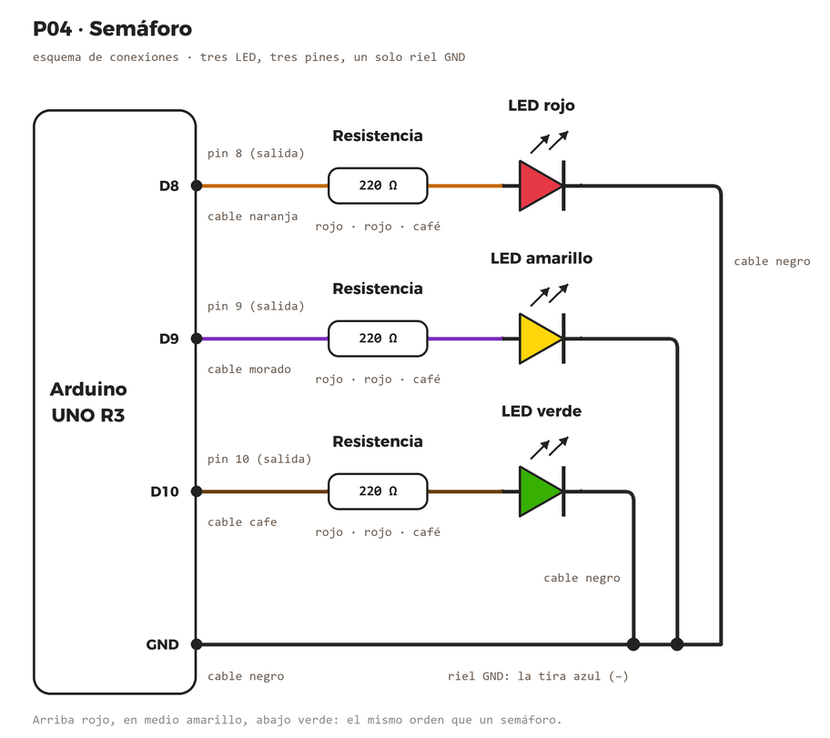
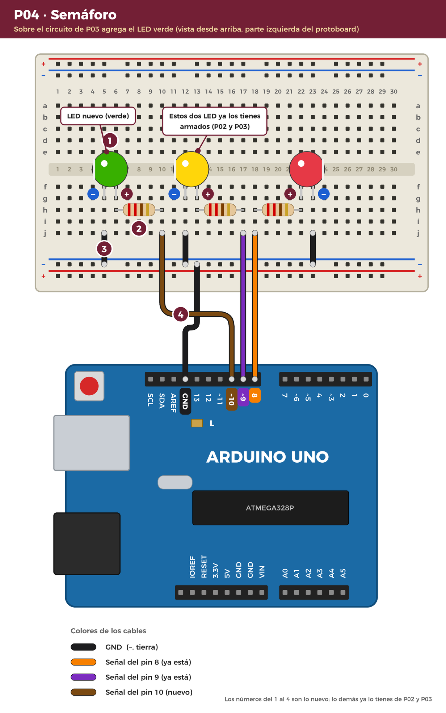

# Sesión 2 · Luces con tiempos

**Guía de práctica para el instructor** (de aquí saldrán después las láminas y las fichas de los alumnos)
**Prácticas:** P03 Dos LED que se alternan (≈35 min) · P04 Semáforo (≈45 min). Los tiempos son estimados: anota los reales en la tabla del final.
**Sketches:** `curso-arduino/sketches/P03_dos_led_alternados/` · `P04_semaforo/` · soluciones de retos: `P03_dos_tiempos/` y `P04_verde_parpadea/`
**Idea nueva de la sesión:** un dato que puede cambiar se guarda en una **variable** (o una **constante**) con nombre, para cambiarlo en un solo lugar; y varias órdenes que se repiten se juntan en una **función**.

## Cómo leer los diagramas de esta sesión

Cada práctica trae **dos diagramas del mismo circuito**:

| Diagrama | Para qué sirve |
|---|---|
| **Protoboard** (vista desde arriba, con coordenadas) | Para **armar**: dice en qué agujero va cada pata y cada cable |
| **Cableado** (placa a la izquierda, cables de colores) | Para **entender**: se ve qué pin va a qué componente, y qué cables comparten el riel GND |

Los colores de cable son los mismos en los dos. Si tu kit no trae jumper morado o café, usa cualquier color distinto del negro y anota cuál usaste; lo importante es que cada pin tenga su propio color.

## Materiales (lo que se agrega a la Sesión 1)

| Cantidad | Material |
|---|---|
| 1 | LED **amarillo** de 5 mm |
| 1 | LED **verde** de 5 mm |
| 2 | Resistencias de 220 Ω (**rojo, rojo, café**, dorado). Con la de la Sesión 1 suman 3 |
| 4 | Cables jumper macho-macho más (2 para P03 y 2 para P04) |

El LED rojo, su resistencia y los 3 cables de la Sesión 1 **se quedan armados**: P03 y P04 se construyen encima, sin desarmar nada.

**Antes de empezar:** si el circuito de P02 ya no está armado, vuelve a armarlo con la tabla de `S01-hola-arduino.md` (5 minutos) y comprueba que parpadea.

## La idea de la sesión (15 min, en el pizarrón)

1. **Variable = una caja con nombre.** Dibuja una caja con la etiqueta `tiempoEncendido` y un 500 adentro. El programa usa la **caja**, no el número. Pregunta al grupo: *«En P02 había dos `delay(1000)`. Si quiero el doble de rápido, ¿cuántas líneas cambio? ¿Y si en vez del número usara una caja?»*.
2. **Constante = una caja con candado.** `const int LED_ROJO = 8;` guarda el 8 y el programa no puede cambiarlo por error. Por eso las constantes se escriben en MAYÚSCULAS: así se distinguen a simple vista.
3. **El orden importa.** El Arduino lee de arriba hacia abajo, una línea a la vez, y `loop()` vuelve a empezar al terminar. Para mostrarlo, pide a un alumno que «sea el Arduino» y siga el código con el dedo.
4. **Función = una receta con nombre.** Antes de P04: *«Para encender solo el verde necesito tres órdenes. ¿Y si las junto en una receta llamada `luces`?»*.

**Un dato para el pizarrón:** cada LED lleva **su propia resistencia**. Si dos LED compartieran una sola, la corriente se repartiría entre ellos y el brillo de uno cambiaría cuando el otro se apague.

---

## P03 · Dos LED que se alternan (≈35 min)

### Idea de la práctica

Cuando un LED está encendido, el otro está apagado, y luego se invierten. Los dos tiempos son el **mismo número**: la variable `tiempoEncendido`. Cambia ese número en un solo lugar y cambia todo el programa.

### Esquema de conexiones



Cada LED tiene su propio pin y su propia resistencia (rojo en el 8, amarillo en el 9). Lo único que comparten es el **riel GND**.

### Conexión en el protoboard

**Con el USB desconectado**, agrega lo siguiente sin tocar lo que ya tienes. Los números del diagrama son los de esta tabla.



| Paso | Qué | De | A |
|---|---|---|---|
| 1 | LED amarillo | pata **larga (+)** en **g13** | pata **corta (−)** en **g12** |
| 2 | Resistencia 220 Ω | **h13** | **h17** |
| 3 | Cable negro | **j12** | riel azul **−** |
| 4 | Cable morado | **pin 9** de la placa | **j17** |

**Este LED queda «al revés» que el de P02:** su pata larga está a la **derecha**. No es un error. Lo que importa es que la pata larga quede del lado de la **resistencia**, y en este caso la resistencia está a su derecha.

**Revisa antes de conectar el USB**

- [ ] La pata **larga** del LED amarillo va del lado de la resistencia (a la derecha, en g13); la corta (lado plano) va en g12.
- [ ] La resistencia está entre **h13** y **h17**, y el cable morado llega a **j17**, la misma columna que el otro extremo de la resistencia.
- [ ] Las patas de metal de las dos resistencias (en **h17** y **h18**) están en columnas vecinas: **no se tocan**.
- [ ] El cable negro de **j12** llega al riel azul (−), el mismo al que ya llegan los otros dos cables negros.
- [ ] El circuito de P02 sigue igual: pin 8 (naranja) → **j18**.

### Código

Abre `curso-arduino/sketches/P03_dos_led_alternados/P03_dos_led_alternados.ino` (**Archivo → Abrir**), presiona **Subir** y observa.

Lo que hay que leer con el grupo:

```cpp
const int PIN_LED_1 = 8;        // const = valor que no cambia mientras corre el programa
const int PIN_LED_2 = 9;
int tiempoEncendido = 500;      // milisegundos
```

- Las dos primeras líneas dicen **a qué pin está conectado** cada LED. Si el cable cambia de pin, se cambia **una** línea.
- `tiempoEncendido` es una **variable** (`int`, sin `const`): su valor sí se puede cambiar.
- En `loop()`, `delay(tiempoEncendido)` usa la caja, no el número.

### Qué debes ver

Los LED rojo y amarillo se alternan: uno se enciende medio segundo mientras el otro está apagado, y luego se invierten, sin parar.

### Modifica (retos)

1. **Básico:** cambia `tiempoEncendido` a **200** y luego a **1500**. ¿Cuántas líneas tuviste que tocar? (una)
2. **Medio:** haz que el LED rojo dure **300 ms** y el amarillo **900 ms**. Pista: una sola variable ya no alcanza; necesitas dos. *Solución del instructor: `sketches/P03_dos_tiempos/`.*
3. **Desafío (opcional):** agrega un tercer LED y haz que se enciendan uno por uno. Esto es lo que se hace en P04.

### Rompe y arregla

Dos fallos de código, seguros (no dañan nada). El instructor los plantea en la computadora del equipo, el equipo los encuentra leyendo el mensaje rojo del IDE:

| Fallo plantado | Mensaje del IDE | Qué se aprende |
|---|---|---|
| Quitar el `;` al final del **primer** `delay(tiempoEncendido);` | `expected ';' before 'digitalWrite'` | **El IDE marca la línea siguiente** a la que falta el `;`. Hay que mirar también la línea de arriba |
| Escribir `tiempoencendido` (con `e` minúscula) en el segundo `delay` | `'tiempoencendido' was not declared in this scope` y debajo `suggested alternative: 'tiempoEncendido'` | Las **mayúsculas importan**; y el IDE a veces sugiere la corrección |

Estos mensajes se comprobaron compilando copias dañadas del sketch con el mismo compilador del IDE. En el IDE aparecen en la franja negra de abajo, con el nombre del archivo, la línea y la columna.

### Evidencia para la bitácora

- Los dos LED se alternan y el equipo explica **por qué cambiar un número cambia todo** el comportamiento.
- Un cambio propio (otro tiempo o los tiempos distintos del reto 2) y qué pasó.

---

## P04 · Semáforo (≈45 min)

### Idea de la práctica

Tres LED, cada uno con su tiempo, en secuencia: verde, amarillo, rojo, y vuelve a empezar. Aquí aparecen dos ideas nuevas: las **constantes con nombre** para los tiempos (`TIEMPO_VERDE`...) y la **función** `luces(...)`, que enciende o apaga los tres LED de una sola vez.

**Para el pizarrón, el ciclo del semáforo:**

| Etapa | Rojo | Amarillo | Verde | Dura |
|---|---|---|---|---|
| 1 | apagado | apagado | encendido | 4 s (`TIEMPO_VERDE`) |
| 2 | apagado | encendido | apagado | 1.5 s (`TIEMPO_AMARILLO`) |
| 3 | encendido | apagado | apagado | 4 s (`TIEMPO_ROJO`) |

El ciclo completo dura **9.5 s** y luego vuelve a la etapa 1. (Es una versión simplificada: no hay luz de espera entre el rojo y el verde.)

### Esquema de conexiones



Se dibujó con el rojo arriba, el amarillo en medio y el verde abajo, como un semáforo.

### Conexión en el protoboard

**Con el USB desconectado**, agrega el LED verde sobre el circuito de P03.



| Paso | Qué | De | A |
|---|---|---|---|
| 1 | LED verde | pata **larga (+)** en **g6** | pata **corta (−)** en **g5** |
| 2 | Resistencia 220 Ω | **h6** | **h10** |
| 3 | Cable negro | **j5** | riel azul **−** |
| 4 | Cable café | **pin 10** de la placa | **j10** |

Sobre el protoboard quedan, de izquierda a derecha, el **verde (pin 10)**, el **amarillo (pin 9)** y el **rojo (pin 8)**. Los cables morado (pin 9) y naranja (pin 8) suben rectos. El cable café (pin 10) da una vuelta hacia la izquierda y **cruza por encima** del cable negro de GND; no se tocan porque los jumper tienen funda. El camino exacto no importa mientras el café llegue a **j10**.

**Revisa antes de conectar el USB**

- [ ] Cada LED tiene su pata larga (+) del lado de su resistencia, y su pata corta (−) hacia el cable negro.
- [ ] Hay **tres** cables negros al riel azul (−) desde los LED, más el de **GND** de la placa.
- [ ] Rojo → pin 8, amarillo → pin 9, verde → pin 10. Los tres cables de señal tienen colores distintos.
- [ ] Ninguna pata de metal de las tres resistencias toca otra.

### Código

Abre `curso-arduino/sketches/P04_semaforo/P04_semaforo.ino`, sube y observa. Lo que hay que leer con el grupo:

```cpp
void luces(int rojo, int amarillo, int verde) {
  digitalWrite(LED_ROJO, rojo);
  digitalWrite(LED_AMARILLO, amarillo);
  digitalWrite(LED_VERDE, verde);
}
```

- `luces` es una **receta**: recibe tres datos (rojo, amarillo, verde) y pone cada LED en `HIGH` (encendido) o `LOW` (apagado).
- En `loop()`, `luces(LOW, LOW, HIGH);` significa «rojo apagado, amarillo apagado, verde encendido». **El orden de los datos importa**: es el mismo orden en que se declaró la receta.
- Sin la función habría que escribir tres `digitalWrite` cada vez; con ella, una línea.

### Qué debes ver

Verde 4 segundos, amarillo 1.5 segundos, rojo 4 segundos, y vuelve a empezar.

### Modifica (retos)

1. **Básico:** cambia los tiempos para que el **rojo dure el doble que el verde**. (Solo se cambian las constantes `TIEMPO_...`.)
2. **Medio:** que el **verde parpadee 3 veces** antes de pasar al amarillo. Con lo que saben hasta ahora se resuelve repitiendo líneas (son seis llamadas a `luces`). *Solución del instructor: `sketches/P04_verde_parpadea/`.* En la Sesión 4 aprenderán `for`, que evita copiar y pegar: dilo en voz alta al terminar este reto.
3. **Desafío en papel (se hace antes de programar):** dibuja en el cuaderno el diagrama de tiempos del semáforo, con una línea para cada color y el tiempo en el eje horizontal. Después compara con el comportamiento real.

### Rompe y arregla

| Fallo plantado | Qué ocurre | Qué se aprende |
|---|---|---|
| **De código:** en la función `luces`, escribir `LED_AMARILO` (una `L` menos) | Error: `'LED_AMARILO' was not declared in this scope` y debajo `suggested alternative: 'LED_AMARILLO'` | Un nombre mal escrito es otro nombre. El mismo tipo de error que en P03 |
| **De cableado:** con el USB desconectado, **intercambiar** los cables de los pines 9 y 10 | Compila bien, pero cuando el código dice «amarillo» se enciende el verde, y al revés | El código no «sabe» de qué color es el LED: solo sabe el **pin**. Se arregla de dos maneras: cambiar los cables de lugar, o cambiar los números de `LED_AMARILLO` y `LED_VERDE` en el código |

Los dos son fallos seguros: cada LED sigue con su resistencia, así que no se daña nada.

### Evidencia para la bitácora

- El semáforo funciona con **tiempos propios** del equipo, anotados en una tabla como la de arriba.
- El equipo explica con sus palabras **qué hace la función `luces`** y por qué conviene.
- El diagrama de tiempos del reto 3 dibujado a mano.

---

## Cierre de la sesión (15 min)

- Desarmar y guardar el kit completo (los LED por color, las resistencias juntas); contar con la hoja de inventario.
- En la bitácora: *«qué cambié, qué pasó, por qué»* para P03 y para P04, y el visto bueno del instructor en los tres puntos (funciona, lo explica, hizo una modificación propia).
- Si la visita sigue con la Sesión 3, **no desarmar**: los LED y el protoboard se reutilizan. Pregunta de enlace: *«¿cómo haría el semáforo para cambiar cuando yo se lo pido?»* (con un botón: Sesión 3).

## Tu práctica: anota lo que encuentres

Haz las dos prácticas como lo haría un alumno y llena esto. Sirve para ajustar la sesión y las láminas.

| Dato | Anota aquí |
|---|---|
| Tiempo real de P03 (agregar el LED y subir) | |
| Tiempo real de P04 (armar y subir) | |
| Tiempo real de los retos y de «rompe y arregla» | |
| ¿El diagrama de **protoboard** se entiende sin ayuda? ¿Qué cambiarías? | |
| ¿El diagrama de **cableado** ayuda a entender el circuito o estorba? | |
| ¿Confunde que el LED amarillo tenga la pata larga a la derecha? | |
| ¿Las patas de las resistencias en h17 y h18 quedan muy juntas? | |
| ¿Tienes jumpers morado y café? ¿Qué colores usaste? | |
| ¿Los mensajes de error del IDE salen igual que en esta guía? | |
| Dudas o errores que tuviste | |
| Foto de P04 armado (vista desde arriba) | |

## Para recompilar o regenerar

- Los sketches se verifican con `curso-arduino/compilar-sketches.ps1`.
- Los diagramas de protoboard se generan con `python curso-arduino/diagramas/generar_diagramas.py P03 P04` y los de cableado con el mismo comando (ambos están en el mismo script; el motor de cableado es `esquema.py`). Comprueban las conexiones al dibujar: si algo no corresponde al circuito, se detienen.
