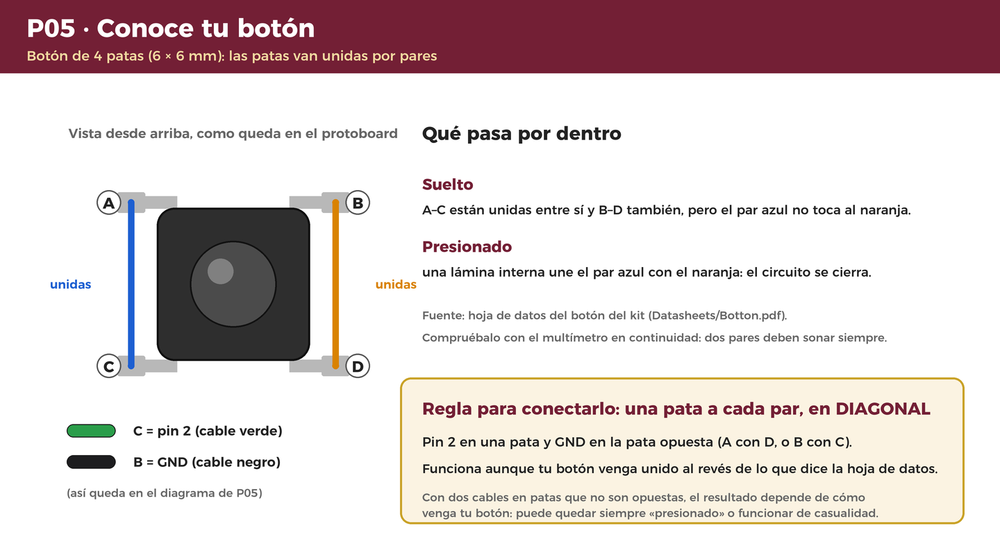
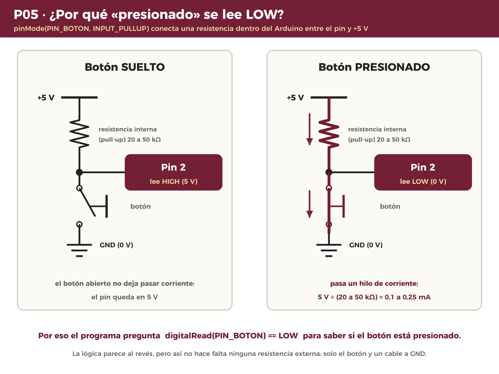
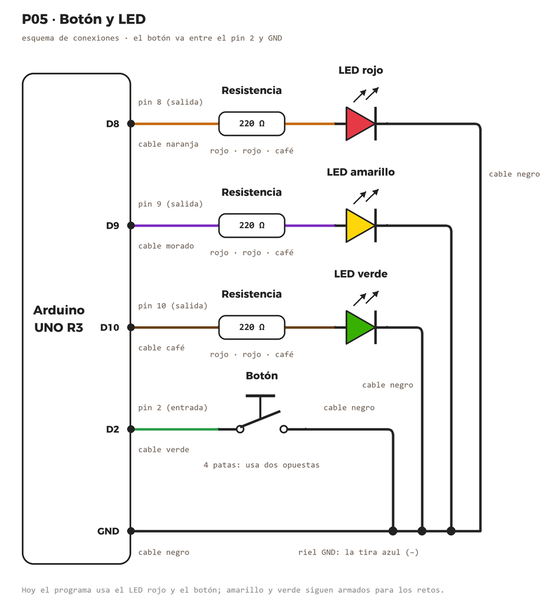
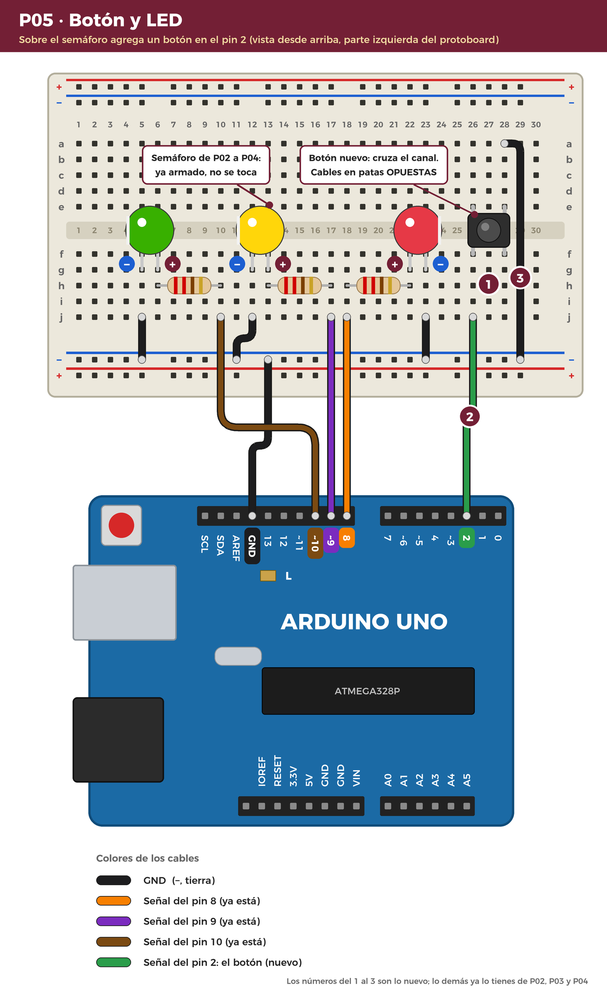
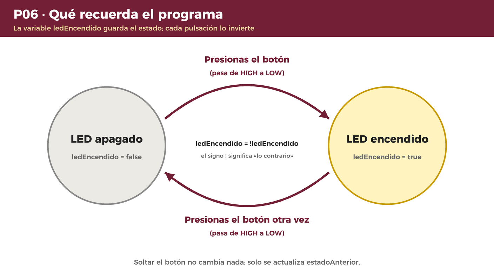
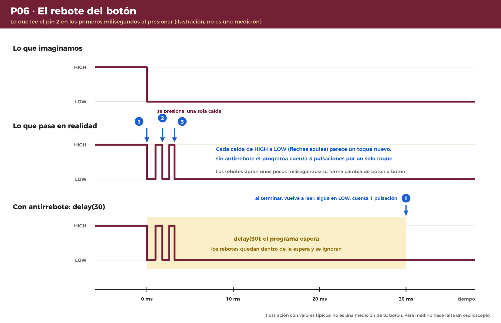

# Sesión 3 · Botones

**Guía de práctica para el instructor** (de aquí saldrán después las láminas y las fichas de los alumnos)
**Prácticas:** P05 Botón y LED (≈35 min) · P06 Botón con memoria (≈45 min) · reto de cierre: semáforo con botón (≈15 min). Los tiempos son estimados: anota los reales en la tabla del final.
**Sketches:** `curso-arduino/sketches/P05_boton_led/` · `P06_boton_toggle/` · soluciones de retos: `P05_dos_led_opuestos/`, `P06_parpadeo_cada_5/` y `P06_semaforo_con_boton/`
**Idea nueva de la sesión:** hasta ahora el Arduino solo **mandaba** (salidas). Hoy también **escucha**: lee un botón, decide con un `if` y **recuerda** lo que pasó antes con una variable.

## Cómo leer los diagramas de esta sesión

Además de los dos diagramas del circuito (los mismos dos tipos de la Sesión 2), hay cuatro ayudas para entender ideas nuevas:

| Diagrama | Para qué sirve |
|---|---|
| **Protoboard** (`P05_boton_led.png`) | Para **armar**: en qué agujeros va el botón y cada cable |
| **Cableado** (`P05_boton_led_cableado.png`) | Para **entender**: el botón queda entre el pin 2 y GND |
| **Conoce tu botón** (`P05_boton_patas.png`) | Las 4 patas del botón y por qué se conecta en diagonal |
| **Pull-up** (`P05_pullup_esquema.png`) | Por qué «presionado» se lee `LOW` |
| **Rebote** (`P06_rebote.png`) | Por qué hace falta el antirrebote (es una **ilustración**, no una medición) |
| **Estados** (`P06_estados.png`) | Qué recuerda el programa de P06 |

P06 usa el **mismo circuito** que P05: no hay nada nuevo que armar.

## Materiales (lo que se agrega a la Sesión 2)

| Cantidad | Material |
|---|---|
| 1 | Botón de 4 patas (6 × 6 mm). El kit trae 5; con uno basta |
| 1 | Cable jumper macho-macho **verde** (o de cualquier color que no sea negro) |
| 1 | Cable jumper macho-macho **negro y largo**: tiene que subir del riel hasta el otro lado del canal central (≈14 agujeros). Mide el tuyo contra el diagrama |

El **semáforo de la Sesión 2** (3 LED, 3 resistencias y sus cables) **se queda armado**. Hoy el programa usa el LED rojo; el amarillo y el verde se usan en los retos.

**Antes de empezar:** si el semáforo ya no está armado, vuelve a armarlo con las tablas de `S01` y `S02` y comprueba que funciona con `P04_semaforo` (5 minutos).

## La idea de la sesión (15 min, en el pizarrón)

1. **Salida y entrada.** Hasta hoy el Arduino *hablaba*: `digitalWrite` manda 5 V o 0 V por un pin. Ahora va a *escuchar*: `digitalRead` pregunta qué voltaje hay en un pin y contesta `HIGH` (5 V) o `LOW` (0 V). Pregunta al grupo: *«¿qué dispositivos de su casa o de la escuela «escuchan» a alguien?»* (timbre, interruptor, botón del elevador, teclado).
2. **¿Qué lee un pin que no está conectado a nada?** Nada seguro: el pin «flota» y capta ruido de la mano, del cable, de una lámpara cercana. Hay que **darle un valor por omisión**. Eso hace la **resistencia pull-up**: jala el pin hacia 5 V (como un resorte). Dibuja el diagrama de pull-up.
3. **El botón jala el pin hacia GND.** Suelto: el pin queda en 5 V, se lee `HIGH`. Presionado: el botón lo une a GND, se lee `LOW`. **Por eso «presionado» es `LOW`.** Parece al revés; lo importante es repetirlo: *«presionado = LOW»*.
4. **Decidir: `if` / `else`.** *«Si el botón está presionado, enciende el LED; si no, apágalo»*. Es la primera vez que el programa hace cosas distintas según lo que pasa afuera.
5. **`=` guarda, `==` pregunta.** `x = 5` guarda un 5 en `x`. `x == 5` pregunta si `x` vale 5. Confundirlos es el error más común (se verá en «rompe y arregla»).
6. **Memoria.** P05 solo mira **ahora**. P06 **recuerda** lo que pasó antes (¿el LED estaba encendido?) con una variable de estado.
7. **Rebote.** Un botón es un contacto metálico; al cerrarse **rebota** unos milisegundos. El Arduino es tan rápido que ve cada rebote como un toque nuevo. Se ve en P06.

**Dos datos para el pizarrón**

- El pull-up interno es de **20 a 50 kΩ** (según `kit-arduino/Datasheets/UNO.pdf`). Con el botón presionado pasa apenas **0,1 a 0,25 mA** (5 V ÷ 50 kΩ y 5 V ÷ 20 kΩ): nada que dañe el pin.
- `INPUT_PULLUP` **no necesita ninguna resistencia externa**: por eso el botón solo lleva dos cables.

---

## P05 · Botón y LED (≈35 min)

### Idea de la práctica

El LED rojo se enciende **mientras** mantienes presionado el botón y se apaga al soltarlo. El botón se conecta entre el **pin 2** y **GND**, y el pin se configura con `INPUT_PULLUP`.

### Conoce tu botón (5 min)



El botón tiene **4 patas**, unidas **por pares** por dentro. Al presionar, una lámina interna une un par con el otro. No importa cuál sea cuál: la regla para conectarlo es **una pata de cada par, en diagonal**. Así funciona siempre.

> **Para el instructor.** La hoja de datos del botón (`kit-arduino/Datasheets/Botton.pdf`) dice que las patas unidas son las dos que quedan **de lado a lado del canal** (A–C y B–D en el diagrama). **No lo he comprobado con tu botón.** Si tienes multímetro, pruébalo en continuidad (dos pares deben sonar siempre) y anótalo al final. El armado de esta guía funciona **con cualquiera de las dos formas** posibles, por eso se pide la diagonal.

### Esquema eléctrico: por qué «presionado» es LOW



Con `pinMode(PIN_BOTON, INPUT_PULLUP)` el Arduino conecta, **por dentro**, una resistencia entre el pin y 5 V. Con el botón suelto el pin queda en 5 V (`HIGH`). Al presionar, el botón lo une a GND y el pin baja a 0 V (`LOW`).

### Esquema de conexiones



El semáforo queda igual que en P04. Lo nuevo es la fila de abajo: **pin 2 → botón → GND**. El botón es el único componente con dos patas «sueltas»: las otras dos no llevan cable.

### Conexión en el protoboard

**Con el USB desconectado**, agrega lo siguiente sin tocar el semáforo. Los números del diagrama son los de esta tabla.



| Paso | Qué | De | A |
|---|---|---|---|
| 1 | Botón | arriba del canal: **e26** y **e28** | abajo del canal: **f26** y **f28** |
| 2 | Cable verde | **pin 2** de la placa | **j26** (pata de abajo a la izquierda) |
| 3 | Cable negro **largo** | riel azul **−** (debajo de la columna 29) | **a28** (pata de arriba a la derecha) |

**El botón cruza el canal central.** Las cuatro patas entran en los agujeros de las filas **e** (arriba del canal) y **f** (abajo). Entra con algo de presión: empújalo parejo por los costados de la caja, no por el botón de en medio, y no dobles las patas. Solo cabe en una posición; si no entra, gíralo 90°.

**Los dos cables van en patas opuestas** (diagonal): el verde en la pata de **abajo a la izquierda** y el negro en la pata de **arriba a la derecha**. El cable negro largo sube por la columna 29 y entra en a28; no toca el botón.

**Revisa antes de conectar el USB**

- [ ] El botón cruza el canal central: dos patas arriba (e26, e28) y dos abajo (f26, f28).
- [ ] El cable verde llega a **j26** y el negro largo a **a28**: patas **opuestas**.
- [ ] El cable negro largo sale del riel azul (−), el mismo al que ya llegan los demás cables negros.
- [ ] El semáforo sigue igual: pines 8, 9 y 10 con sus cables de color.
- [ ] Ninguna pata de metal ni cable toca otra cosa.

**Cuidado con los pines:** el pin 2 solo debe estar como `INPUT_PULLUP` (así lo deja el programa). Un pin configurado como **salida** (`OUTPUT`) y unido a GND por el botón sí se podría dañar. No cambies `pinMode` de ese pin.

### Código

Abre `curso-arduino/sketches/P05_boton_led/P05_boton_led.ino` (**Archivo → Abrir**), presiona **Subir** y observa. Lo que hay que leer con el grupo:

```cpp
void setup() {
  pinMode(PIN_BOTON, INPUT_PULLUP);   // entrada con resistencia interna a +5 V
  pinMode(PIN_LED, OUTPUT);
}

void loop() {
  if (digitalRead(PIN_BOTON) == LOW) {   // ¿está presionado?
    digitalWrite(PIN_LED, HIGH);
  } else {
    digitalWrite(PIN_LED, LOW);
  }
}
```

- `INPUT_PULLUP` es la palabra que **activa la resistencia interna**. Sin ella, el pin flota.
- `digitalRead(PIN_BOTON)` lee el pin 2 y devuelve `HIGH` o `LOW`.
- `== LOW` **pregunta** si es `LOW`, o sea, si el botón está **presionado**.
- `if` (si) ejecuta lo de sus llaves `{ }` cuando la pregunta es verdadera; `else` (si no) cuando es falsa.
- `loop()` repite todo sin parar: el Arduino revisa el botón miles de veces por segundo.

### Qué debes ver

El LED **rojo** se enciende mientras el botón está presionado y se apaga al soltarlo. Los LED amarillo y verde permanecen apagados.

### Modifica (retos)

1. **Básico:** que el LED se **apague** cuando presionas y se encienda cuando sueltas (lógica contraria). Se resuelve cambiando dos palabras.
2. **Medio:** que el **LED amarillo** (pin 9) haga lo **contrario** del rojo: mientras presionas, rojo encendido y amarillo apagado; al soltar, al revés. *Solución del instructor: `sketches/P05_dos_led_opuestos/`.*
3. **Desafío:** ver el reto de cierre de la sesión (semáforo con botón), más abajo.

### Rompe y arregla

Tres fallos seguros (no dañan nada). El instructor los plantea; el equipo los encuentra.

| Fallo plantado | Qué ocurre | Qué se aprende |
|---|---|---|
| **De cableado:** con el USB desconectado, **quitar el cable negro largo** (el de GND del botón) | Compila y sube bien, pero el LED **nunca** se enciende | El botón necesita **los dos extremos** del circuito: el pin 2 y GND. Con un extremo suelto no hay camino |
| **De código:** cambiar `== LOW` por `= LOW` en el `if` | El IDE no deja subir: `lvalue required as left operand of assignment`. Abajo aparece `#define LOW 0x0` (dentro de `Arduino.h`) y una nota `in expansion of macro 'LOW'` con **la línea 28 de tu sketch** | **`=` guarda y `==` pregunta.** El mensaje apunta primero a un archivo del Arduino, pero la nota dice en qué línea de **tu** código está el error |
| **De código:** cambiar `INPUT_PULLUP` por `INPUT` | Compila y sube, pero sin tocar el botón el LED se comporta **de forma errática**: puede encenderse solo, parpadear o cambiar al acercar la mano al cable. Al presionar sí se apaga o enciende | **Pin flotante.** Sin el pull-up el pin no tiene valor definido. *Esto aún no lo he probado en la placa: anota lo que veas.* |

### Si no funciona

| Síntoma | Causa probable |
|---|---|
| El LED rojo queda **encendido siempre** | Los dos cables están en patas que **no** son opuestas y tu botón las trae unidas por dentro (el botón queda «presionado» siempre). Pasa un cable a la pata opuesta (diagonal) |
| El LED **nunca** enciende | El cable negro largo no llega al riel o a **a28**; el verde no está en **j26**; el botón no entró del todo; o el cable de GND de la placa al riel se soltó |
| Funciona a veces | Alguna pata del botón no hace contacto: vuelve a presionarlo en el canal |
| El LED amarillo o el verde se encienden | Cables de los pines 9 o 10 cruzados con el 2 o con otro pin; revisa los colores |

### Evidencia para la bitácora

- El LED se enciende con el botón y el equipo explica, con sus palabras, **por qué «presionado» se lee `LOW`**.
- Un cambio propio (el reto 1 o el 2) y qué pasó.

---

## P06 · Botón con memoria (≈45 min)

### Idea de la práctica

En P05 el LED copia al botón: solo vale **mientras** lo presionas. Ahora el LED cambia de estado **cada vez que presionas**: un toque lo enciende, otro lo apaga, como la luz de un cuarto. Para eso el programa tiene que **recordar** si el LED estaba encendido. Además cuenta las pulsaciones y las manda a la computadora por el **Monitor Serie**.

El circuito **es el mismo de P05**. No hay que armar nada.

### Código: tres ideas nuevas

Abre `curso-arduino/sketches/P06_boton_toggle/P06_boton_toggle.ino`, sube y abre el **Monitor Serie** (**Herramientas → Monitor Serie**). Abajo a la derecha debe decir **9600 baudio**. Verás `Listo. Presiona el boton.`

**1. Variable de estado: el programa recuerda.**

```cpp
bool ledEncendido = false;   // el LED empieza apagado
int estadoAnterior = HIGH;   // el botón empieza suelto
int pulsaciones = 0;         // cuántas veces se ha presionado
```

`bool` es una variable que solo vale `true` (verdadero) o `false` (falso): ideal para «encendido / apagado». `ledEncendido = !ledEncendido;` la **invierte**: el signo `!` significa «lo contrario».



**2. Detectar el momento en que se presiona.** No basta con preguntar si el botón está presionado (eso sería P05: valdría mientras lo mantienes). Hay que **comparar** cómo estaba antes con cómo está ahora. Pídele a un alumno que «sea el Arduino» y complete esta prueba de escritorio:

| Momento | `estadoAnterior` | `estadoActual` | ¿Qué hace el programa? |
|---|---|---|---|
| Nadie toca el botón | `HIGH` | `HIGH` | Nada: son iguales |
| Acabas de presionar | `HIGH` | `LOW` | **Invierte el LED** y suma 1 |
| Sigues presionando | `LOW` | `LOW` | Nada: son iguales |
| Acabas de soltar | `LOW` | `HIGH` | Solo se actualiza `estadoAnterior` |

La condición `estadoAnterior == HIGH && estadoActual == LOW` es verdadera **solo en la segunda fila**. El `&&` significa «y»: las dos cosas a la vez.

**3. Antirrebote.**



```cpp
if (estadoActual != estadoAnterior) {      // el botón cambió
  delay(30);                               // antirrebote
  estadoActual = digitalRead(PIN_BOTON);   // vuelve a leer
```

Al presionar, los contactos rebotan unos milisegundos. Sin esperar, el programa vería varios toques en uno. Con `delay(30)` espera a que se calme y **vuelve a leer** para quedarse con el valor estable. (`!=` significa «es distinto de».)

> El diagrama de rebote es una **ilustración**. La forma real de los rebotes cambia de un botón a otro; medirla exige un osciloscopio. En el reto 1 los alumnos buscan el efecto en su propio botón.

### Qué debes ver

- Cada vez que **presionas** (no al soltar), el LED cambia de estado.
- En el Monitor Serie aparece una línea por pulsación:

```
Listo. Presiona el boton.
Pulsacion numero 1 -> LED ENCENDIDO
Pulsacion numero 2 -> LED APAGADO
Pulsacion numero 3 -> LED ENCENDIDO
```

### Modifica (retos)

1. **Básico (predice y comprueba):** primero escribe en el cuaderno qué crees que pasará si **quitas `delay(30)`**. Luego quítalo, sube y presiona unas 10 veces. Compara lo que cuenta el Monitor Serie con lo que presionaste. **Anota qué viste.** Con algunos botones el contador salta de 2 en 2 o de 3 en 3; con otros casi no se nota. Las dos respuestas sirven: lo importante es que el equipo explique por qué el antirrebote protege aunque a veces no haga falta.
2. **Medio:** que el LED **parpadee 3 veces cada 5 pulsaciones** (en la 5, la 10, la 15...) y después vuelva a como estaba. Pista: el operador `%` da el **residuo** de una división: `5 % 5` es `0`, `6 % 5` es `1`, `10 % 5` es `0`. *Solución del instructor: `sketches/P06_parpadeo_cada_5/`.* Usa una función `parpadear3()` que repite tres veces las mismas cuatro líneas: en la Sesión 4 aprenderán `for`, que las escribe una sola vez; dilo en voz alta al terminar.
3. **Desafío:** el reto de cierre de la sesión (abajo).

### Rompe y arregla

| Fallo plantado | Qué ocurre | Qué se aprende |
|---|---|---|
| **De código:** quitar el `;` al final de `Serial.begin(9600)` | `expected ';' before 'Serial'`, en la **línea siguiente** (la 35) | Igual que en la Sesión 2: **el IDE marca la línea de abajo** de la que falta el `;` |
| **De monitor:** cambiar la velocidad del Monitor Serie a otra distinta de 9600 | Llegan **símbolos raros** en lugar de texto | La computadora y el Arduino tienen que «hablar a la misma velocidad» (`Serial.begin(9600)`) |

Los mensajes de error de código de esta sesión (los de P05 y el de P06) se comprobaron compilando copias dañadas con el mismo compilador del IDE. En el IDE aparecen en la franja negra de abajo, con el nombre del archivo, la línea y la columna.

### Evidencia para la bitácora

- **Una foto o captura del Monitor Serie** con al menos 5 pulsaciones contadas.
- El equipo explica con sus palabras **para qué sirve `estadoAnterior`** y **para qué sirve el `delay(30)`**.
- Lo que observaron en el reto 1.

---

## Reto de cierre: semáforo con botón (≈15 min)

Aquí se unen las dos sesiones: el semáforo de la Sesión 2 y el botón de hoy. Es la respuesta a la pregunta con la que cerró la Sesión 2: *«¿cómo haría el semáforo para cambiar cuando yo se lo pido?»*

**Comportamiento pedido**

| Situación | Rojo | Amarillo | Verde |
|---|---|---|---|
| Normal (nadie presiona) | apagado | apagado | **encendido** |
| Alguien presiona el botón | apagado | **encendido** (1,5 s) | apagado |
| Después | **encendido** (5 s) | apagado | apagado |
| Vuelve a la situación normal | | | |

**Antes de programar**, el equipo dibuja el diagrama de tiempos en el cuaderno (como en la Sesión 2) y lo compara con lo que haga el programa. Pista: la función `luces(...)` de P04 sirve tal cual.

*Solución del instructor: `sketches/P06_semaforo_con_boton/`.*

**Pregunta para el grupo (no se resuelve hoy):** *«Presiona el botón mientras el semáforo está en rojo. ¿Por qué no hace caso?»* Porque durante la secuencia el programa está parado en `delay()` y **no mira el botón**. Con `millis()` se puede esperar sin dejar de mirar. Esa instrucción se ve en la Sesión 11, y la ampliación `X02_semaforo_peatonal` la usa para resolver justo este problema.

---

## Cierre de la sesión (10 min)

- En la bitácora: *«qué cambié, qué pasó, por qué»* para P05 y para P06, y el visto bueno del instructor en los tres puntos (funciona, lo explica, hizo una modificación propia).
- Si la visita sigue con la Sesión 4, **no desarmar todo**: el botón (pin 2) y el LED rojo (pin 8) se reutilizan tal cual en la alarma de movimiento (P08), junto con el sensor PIR y el zumbador. Solo se retiran el **LED amarillo y el verde** (con sus resistencias y cables), para dejar espacio al zumbador; la Sesión 4 lo indica como primer paso.
- Si es el final del día: desarmar y guardar el kit completo (el botón con los demás componentes pequeños), y contar con la hoja de inventario.
- Pregunta de enlace: *«¿cómo sabría el Arduino que alguien se movió, sin que nadie presione nada?»* (sensor PIR: Sesión 4).

## Tu práctica: anota lo que encuentres

Haz las dos prácticas y el reto de cierre como lo haría un alumno y llena esto. Sirve para ajustar la sesión y las láminas.

| Dato | Anota aquí |
|---|---|
| Tiempo real de P05 (armar y subir) | |
| Tiempo real de P06 (subir, Monitor Serie y retos) | |
| Tiempo real del reto de cierre | |
| ¿El botón entra bien en el canal? ¿Requiere fuerza? | |
| **Con multímetro en continuidad, sin presionar: ¿qué pares de patas suenan?** (¿de lado a lado del canal, como dice la hoja de datos, o del mismo lado?) | |
| ¿El cable negro largo alcanza hasta a28? ¿De qué largo era? | |
| ¿El diagrama de protoboard se entiende sin ayuda (botón en el canal, cable largo)? | |
| ¿Se entiende el diagrama de pull-up? ¿Y el de rebote? ¿Qué cambiarías? | |
| Reto 1 de P06 (sin `delay(30)`): ¿cuántas pulsaciones contó por cada toque? | |
| «Rompe y arregla» con `INPUT` en lugar de `INPUT_PULLUP`: ¿qué hizo el LED? (con la mano lejos y cerca del cable) | |
| ¿Los mensajes de error del IDE salen igual que en esta guía? | |
| ¿Tienes jumpers verde y negro largo? ¿Qué colores usaste? | |
| Dudas o errores que tuviste | |
| Foto del circuito armado y captura del Monitor Serie | |

## Para recompilar o regenerar

- Los sketches se verifican con `curso-arduino/compilar-sketches.ps1` (66 en total).
- Los diagramas se generan con `python curso-arduino/diagramas/generar_diagramas.py P05 P06`. El script **comprueba las conexiones** al dibujar; en el botón comprueba que el pin 2 solo se une con GND al presionar, **con las dos formas posibles** de venir unidas las patas por dentro.
- En esta sesión se corrigió un detalle de los diagramas de la Sesión 2: el cable negro del LED amarillo entra ahora al riel por la columna 11, porque en la 12 el riel tiene un hueco. No cambia el armado: sirve cualquier agujero del riel azul (−).
