# Sesión 4 · Sonido y alarma de movimiento

**Guía de práctica para el instructor** (de aquí saldrán después las láminas y las fichas de los alumnos)
**Prácticas y tiempos estimados (120 min):** idea 10 · P07a Zumbador activo (con el paso 0) 20 · repetir con `for` 10 · P07b Zumbador pasivo y notas 20 · P08a Ver al sensor PIR 20 · P08 Alarma de movimiento 30 · cierre 10. Anota los tiempos reales en la tabla del final.
**Sketches:** `curso-arduino/sketches/P07a_zumbador_activo/` · `P07b_zumbador_notas/` · `P08a_pir_monitor/` · `P08_alarma_pir/` · soluciones de retos: `P07a_pitidos_con_for/`, `P07b_sirena_for/`, `P07b_cumpleanos/` y `P08_alarma_completa/`
**Ideas nuevas de la sesión:** el Arduino produce **sonido** (el sonido es una vibración y la frecuencia decide la nota), usa un sensor que **decide solo** (el PIR, que se lee como un botón) y aprende a **repetir** con `for`. Es la última sesión de la primera visita: termina con una alarma que se arma, detecta y se desarma.

## Cómo leer los diagramas de esta sesión

Hay dos diagramas por circuito (protoboard para **armar**, cableado para **entender**) y seis ayudas para las ideas nuevas:

| Diagrama | Para qué sirve |
|---|---|
| **Conoce tus zumbadores** (`P07_zumbadores.png`) | Cómo reconocer el activo y el pasivo, y por qué se conectan distinto |
| **El sonido es vibración** (`P07_frecuencia.png`) | Qué significa «262 Hz» y por qué más Hz es más agudo |
| **Protoboard y cableado de P07a** (`P07a_zumbador_activo.png` y `_cableado.png`) | Armar y entender el zumbador activo |
| **Repetir con for** (`P07_for.png`) | Las tres partes de un `for` y sus vueltas, una por una |
| **Protoboard y cableado de P07b** (`P07b_zumbador_pasivo.png` y `_cableado.png`) | Armar y entender el zumbador pasivo con su resistencia |
| **Conoce tu PIR** (`P08_pir_conoce.png`) | Las partes del módulo HC-SR501 y qué hace cada perilla |
| **Qué hace OUT en el tiempo** (`P08_pir_senal.png`) | Calentamiento, disparo único y disparo repetible (ilustración, no medición) |
| **Protoboard y cableado de P08** (`P08_alarma_pir.png` y `_cableado.png`) | Conectar el sensor y ver toda la alarma |
| **Estados de la alarma** (`P08_estados.png`) | Qué recuerda el programa de P08 |

## Materiales (lo que se agrega a la Sesión 3)

| Cantidad | Material |
|---|---|
| 1 | Zumbador **activo**: en el kit trae una etiqueta blanca con el signo **+** |
| 1 | Zumbador **pasivo**: un disco negro liso con un orificio |
| 1 | Resistencia de **220 Ω** (rojo · rojo · café). El kit trae 30; con el semáforo retirado quedan de sobra |
| 1 | Cable macho-macho **azul** (señal del pin 12) y 1 **negro** (GND). Los colores son una sugerencia: cualquier color distinto sirve, y negro solo para GND |
| 1 | Sensor **PIR HC-SR501** |
| 3 | Cables **macho-hembra** (del paquete de 20 en cinta de colores). Sugeridos: rojo para 5 V, negro o café para GND y gris o blanco para la señal |

### Paso 0 · Retirar el LED amarillo y el verde (3 min)

De la Sesión 3 **se quedan** el LED rojo con su resistencia (pin 8) y el botón (pin 2). **Se retiran** el LED amarillo y el verde con sus resistencias y cables, para dejar espacio al zumbador. Guarda esas piezas en el kit: las volveremos a usar.

| Se retira | Piezas |
|---|---|
| LED amarillo (pin 9) | LED en g12 y g13 · resistencia h13–h17 · cable negro j12 al riel · cable morado del pin 9 a j17 |
| LED verde (pin 10) | LED en g5 y g6 · resistencia h6–h10 · cable negro j5 al riel · cable café del pin 10 a j10 |

Si pusiste las piezas en otros agujeros, el criterio es el mismo: queda armado solo el LED rojo y el botón. Revisa que el cable negro de la placa al riel azul (−) **sigue ahí**.

## La idea de la sesión (10 min, en el pizarrón)

1. **El sonido es vibración.** Una bocina mueve el aire hacia adelante y hacia atrás muy rápido. Cuántas veces por segundo lo hace es la **frecuencia**, en hertz (Hz): más Hz, nota más aguda. Do vale 262 Hz y el Do de una octava más arriba, 523 Hz: el doble. Dibuja el diagrama de frecuencia.
2. **Dos zumbadores, dos ideas.** El **activo** trae un oscilador adentro: con solo darle 5 V suena, siempre con el mismo tono. El **pasivo** es una bocina diminuta: no suena con 5 V fijos, hay que mandarle una señal que **vibre**, y eso hace `tone()`.
3. **Un pin tiene un límite.** Según la hoja del UNO (`kit-arduino/Datasheets/UNO.pdf`) cada pin entrega como máximo **40 mA**. Es la misma idea de la resistencia del LED en la Sesión 1. El pasivo, según su hoja de datos, tiene **16 Ω**: con 5 V pediría 5 ÷ 16 ≈ **310 mA**. Con una resistencia de 220 Ω en serie: 5 ÷ (16 + 220) ≈ **21 mA** (sin contar la resistencia del propio pin).
4. **Repetir.** Cuando el mismo grupo de líneas se escribe varias veces, se le puede pedir al programa que lo repita un número de veces: se llama `for`.
5. **Un sensor que decide solo.** El PIR se lee como un botón (`HIGH` o `LOW`), pero nadie lo presiona: detecta cambios de calor infrarrojo cuando algo caliente se mueve. **PIR** significa *Passive InfraRed* (infrarrojo pasivo); es «pasivo» porque no emite nada, solo «escucha». Todo lo que hoy se programa es **sí o no**; la sesión 5 empieza con valores intermedios.

**Datos para el pizarrón** (de las hojas de datos del kit)

- Zumbador activo: 3,5 a 5,5 V · menos de 25 mA · unos 2 300 Hz (`Datasheets/Active buzzer.pdf`).
- Zumbador pasivo: 3 a 12 V · 16 Ω (`Datasheets/Passive buzzer.pdf`). El manual del kit dice que suena mejor con señales de 2 000 a 5 000 Hz.
- PIR HC-SR501: alimentación de 5 a 20 V · salida de 3,3 V al detectar · cono de 110° · alcance de 3 a 7 m · casi un minuto para estabilizarse (`Tutorial/English/Lesson 24 HC-SR501 PIR Sensor.pdf`).

---

## P07a · Zumbador activo (≈20 min, incluye el paso 0)

### Idea de la práctica

Tres pitidos cortos, una pausa y un pitido largo, que se repiten. El zumbador activo va **directo** al pin 12, sin resistencia: pide menos de 25 mA (hoja de datos) y un pin aguanta 40 mA como máximo. Por eso los sonidos son cortos y no se deja sonando mucho tiempo.

### Conoce tus zumbadores (5 min)

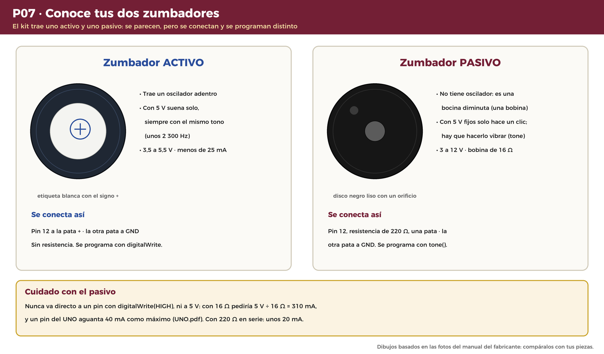

> **Para el instructor.** Los dibujos están hechos con las fotos del manual y de la lámina del kit (`contenido-kit.png`): el activo con etiqueta blanca y signo **+**, el pasivo un disco negro con un orificio. **Compruébalo con tus piezas** y anótalo al final. **No los pruebes con 5 V directos para distinguirlos:** el pasivo pediría unos 310 mA. Si dudas de cuál es cuál, el activo es el de la etiqueta; la prueba segura es subir P07a con el activo y ver que suena.

### Esquema de conexiones

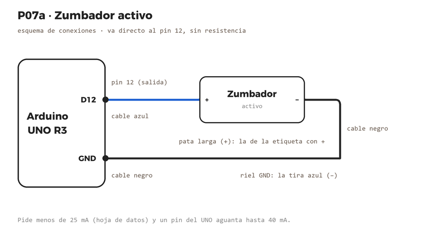

El zumbador queda entre el **pin 12** y **GND**. La pata **+** (la larga, la de la etiqueta) va hacia el pin 12.

### Conexión en el protoboard

**Con el USB desconectado.** Los números del diagrama son los de esta tabla.

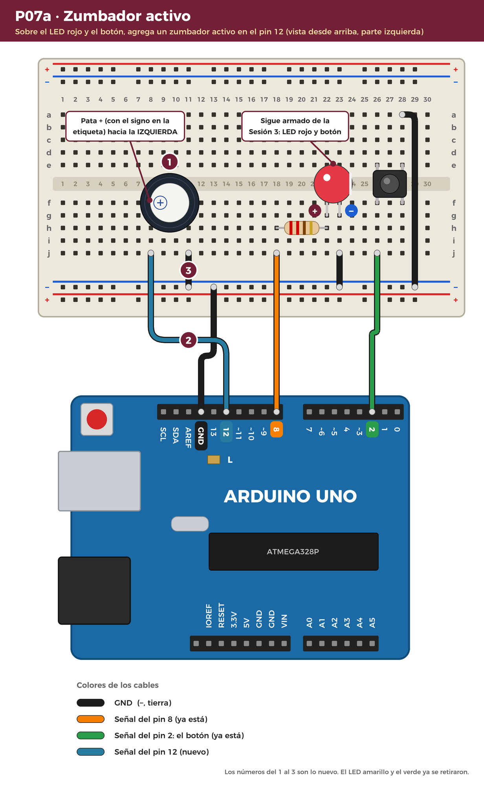

| Paso | Qué | De | A |
|---|---|---|---|
| 1 | Zumbador activo | pata **+** en **f8** | la otra pata en **f11** |
| 2 | Cable azul | **pin 12** de la placa | **j8** (la misma columna que la pata +) |
| 3 | Cable negro | riel azul **−** (debajo de la columna 11) | **j11** (la misma columna que la otra pata) |

Las patas del zumbador están separadas unos **3 agujeros** (7,6 mm). Si las tuyas quedan a otra distancia, no pasa nada: cada pata en **su propia columna** y cada cable en **la columna de su pata**. Empuja el zumbador parejo, sin doblar las patas.

**Revisa antes de conectar el USB**

- [ ] El zumbador es el **activo** (etiqueta blanca con +) y su pata + está del lado del cable azul.
- [ ] El cable azul llega a **j8** y al **pin 12** de la placa (el que dice 12, no el 13 ni el 11).
- [ ] El cable negro sale del riel azul (−) y llega a **j11**.
- [ ] El LED rojo y el botón siguen como estaban.

### Código

Abre `curso-arduino/sketches/P07a_zumbador_activo/P07a_zumbador_activo.ino` (**Archivo → Abrir**), presiona **Subir** y escucha.

```cpp
void pitido(int duracion) {
  digitalWrite(PIN_ZUMBADOR, HIGH);
  delay(duracion);
  digitalWrite(PIN_ZUMBADOR, LOW);
  delay(150);                     // silencio breve entre pitidos
}
```

- `pitido(int duracion)` es una **función con parámetro**, como `luces(rojo, amarillo, verde)` de la Sesión 2: se escribe una vez y se usa muchas veces con valores distintos. `pitido(100)` es un pitido corto y `pitido(600)` uno largo.
- El activo suena mientras el pin está en `HIGH`: `digitalWrite` basta, como con el LED.

### Qué debes oír

Tres pitidos cortos, una pausa, un pitido largo y dos segundos de silencio. Se repite.

### Repetir con `for` (10 min)

En `loop()` la línea `pitido(100);` está **tres veces**. Pregunta: *«¿y si quisiera diez?»* Para eso existe `for`.

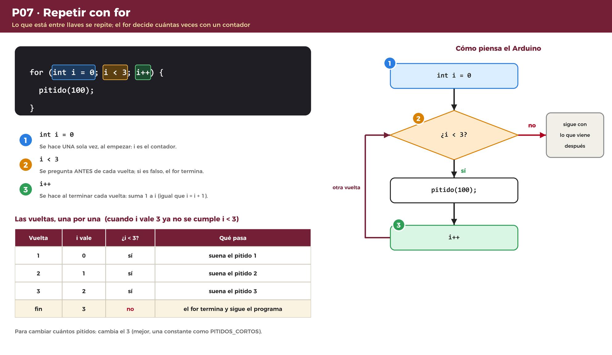

```cpp
for (int i = 0; i < 3; i++) {
  pitido(100);
}
```

- `int i = 0` se hace **una sola vez**, al empezar: `i` es el contador.
- `i < 3` se **pregunta antes de cada vuelta**; si es falso, el `for` termina.
- `i++` se hace **al terminar cada vuelta** y suma 1 a `i` (es lo mismo que `i = i + 1`).
- Con `i` valiendo 0, 1 y 2 se cumple `i < 3`: **tres vueltas**. Cuando `i` vale 3, ya no, y el programa sigue con la línea de abajo.

Pide a un alumno que «sea el Arduino» y llene la tabla de vueltas del diagrama en el pizarrón. Luego los equipos cambian las tres líneas por un `for`. *Solución del instructor: `sketches/P07a_pitidos_con_for/`.* Cierra la idea con la promesa de la Sesión 3: el `parpadear3()` de P06 tenía cuatro líneas repetidas tres veces; con `for` se escriben una sola vez.

### Modifica (retos)

1. **Básico:** cambia las tres líneas `pitido(100)` por un `for` (arriba). Prueba con 5 pitidos.
2. **Medio:** escribe el patrón de un **timbre de puerta** (por ejemplo, un pitido corto y uno largo) y de un **código secreto**: 2 cortos, 1 largo, 2 cortos.
3. **Desafío:** haz que el número de pitidos vaya cambiando: 1, 2, 3, 4 y 5 pitidos seguidos con una pausa entre ellos. (Pista: un `for` dentro de otro.)

### Rompe y arregla

El instructor planta un fallo; el equipo lo encuentra y lo explica.

| Fallo plantado | Qué ocurre | Qué se aprende |
|---|---|---|
| **De cableado:** con el USB desconectado, pasar el cable azul del pin 12 al **pin 11** | Compila y sube bien, pero **no suena** | El número del código (`PIN_ZUMBADOR = 12`) es el pin físico que se usa, como en la Sesión 1 |
| **De código:** quitar el `;` entre `int i = 0` e `i < PITIDOS_CORTOS` en el `for` (solución del instructor) | `expected ';' before 'i'` y la línea del **propio `for`** (línea 35). Esta vez el IDE marca la misma línea porque lo que sigue está en ella | En la Sesión 2 el error aparecía en la línea siguiente; aquí no. Lo importante es leer la línea y la columna |
| **De código:** escribir `pitdo(100);` en lugar de `pitido(100);` | `'pitdo' was not declared in this scope` y debajo `suggested alternative: 'pitido'` | Un nombre mal escrito: el IDE incluso sugiere el correcto |
| **De código:** quitar la llave `}` que cierra el `for` | `expected '}' at end of input`, marcado en la **última línea del archivo** | El IDE no sabe dónde se olvidó la llave, solo ve que al final falta una |
| **De lógica:** cambiar `i < 3` por `i <= 3` | Compila y sube, pero suenan **4 pitidos** en lugar de 3 | Un error sin mensaje: el programa hace lo que escribiste, no lo que querías. Repasar la tabla de vueltas |

Los mensajes del IDE se comprobaron compilando copias dañadas con el mismo compilador del IDE.

### Si no funciona

| Síntoma | Causa probable |
|---|---|
| No suena nada | El cable azul no llega a j8 o al pin 12; el cable negro no llega al riel o a j11; el zumbador no entró del todo; o las dos patas quedaron en la **misma** columna |
| Solo hace «clic» o suena muy poco | Es el **pasivo**: con `digitalWrite` hace un clic. Cambia al activo (el de la etiqueta con +) |
| Suena bajito | Prueba quitar la etiqueta blanca del activo (dice *REMOVE SEAL AFTER WASHING*). Anota si cambia |
| Suena sin parar | El cable azul quedó en un pin de 5 V en lugar del pin 12 (la hilera de abajo de la placa), o se subió otro sketch |

### Evidencia para la bitácora

- El zumbador suena con el patrón pedido y el equipo explica **qué hace `pitido(100)` y qué hace el `for`**.
- Un reto resuelto (el 1 o el 2).

---

## P07b · Zumbador pasivo y notas (≈20 min)

### Idea de la práctica

El pasivo **no suena con 5 V fijos**: hay que mandarle una señal que vibre. `tone(pin, frecuencia, duracion)` la genera, y la frecuencia decide la nota. Este circuito cambia el zumbador y agrega **una resistencia** de 220 Ω.

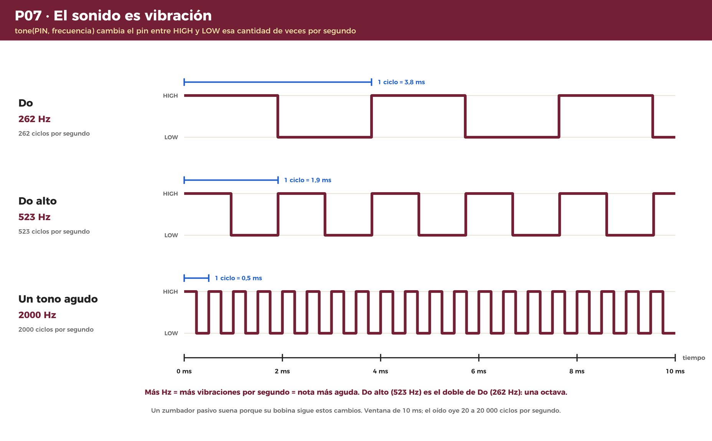

### Por qué lleva resistencia

La hoja de datos del pasivo dice **16 Ω**. Con 5 V y sin resistencia pediría unos 310 mA (5 ÷ 16) y un pin del UNO aguanta 40 mA como máximo. Con `tone()` la señal alterna y la bobina limita algo la corriente, pero la hoja de datos no dice cuánto. Para no depender de eso se pone una resistencia de **220 Ω en serie**: 5 ÷ (16 + 220) ≈ 21 mA. Si tu pasivo trae una marca **+**, conecta ese lado hacia la resistencia; si no, cualquier lado (es una bobina).

La resistencia baja un poco el volumen. Las notas graves suenan menos que las agudas: según el manual del kit, este zumbador suena mejor con señales de 2 000 a 5 000 Hz. **No** la quites ni la cambies por una menor sin medir la corriente.

### Esquema de conexiones

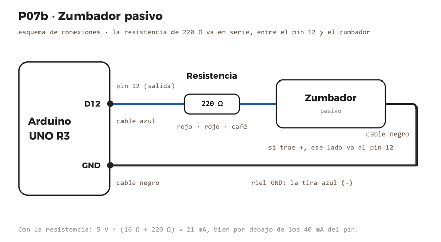

### Conexión en el protoboard

**Con el USB desconectado**, sobre el circuito de P07a.

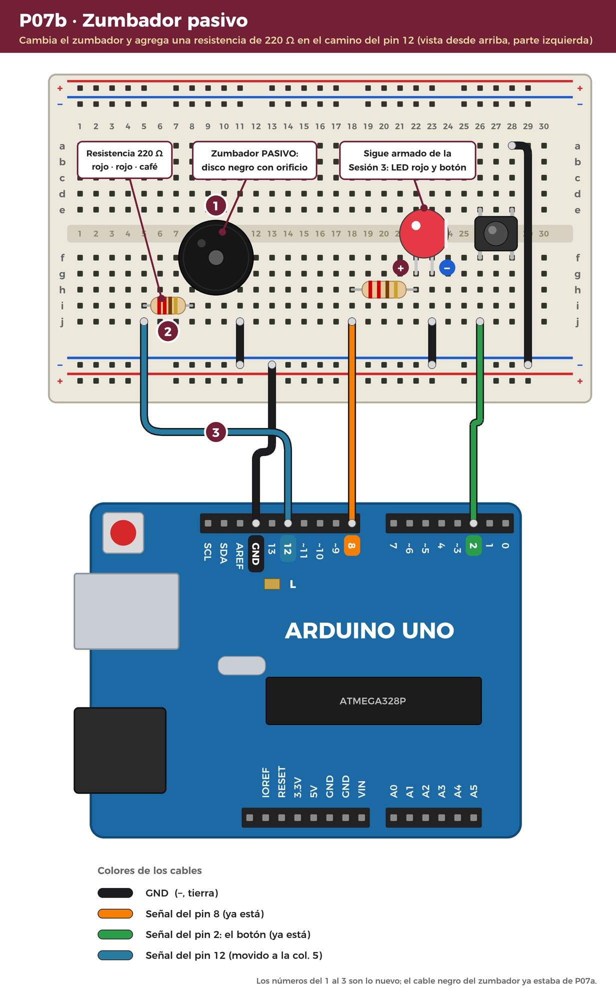

| Paso | Qué | De | A |
|---|---|---|---|
| 1 | Zumbador **pasivo** (retira el activo) | una pata en **f8** | la otra pata en **f11** |
| 2 | Resistencia 220 Ω | **i5** | **i8** |
| 3 | Cable azul (**mueve** el extremo que estaba en j8) | **pin 12** de la placa | **j5** |

El cable negro de **j11** al riel **no cambia**. Ahora la señal pasa por la resistencia: pin 12 → j5 → resistencia → i8 → pata del zumbador (f8) → zumbador → f11 → j11 → GND.

**Revisa antes de conectar el USB**

- [ ] El zumbador es el **pasivo** (disco negro liso con orificio).
- [ ] La resistencia es de **220 Ω** (rojo · rojo · café) y va de **i5** a **i8**.
- [ ] El cable azul llega a **j5**, **no** a j8: si llegara a j8, saltaría la resistencia.
- [ ] El cable negro sigue yendo de **j11** al riel azul (−).

### Código

Abre `curso-arduino/sketches/P07b_zumbador_notas/P07b_zumbador_notas.ino`, sube y escucha.

```cpp
const int DO = 262;
const int RE = 294;
...
void nota(int frecuencia, int duracion) {
  tone(PIN_ZUMBADOR, frecuencia, duracion);
  delay(duracion + duracion / 3);
}
```

- Las notas son **constantes con nombre** (como los tiempos de la Sesión 2): `DO` vale 262.
- `tone(pin, frecuencia, duracion)` empieza a sonar y **sigue con la línea de abajo** sin esperar; por eso la función `nota` agrega un `delay` un poco más largo que la nota, para dejar un silencio entre notas.
- `noTone(pin)` apaga el sonido (se usa en los retos).

### Qué debes oír

La escala Do-Re-Mi-Fa-Sol-La-Si-Do, cada nota un poco más aguda que la anterior, y una pausa de dos segundos.

### Modifica (retos)

1. **Básico:** la **sirena**: que el tono suba y baje con un `for`. Aquí el contador **es** la frecuencia. *Solución del instructor: `sketches/P07b_sirena_for/`.*
2. **Medio:** toca **«Cumpleaños feliz»** o una canción que conozcan (busca las frecuencias de las notas; la solución usa una nota nueva, `SIB` = 466 Hz). *Solución del instructor: `sketches/P07b_cumpleanos/`.*
3. **Desafío:** que cada nota dure distinto tiempo; o una melodía con **dos velocidades** que se cambian modificando un solo número.

### Rompe y arregla

| Fallo plantado | Qué ocurre | Qué se aprende |
|---|---|---|
| **De cableado:** cable azul en el **pin 11** en lugar del 12 | Compila y sube, pero **no suena** | Igual que con el activo: el número del código es el pin físico |
| **De código:** subir `P07a_zumbador_activo` (que usa `digitalWrite`) con el **pasivo** conectado | Solo se oyen **clics** (o casi nada) | El pasivo necesita vibración, no solo `HIGH`. Con la resistencia en su lugar es seguro hacerlo |
| **De código:** quitar la línea `delay(duracion + duracion / 3);` de la función `nota` | Compila y sube, pero solo se oye **la última nota** (`DO_ALTO`) una vez por vuelta. *Aún no lo he probado en la placa: anota lo que oigas* | `tone()` **no espera** a que termine la nota: sigue con la línea siguiente y la nueva nota reemplaza a la anterior. Por eso hace falta el `delay` |

No se planta ningún fallo que deje el pasivo conectado **sin la resistencia**: es la parte de este circuito que protege el pin.

### Si no funciona

| Síntoma | Causa probable |
|---|---|
| No suena | Cable azul en j5 y resistencia entre i5 e i8; cable negro en j11; patas en f8 y f11 |
| Suena muy bajito | Normal con la resistencia y con notas graves. Prueba la sirena (800 a 2 400 Hz) o acerca el oído. No quites la resistencia |
| Suena un clic y nada más | Estás subiendo el sketch de P07a (con `digitalWrite`), no el de P07b |
| Las notas se oyen cortadas o repetidas | Las patas del zumbador no hacen buen contacto; vuelve a presionarlo |

### Evidencia para la bitácora

- La escala suena y el equipo explica **la diferencia entre el zumbador activo y el pasivo** y **por qué el pasivo lleva resistencia**.
- Un reto resuelto (la sirena o la melodía) y los Hz que usaron.

---

## P08a · Ver al sensor PIR (≈20 min)

### Idea de la práctica

Antes de armar la alarma hay que **ver** al sensor. El PIR se lee como un botón (`digitalRead`: `HIGH` = movimiento), pero decide solo. Este programa muestra en el **Monitor Serie** el segundo en que empieza y en que termina cada detección, y prende el LED rojo mientras detecta. Así se descubren sus «manías» (calentamiento, retardo, bloqueo) antes de depender de ellas.

### Conoce tu PIR (3 min)

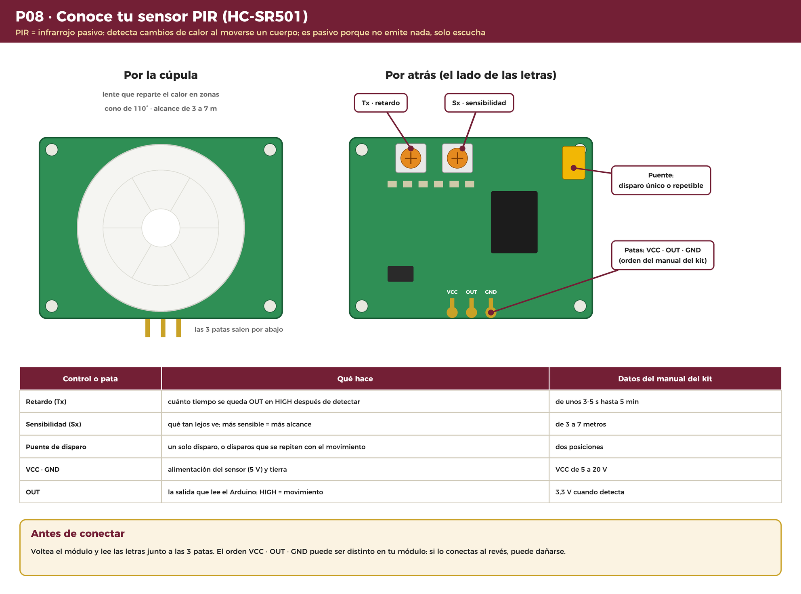

El sensor necesita **casi un minuto** para estabilizarse cuando recibe 5 V, y en ese tiempo puede dar falsas detecciones. Por eso conviene conectarlo cuanto antes (siguiente apartado) y dejar que se caliente mientras los equipos leen el diagrama y revisan sus módulos.

> **Para el instructor.** El manual del kit trae un párrafo que dice que el sensor «pone su salida en LOW al detectar»: es un error. La tabla del propio manual y el código dicen que **OUT pasa a HIGH al detectar** (3,3 V). Además da dos cifras para el retardo mínimo (3 y 5 segundos). Por eso en la práctica se **mide** en el Monitor Serie.

### Esquema de conexiones

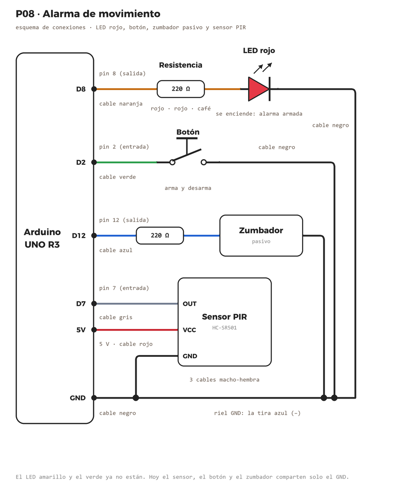

En este diagrama está **toda la alarma**. En P08a solo se usan el LED rojo (pin 8) y el sensor.

### Conexión del sensor

**Con el USB desconectado.** Los **tres cables macho-hembra** van **directo a la placa**, sin pasar por el protoboard. El extremo **macho** (el pin metálico) entra en la placa y el **hembra** (la funda negra con hueco) en las patas del sensor.

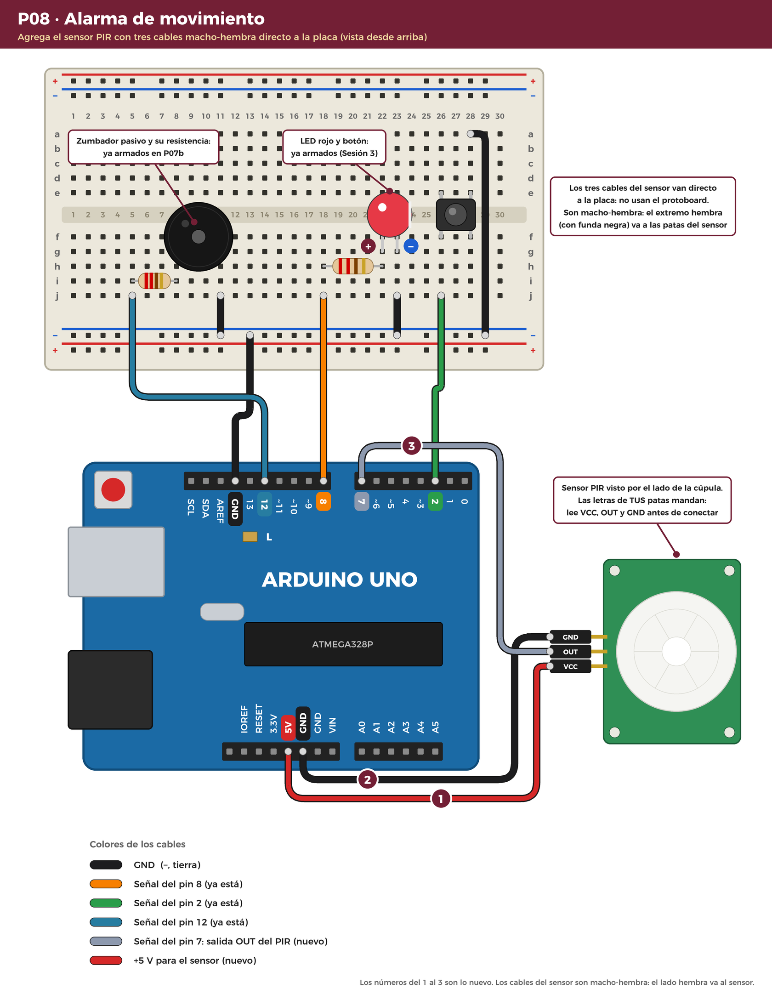

| Paso | Qué | De | A |
|---|---|---|---|
| 1 | Cable rojo | **5V** de la placa (hilera de abajo) | pata **VCC** del sensor |
| 2 | Cable negro | **GND** de la placa (el que está pegado al 5V) | pata **GND** del sensor |
| 3 | Cable gris | **pin 7** de la placa | pata **OUT** del sensor |

> **Lee las letras antes de conectar.** Voltea el módulo: junto a las 3 patas están impresas las letras VCC, OUT y GND. El orden del dibujo es el del manual del kit; **en tu módulo puede ser otro**. Si conectas VCC y GND al revés, el sensor puede dañarse. Conecta primero GND, luego VCC y OUT, y revisa antes de conectar el USB.

**Revisa antes de conectar el USB**

- [ ] El rojo va de **5V** a la pata marcada **VCC**; el negro, de **GND** a la pata marcada **GND**.
- [ ] El gris va del **pin 7** a la pata **OUT**.
- [ ] Los conectores hembra encajan bien en las patas (no hay una pata sin cable ni dos cables en una).
- [ ] El LED rojo sigue en el pin 8 con su resistencia.

### Código

Abre `curso-arduino/sketches/P08a_pir_monitor/P08a_pir_monitor.ino`, sube y abre el **Monitor Serie** a **9600 baudios**.

```cpp
void loop() {
  int estado = digitalRead(PIN_PIR);
  digitalWrite(PIN_LED, estado);               // el LED copia lo que dice el sensor

  if (estado != estadoAnterior) {              // el sensor cambió
    Serial.print(millis() / 1000);             // segundos desde que arrancó el programa
    ...
```

- `pinMode(PIN_PIR, INPUT)`: el sensor trae su propia salida, **no** necesita `INPUT_PULLUP`.
- `digitalWrite(PIN_LED, estado)`: el LED copia al sensor; `estado` ya es `HIGH` o `LOW`.
- `estado != estadoAnterior` avisa solo **cuando cambia**, como en P06 (estados).
- `millis()` cuenta los milisegundos desde que arrancó el programa. Hoy solo se usa para poner «la hora»; se estudia a fondo en la Sesión 11.

### Qué debes ver

El mensaje `Sensor PIR listo...` y, cada vez que algo se mueve frente al sensor, una línea como estas (**ejemplo con tiempos inventados**):

```
Sensor PIR listo. En el primer minuto puede dar falsas detecciones.
7 s: MOVIMIENTO
13 s: sin movimiento
...
```

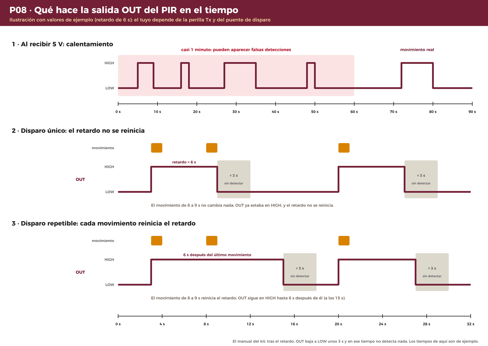

### Explora (10 min)

Cada equipo investiga con el Monitor Serie y **anota con números**. Con la hora del Monitor Serie se miden los segundos.

| Qué probar | Qué anotar |
|---|---|
| **Calentamiento:** sin moverse, ¿aparece «MOVIMIENTO» solo? ¿hasta qué segundo? | A partir de qué segundo deja de dar falsas detecciones |
| **Retardo:** mover la mano una vez frente al sensor | Cuántos segundos dura en `HIGH` |
| **Perilla de retardo (Tx):** girarla hasta un tope y hasta el otro | Segundos de retardo en cada tope y **en qué sentido** se gira para que sea más largo |
| **Bloqueo:** después de volver a `LOW`, mover la mano en seguida | Cuántos segundos no detecta (el manual dice unos 3) |
| **Sensibilidad (Sx):** girarla hasta un tope y hasta el otro | A qué distancia (en metros) deja de ver tu mano |
| **Puente de disparo:** pasarlo a la otra posición y mover la mano varias veces seguidas | Qué cambia: ¿el retardo se reinicia con cada movimiento (repetible) o no (único)? |

Con eso, cada equipo **deja el sensor listo para la alarma**: retardo al mínimo (para que la sirena no se repita muchas veces) y sensibilidad a la mitad.

### Rompe y arregla

| Fallo plantado | Qué ocurre | Qué se aprende |
|---|---|---|
| **De cableado:** con el USB desconectado, pasar el cable gris del pin 7 al **pin 6** | Compila y sube, pero el LED nunca se enciende y el Monitor Serie no escribe «MOVIMIENTO» | El sensor funciona, pero el programa lee **otro pin**. Un sensor «que no responde» puede estar bien |
| **De ajuste:** girar la perilla de retardo al tope largo | Tras un movimiento, el LED se queda encendido **minutos** | El sensor parece «pegado», pero hace lo que se le pidió. Comparar con la gráfica de la señal |

### Si no funciona

| Síntoma | Causa probable |
|---|---|
| El Monitor Serie no escribe nada | Velocidad distinta de 9600; o falta subir el sketch |
| «MOVIMIENTO» constante | El sensor aún se calienta (espera un minuto); o el retardo está al máximo; o VCC y GND están al revés (**desconecta ya**) |
| Nunca detecta | Cable gris en otro pin; OUT no conectado; la sensibilidad en el mínimo; se probó con algo que no es caliente ni se mueve |
| El sensor se calienta o huele raro | VCC y GND posiblemente al revés: **desconecta el USB de inmediato** y revisa las letras |

### Evidencia para la bitácora

- **Una captura del Monitor Serie** con al menos tres detecciones y su hora.
- El valor medido del **retardo** y la explicación de **por qué el sensor «no responde» en los primeros segundos**.

---

## P08 · Alarma de movimiento (≈30 min)

### Idea de la práctica

Un botón **arma y desarma** la alarma (como el LED con memoria de P06). Si está armada y el PIR detecta movimiento, suena una sirena. El LED rojo encendido dice «armada». **No hay nada nuevo que armar** si ya terminaste P08a: el LED y el botón vienen de la Sesión 3, el zumbador con su resistencia de P07b y el sensor de P08a.

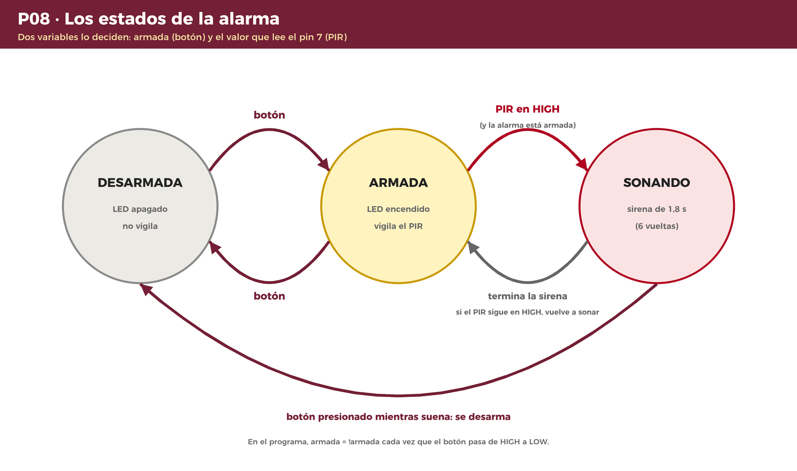

### Qué debe estar armado

| Pin | Qué | De dónde |
|---|---|---|
| 2 | Botón (con GND, en patas opuestas) | Sesión 3 |
| 7 | Sensor PIR (OUT) | P08a |
| 8 | LED rojo con su resistencia | Sesión 1 |
| 12 | Zumbador **pasivo** con su resistencia | P07b |

### Código: lo que ya conoces y dos cosas nuevas

Abre `curso-arduino/sketches/P08_alarma_pir/P08_alarma_pir.ino`. Si vas a modificarlo, **Archivo → Guardar como…** con otro nombre (un solo `.ino` por carpeta).

**Lo que ya conoces.** `armada` es un `bool` que el botón invierte con `armada = !armada`, y `botonAnterior` sirve para detectar el momento en que se presiona (P06). La condición `armada && digitalRead(PIN_PIR) == HIGH` usa `&&` («y»), como en P06.

**Nuevo 1 · `for` dentro de funciones.** Los pitidos y la sirena se hacen con `for`:

```cpp
void pitidos(int cantidad) {
  for (int i = 0; i < cantidad; i++) {
    tone(PIN_ZUMBADOR, 2000, 100);
    delay(220);
  }
}
```

`pitidos(1)` al armar y `pitidos(2)` al desarmar: la misma función con otro parámetro.

**Nuevo 2 · `break`: salir del `for` antes de tiempo.**

```cpp
void sirena() {
  for (int i = 0; i < 6; i++) {
    if (digitalRead(PIN_BOTON) == LOW) {   // si presionan el botón, deja de sonar
      break;
    }
    tone(PIN_ZUMBADOR, 2400);
    delay(150);
    tone(PIN_ZUMBADOR, 1800);
    delay(150);
  }
  noTone(PIN_ZUMBADOR);
}
```

La sirena alterna dos tonos seis veces (6 × 300 ms = **1,8 s**). `break` sale del `for` al presionar el botón. Los tonos (2 400 y 1 800 Hz) están en la zona donde el zumbador pasivo suena más fuerte.

**El calentamiento.** `setup()` espera 60 segundos con el LED parpadeando para dar tiempo al sensor. El módulo se calienta cuando le llega 5 V (el USB se los da todo el tiempo, aunque subas otro programa); si ya lleva más de un minuto conectado, **baja `SEGUNDOS_CALENTAMIENTO` a 5** para hacer pruebas. Vuelve a 60 para la demostración.

### Qué debes ver

1. El LED parpadea durante el calentamiento y el Monitor Serie escribe `Listo. Presiona el boton para armar la alarma.`
2. Presionas el botón: **un pitido**, el LED queda encendido y el Monitor Serie escribe `Alarma ARMADA`.
3. **Aléjate un par de pasos** y luego muévete frente al sensor: suena la sirena y el Monitor Serie escribe `MOVIMIENTO DETECTADO`.
4. Presionas el botón y lo mantienes hasta que calle: **dos pitidos**, el LED se apaga y escribe `Alarma DESARMADA`.

> Al armar, **aleja la mano del sensor**: si el PIR ve el movimiento de tu mano, la alarma suena de inmediato. Es el origen del reto «tiempo de salida».

### Modifica (retos)

1. **Básico:** cambia la sirena por **otro sonido** (otros Hz, otra duración).
2. **Medio:** agrega un **tiempo de salida**: al armar, la alarma espera 10 segundos antes de vigilar, con un pitido por segundo. (Un `for` que cuente hacia atrás.)
3. **Desafío:** un **código de desarme de 3 pulsaciones**: estando armada, hay que presionar el botón 3 veces seguidas (con no más de 3 segundos entre ellas). Una pulsación suelta no desarma.

*Solución del instructor para los retos 2 y 3, juntos: `sketches/P08_alarma_completa/`.* Cambia además la sirena para que **no bloquee** el programa (así se pueden contar las pulsaciones mientras suena). Para explicarla al grupo: lee primero `armar()`, luego `desarmar()` y al final `loop()`.

### Rompe y arregla

| Fallo plantado | Qué ocurre | Qué se aprende |
|---|---|---|
| **De cableado:** cable gris en el **pin 6** | Arma, pero nunca suena | El sensor funciona; el programa mira otro pin |
| **De ajuste:** perilla de retardo al tope largo | La sirena se repite una y otra vez después de un solo movimiento | La salida del PIR se queda en `HIGH` y el programa vuelve a ver «movimiento» |
| **De uso:** armar con la mano junto al sensor | Suena en seguida | Las alarmas reales dan un **tiempo de salida** |

### Si no funciona

| Síntoma | Causa probable |
|---|---|
| El LED parpadea y no termina | Es el calentamiento (60 s). Espera, o baja `SEGUNDOS_CALENTAMIENTO` |
| Al presionar el botón no pasa nada | Botón sin GND en patas opuestas; sigue en calentamiento |
| Arma pero nunca suena | Cable OUT en otro pin; sensor sin 5 V o con GND mal; retardo/sensibilidad mal; el zumbador sin resistencia en su camino |
| Suena sola | Falsas detecciones del calentamiento; o algo se mueve en el campo del sensor (ventilador, cortina, otra persona) |
| Suena muy bajito | Normal con la resistencia de 220 Ω; acerca el oído |

### Evidencia para la bitácora

- **Una captura del Monitor Serie** (o un video corto del equipo) con la alarma armándose, detectando y desarmándose.
- El equipo dibuja los **tres estados** de la alarma y qué cambia de uno a otro.
- Un reto resuelto (aunque sea el 1).

---

## Cierre de la sesión (10 min)

- En la bitácora: *«qué cambié, qué pasó, por qué»* para P07a, P07b y P08, y el visto bueno del instructor en los tres puntos (funciona, lo explica, hizo una modificación propia).
- **Es el final de la primera visita:** desarmar y guardar el kit. Los dos zumbadores **por separado y marcados** (activo y pasivo), el sensor PIR sin doblar sus patas, los cables macho-hembra en su paquete y el LED amarillo y el verde con sus resistencias. Contar con la hoja de inventario.
- Pregunta de enlace con la Sesión 5: *«Hoy todo era sí o no: hay movimiento o no hay movimiento. ¿Cómo sabría el Arduino **cuánto** gira una perilla o **cuánta** luz hay?»* (señal analógica: Sesión 5).

## Tu práctica: anota lo que encuentres

Haz las prácticas como lo haría un alumno y llena esto. Sirve para ajustar la sesión y las láminas. **Lo del sensor PIR cubre la validación V8 del plan.**

| Dato | Anota aquí |
|---|---|
| Tiempo real de P07a (incluye retirar los LED), del `for`, de P07b, de P08a y de P08 | |
| ¿Cuál es el zumbador activo y cuál el pasivo en tu kit? ¿Coinciden con la etiqueta y las fotos? | |
| ¿Cuántos agujeros quedan entre las patas de cada zumbador? ¿Entran bien en el protoboard? | |
| ¿El activo suena fuerte? ¿Cambia al quitar la etiqueta blanca? | |
| ¿El pasivo se oye bien con 220 Ω? ¿Y las notas graves? ¿Y la sirena (800 a 2 400 Hz)? | |
| Si hay multímetro: corriente con el pasivo sonando (multímetro en serie, escala de mA) con **220 Ω** | |
| Orden real de las letras de las 3 patas del PIR (¿VCC · OUT · GND como en el dibujo?) | |
| ¿Los conectores macho-hembra encajan en las patas del sensor y en la placa? ¿Alcanzan los cables? | |
| Calentamiento del PIR: segundo en que dejó de dar falsas detecciones | |
| Retardo del PIR en los dos topes (segundos) y en qué sentido se gira para aumentarlo | |
| Posición del puente de disparo de tu módulo y qué hace (¿el retardo se reinicia?) | |
| Bloqueo después del retardo (segundos sin detectar) | |
| Sensibilidad: distancia (m) a la que ve la mano en los dos topes; ¿ve a través de una puerta o de un vidrio? | |
| ¿Los mensajes del IDE para el `for` salen igual que en esta guía? | |
| ¿Funciona `P08_alarma_completa` (tiempo de salida y código de 3 pulsaciones)? ¿Qué ajustarías? | |
| ¿El calentamiento de 60 s en cada subida estorba? ¿Cuántas veces lo esperaste? | |
| Dudas o errores que tuviste | |
| Foto del circuito armado y captura del Monitor Serie con detecciones | |

## Para recompilar o regenerar

- Los sketches se verifican con `curso-arduino/compilar-sketches.ps1` (66 en total).
- Los diagramas se generan con `python curso-arduino/diagramas/generar_diagramas.py P07 P08`. El script **comprueba las conexiones** al dibujar (por ejemplo, que el pin 12 llega al zumbador solo a través de la resistencia, o que VCC y GND del sensor no se tocan) y se detiene si algo no coincide.
- Valores que **no** están verificados y salen de las hojas de datos: la corriente real del zumbador pasivo con `tone()`, la distancia entre las patas de los zumbadores, el orden de las patas del sensor de tu módulo y el sentido de giro de sus perillas. Por eso están en la tabla de arriba.
