# Sesión 5 · Perilla y brillo

**Guía de práctica para el instructor** (de aquí saldrán después las láminas y las fichas de los alumnos)
**Prácticas y tiempos estimados (120 min):** Paso 0 LED en el pin 9 (repaso) 10 · idea 10 · P09 La perilla y los números 25 · P09a La perilla como gráfica 10 · P10a PWM a mano 15 · P10 Perilla y brillo (con retos) 40 · cierre 10. Anota los tiempos reales en la tabla del final.
**Sketches:** `curso-arduino/sketches/P02_led_parpadeo/` (Paso 0) · `P09_perilla_serie/` · `P09a_perilla_plotter/` · `P10a_pwm_a_mano/` · `P10_perilla_brillo/` · soluciones de retos: `P10_brillo_invertido/`, `P10_solo_pasada_la_mitad/`, `P10_rango_20_200/` y `P10_led_respira/`
**Ideas nuevas de la sesión:** hasta hoy todo era **sí o no** (`HIGH` o `LOW`). Hoy el Arduino **lee valores intermedios** (`analogRead`, de 0 a 1023) y **da brillos intermedios** (`analogWrite`, con PWM). Entre las dos cosas se aprende a **cambiar de escala** con `map` y a **ver una señal como gráfica**. Es la primera sesión de la visita 2; el mismo día sigue la Sesión 6 (el sensor de luz usa la misma idea).
**Si el tiempo se acorta:** P09a (la gráfica) y P10a (PWM a mano) son ampliaciones. Sin ellas la sesión cabe en 95 minutos: la gráfica se enseña en 5 minutos con el instructor y el PWM se explica con el diagrama `P10_pwm.png`.

## Cómo leer los diagramas de esta sesión

Hay dos diagramas por circuito (protoboard para **armar**, cableado para **entender**) y seis ayudas para las ideas nuevas:

| Diagrama | Para qué sirve |
|---|---|
| **LED en el pin 9** (`P09_paso0_led_pin9.png`) | Armar el LED del repaso, igual que P02 pero con el cable en el pin 9 |
| **Conoce tu potenciómetro** (`P09_perilla_conoce.png`) | Qué es cada pata y por qué el centro reparte el voltaje |
| **De volts a números** (`P09_lectura.png`) | Cómo `analogRead` convierte el voltaje en un número y cómo se calcula de vuelta |
| **Protoboard y cableado de P09** (`P09_perilla_serie.png` y `_cableado.png`) | Conectar el potenciómetro y entender el divisor |
| **La perilla como gráfica** (`P09_plotter.png`) | Qué se espera ver en el Serial Plotter (ilustración, no medición) |
| **PWM a mano** (`P10_pwm_a_mano.png`) | El mismo reparto del ciclo con ciclos de 1 s, 100 ms y 20 ms (ilustración de lo que se espera ver) |
| **Lo que hace analogWrite** (`P10_pwm.png`) | Cómo cada valor de 0 a 255 reparte el ciclo de PWM |
| **map(): cambiar de escala** (`P10_map.png`) | Las cinco partes de `map` y una tabla de ejemplos con los retos |
| **Protoboard y cableado de P10** (`P10_perilla_brillo.png` y `_cableado.png`) | El circuito completo: entrada A0 y salida pin 9 |

## Materiales (lo que se arma hoy)

El kit llega **desarmado** de la visita anterior: antes de empezar, cuenta las piezas con la hoja de inventario.

| Cantidad | Material |
|---|---|
| 1 | LED (el rojo, por ejemplo) y 1 resistencia de **220 Ω** (rojo · rojo · café) |
| 1 | Potenciómetro de **10 kΩ**, rotulado **B103** (el kit trae 2; son de los que se giran con desarmador) |
| 1 | **Desarmador plano pequeño** (de relojero o de lentes). **No viene en el kit**: hay que llevarlo |
| 3 | Cables macho-macho **negros** (LED, riel de GND y potenciómetro) |
| 1 | Cable macho-macho **morado** (señal del pin 9), 1 **amarillo** (centro del potenciómetro a A0) y 1 **rojo** (5 V). Los colores son una sugerencia: cualquier color distinto sirve, y negro solo para GND |

> **Para el instructor.** El kit trae dos hojas de datos que podrían ser la de este potenciómetro (`Datasheets/Precision Potentiometer 3386p - 1- 103T.pdf` y `Datasheets/Spain potentiometer_.pdf`, de otro fabricante) y la pieza no dice cuál es. Ambas coinciden en lo importante: 10 kΩ y un giro de menos de una vuelta (de 240° a 280°). La del 3386 declara apenas **200 ciclos de giro de vida útil**: alcanza para el curso, pero conviene no usarlo «para jugar». **Con potenciómetros de perilla** (compra opcional del plan, sección 10) la práctica es la misma y no hace falta desarmador; solo hay que revisar cuántos agujeros separan sus patas.

## Paso 0 · LED en el pin 9 (≈10 min, repaso de la Sesión 1)

Es el **repaso práctico** con que empieza cada visita: reconstruir un circuito de la visita anterior en pocos minutos. Es el LED de P02, con **un solo cambio**: el cable de señal va al **pin 9**, el que tiene el símbolo **~**. Sirve para P10 y deja una pregunta: *«¿qué tiene de especial el 9?»* (se contesta en P10).

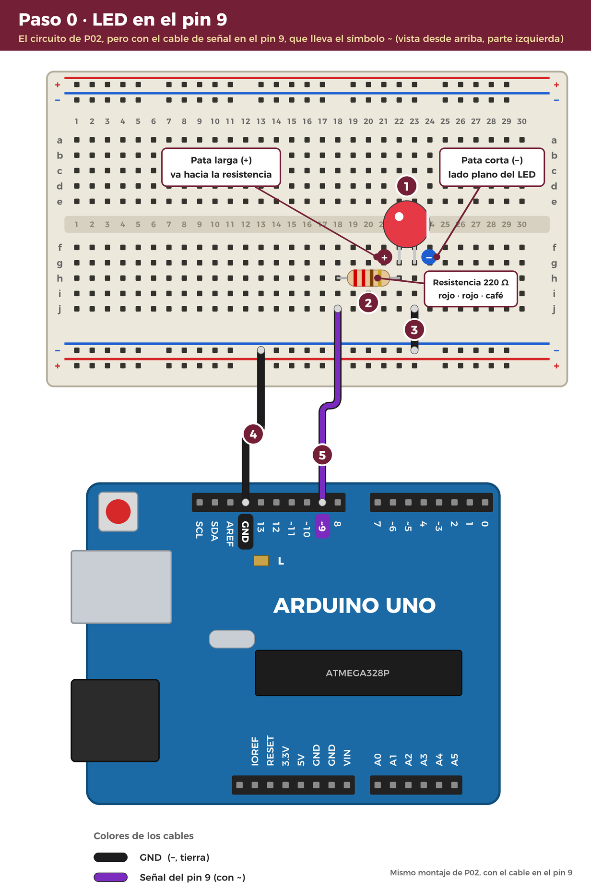

**Con el USB desconectado.** Los números del diagrama son los de esta tabla.

| Paso | Qué | De | A |
|---|---|---|---|
| 1 | LED rojo | pata **larga (+)** en **g22** | pata corta (−) en **g23** |
| 2 | Resistencia 220 Ω | **h18** | **h22** |
| 3 | Cable negro | **j23** | riel azul **−** (debajo de la columna 23) |
| 4 | Cable negro | **GND** de la placa (el de la hilera de arriba) | riel azul **−** (debajo de la columna 13) |
| 5 | Cable morado | **pin 9** de la placa | **j18** |

Si pusiste las piezas en otros agujeros, el criterio es el mismo: el pin 9 llega a la resistencia, la resistencia a la pata larga y la pata corta a GND.

**Código.** Abre `curso-arduino/sketches/P02_led_parpadeo/P02_led_parpadeo.ino`, haz **Archivo → Guardar como…** (por ejemplo `Paso0_led_pin9`) y cambia la primera línea: `int pinLed = 8;` por `int pinLed = 9;`. Sube: el LED parpadea. Si no parpadea, es el mismo fallo de siempre: el cable sigue en el pin 8 o el número del código no es el del cable.

**Pregunta de arranque (pizarrón).** *«Este LED tiene dos estados: prendido o apagado. ¿Cómo haríamos que brille a medias?»* Se deja sin contestar hasta P10.

## La idea de la sesión (10 min, en el pizarrón)

1. **Sí o no, frente a «cuánto».** Un botón está presionado o no; un PIR detecta o no. Pero **cuánto** gira una perilla o **cuánta** luz hay no se contesta con sí o no: son valores intermedios, una señal **analógica**.
2. **El potenciómetro es un divisor de voltaje.** Es una resistencia de 10 kΩ con una tercera pata, el **cursor**, que se desliza por ella. Con 5 V en un extremo y GND en el otro, el voltaje del centro va de 0 a 5 V según dónde esté el cursor. Dibuja el diagrama del potenciómetro.
3. **`analogRead` convierte volts en un número.** El Arduino mide de 0 a 5 V con 10 bits: **1024 niveles**, del 0 al 1023. Cada nivel cubre unos **4,9 mV** (5 V ÷ 1024). Solo se lee con los pines **A0 a A5**, y no necesita `pinMode`.
4. **El camino de vuelta no existe.** Un pin digital solo da 0 V o 5 V: no puede dar 2,5 V. Para lograr un brillo intermedio el Arduino **enciende y apaga el pin muy rápido** (unas 490 veces por segundo): se llama **PWM**. El ojo no ve el parpadeo; ve el promedio. Se hace con `analogWrite`, y **solo en los pines con ~** (3, 5, 6, 9, 10 y 11). El nombre confunde: `analogWrite` no tiene nada que ver con los pines analógicos A0 a A5.
5. **Cambiar de escala.** La perilla da 0 a 1023 y `analogWrite` pide 0 a 255: `map` convierte uno en otro.
6. **Una gráfica dice más que una lista de números.** El Serial Plotter dibuja lo que el Arduino escribe.

**Datos para el pizarrón** (de la documentación del kit)

- Potenciómetro: 10 kΩ · giro de 240° a 280° (hojas de datos). Con 5 V pasan 5 ÷ 10 000 = **0,5 mA**: no hace falta resistencia.
- Entradas analógicas del UNO: 6, de 10 bits (1024 valores), de 0 a 5 V por omisión · unos 100 µs por lectura, o sea unas 10 000 lecturas por segundo (`Datasheets/UNO.pdf` y `Language Reference.pdf`).
- PWM: pines 3, 5, 6, 9, 10 y 11, de 8 bits (0 a 255). Frecuencia de unos **490 Hz**; en los pines 5 y 6, unos 980 Hz (`Language Reference.pdf`).

---

## P09 · La perilla y los números (≈25 min)

### Idea de la práctica

Conectar el potenciómetro a **A0** y ver en el Monitor Serie el número que lee el Arduino y el voltaje que le corresponde. Es la primera vez que el programa recibe algo que **no** es sí o no.

### Conoce tu potenciómetro (5 min)

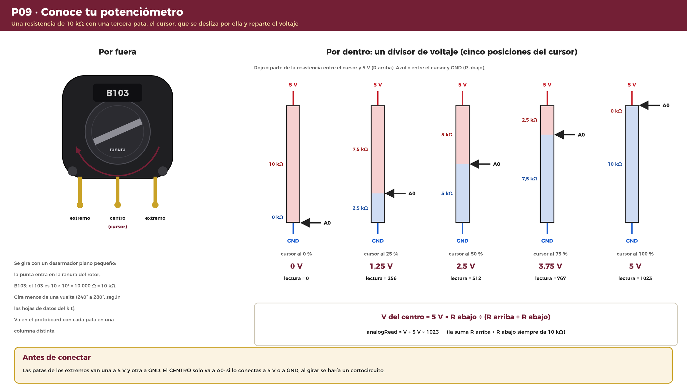

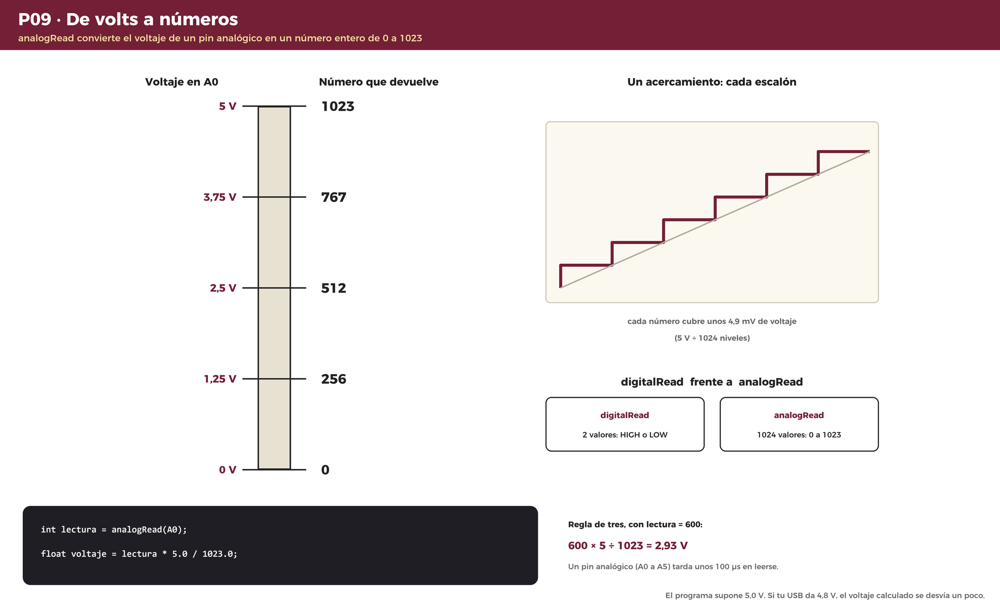

> **Para el instructor.** La «B» de **B103** suele indicar un giro **lineal** (el número cambia parejo con el giro) y el **103** es 10 × 10³ Ω = 10 kΩ. La hoja de datos de uno de los fabricantes del kit usa otra convención para la letra, así que **no lo des por hecho**: se comprueba en «Explora» (a la mitad del giro debe salir cerca de 512). Si fuera logarítmico saldría otro número.

### Esquema de conexiones

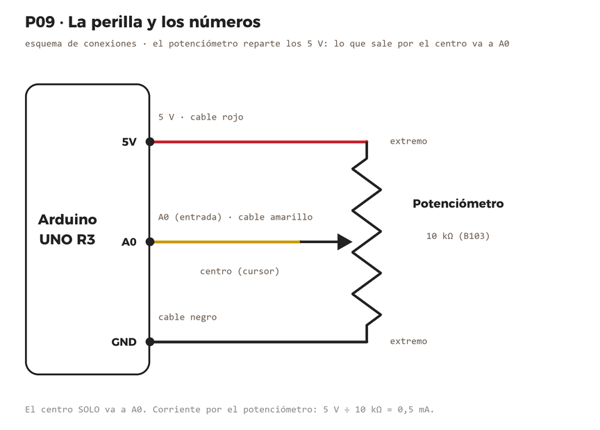

Los **extremos** van uno a 5 V y el otro a GND. El **centro** (el cursor) va **solo** a A0.

### Conexión en el protoboard

**Con el USB desconectado.** Sobre el LED del Paso 0 (que **no se toca**). Se conecta en este orden: primero GND, luego A0 y **5 V al final**.

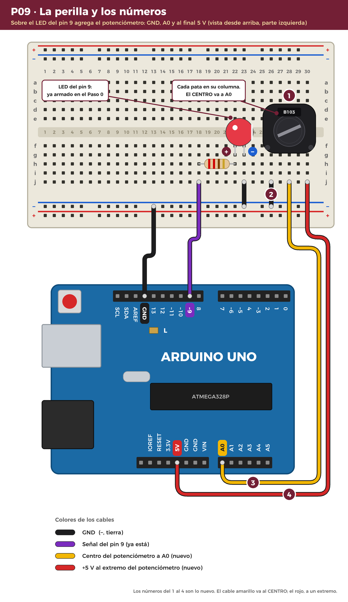

| Paso | Qué | De | A |
|---|---|---|---|
| 1 | Potenciómetro | patas en **f26**, **f28** y **f30** (cada una en su columna) | el centro (f28) es el cursor |
| 2 | Cable negro | **j26** (la columna del extremo izquierdo) | riel azul **−** (debajo de la columna 26) |
| 3 | Cable amarillo | pin **A0** de la placa (hilera de abajo) | **j28** (la columna del centro) |
| 4 | Cable rojo | pin **5V** de la placa (hilera de abajo) | **j30** (la columna del extremo derecho) |

Los cables de A0 y de 5 V **rodean la placa por la derecha**, porque esos pines están en la hilera de abajo. Las patas del potenciómetro están separadas unos **2 agujeros** (5 mm); si las tuyas están a otra distancia, no pasa nada: cada pata en **su propia columna** y cada cable en **la columna de su pata**. Si una pata queda del otro lado del canal, su cable va en la fila **a-e** de esa columna. Empuja el potenciómetro parejo, sin doblar las patas.

**Revisa antes de conectar el USB**

- [ ] El cable **amarillo** va a la columna del **centro** y a **A0**; **no** va a 5 V ni a GND.
- [ ] El cable **rojo** va a **5V** y a **un extremo**; el **negro**, al riel de GND y al **otro extremo**.
- [ ] Las tres patas están en **tres columnas distintas** y ningún cable comparte columna con otra pata.
- [ ] El LED del Paso 0 sigue armado (no se usa en P09).

> **Por qué esto importa.** Si el centro quedara conectado a 5 V y un extremo a GND, al girar el cursor hacia ese extremo se haría un **cortocircuito** entre 5 V y GND. **Por eso no se planta ese fallo** en «Rompe y arregla».

### Código

Abre `curso-arduino/sketches/P09_perilla_serie/P09_perilla_serie.ino`, sube y abre el **Monitor Serie** a **9600 baudios**.

```cpp
void loop() {
  int lectura = analogRead(PIN_PERILLA);        // número de 0 a 1023
  float voltaje = lectura * 5.0 / 1023.0;       // lo convertimos a volts

  Serial.print("Lectura: ");
  Serial.print(lectura);
  Serial.print("    Voltaje: ");
  Serial.print(voltaje, 2);                     // 2 decimales
  Serial.println(" V");
  delay(200);
}
```

- `analogRead(PIN_PERILLA)` devuelve un `int` de **0 a 1023**. `PIN_PERILLA` vale `A0`.
- `lectura * 5.0 / 1023.0` es una **regla de tres**: 1023 equivale a 5 V. Los `.0` hacen que la cuenta use **decimales** (se verá por qué en «Rompe y arregla»). `voltaje` es una variable `float`: a diferencia de `int`, que solo guarda números enteros, `float` guarda números **con decimales**.
- `Serial.print(voltaje, 2)` escribe el número con **2 decimales**.

### Qué debes ver

Una línea nueva cada 0,2 s. Al girar el potenciómetro el número cambia (**ejemplo con valores inventados**):

```
Lectura: 0    Voltaje: 0.00 V
Lectura: 312    Voltaje: 1.52 V
Lectura: 511    Voltaje: 2.50 V
Lectura: 1023    Voltaje: 5.00 V
```

### Explora (10 min)

Cada equipo investiga con el Monitor Serie y **anota con números**.

| Qué probar | Qué anotar |
|---|---|
| **Gira despacio** de un tope al otro | El número en cada tope (¿llega a 0 y a 1023?) y **hacia dónde** hay que girar para que suba (derecha o izquierda) |
| **A la mitad del giro** | El número y el voltaje. Si el potenciómetro es lineal debe salir cerca de 512 y de 2,5 V |
| **Déjala quieta** y mira unas 10 líneas | Cuántos números «baila» la lectura (un poco de ruido es normal) |
| **Regla de tres** | Elige una lectura de la pantalla, calcula a mano su voltaje (lectura × 5 ÷ 1023) y compáralo con lo que escribe el Monitor |
| Si hay multímetro | Mide entre **5V** y **GND** de la placa (¿5,0 V o menos?) y entre el **cursor** y GND. ¿Coincide con el Monitor? |

> **El «5 V» es el de tu USB.** El programa supone 5,0 V, pero un puerto USB puede dar entre 4,75 y 5,25 V (lo que permite la norma USB). Por eso el voltaje calculado puede desviarse un poco del real. No es un error del programa.

### Modifica (retos)

1. **Básico:** anota qué número sale en los dos extremos y en el centro del giro.
2. **Medio:** con la regla de tres, calcula el voltaje de tres lecturas y compáralo con lo que muestra el Monitor.
3. **Desafío:** haz que también escriba el **porcentaje de giro** (0 a 100 %). Pista: es otra regla de tres, con `100.0` en lugar de `5.0`: `float porcentaje = lectura * 100.0 / 1023.0;`

### Rompe y arregla

El instructor planta un fallo; el equipo lo encuentra y lo explica.

| Fallo plantado | Qué ocurre | Qué se aprende |
|---|---|---|
| **De cableado:** con el USB desconectado, **intercambiar los cables de los extremos** (el rojo a la columna del extremo izquierdo y el negro al derecho) | Funciona igual, pero al girar el número cambia **al revés** | Los extremos son intercambiables eléctricamente: solo cambia el sentido. Hay **dos soluciones**: cambiar los cables o arreglarlo en el programa (se hace en P10, con `map` al revés) |
| **De cableado:** con el USB desconectado, **soltar el cable amarillo** de j28 (o pasarlo a la entrada **A1**) | El número **no se queda quieto**: salta solo y cambia al acercar la mano a los cables | Una entrada analógica sin conectar «flota» y lee ruido eléctrico: es la misma idea del `INPUT` sin pull-up de la Sesión 3. La referencia de Arduino lo advierte |
| **De código:** escribir `lectura * 5 / 1023` (**quitar los dos `.0`**) | Compila y sube, pero el voltaje avanza **a saltos de 1 V**: `0.00`, `1.00`, `2.00`, `3.00`, `4.00`, y solo `5.00` en el tope | Con números enteros, la división **recorta los decimales**. Con `5.0` y `1023.0` la cuenta se hace con decimales |

### Si no funciona

| Síntoma | Causa probable |
|---|---|
| El Monitor Serie no escribe nada | Velocidad distinta de 9600; o falta subir el sketch |
| El número es siempre 0 | El cable amarillo (centro) está en la columna de GND, o el extremo del 5 V no está conectado |
| El número es siempre 1023 | El cable amarillo está en la columna del 5 V, o el extremo de GND no está conectado |
| El número no cambia al girar | El cable amarillo no está en la columna del centro; o dos patas comparten columna; o el rotor no está girando (el desarmador no entró en la ranura) |
| El número salta sin control | El cable amarillo está suelto, o A0 no está conectado |
| Cambia, pero solo en un pedazo del giro | Normal si el potenciómetro llega a un tope antes de lo esperado. Anótalo |
| Sube al girar a la izquierda | Normal: depende de cuál extremo va a 5 V. Es el fallo de arriba, sin plantar |

### Evidencia para la bitácora

- El número cambia al girar y el equipo explica **qué es 0 y qué es 1023** y **cuál es la ecuación del voltaje**.
- Una **tabla de tres puntos**: posición del giro, lectura y voltaje.
- Un reto resuelto (el 1 o el 2).

---

## P09a · La perilla como gráfica (≈10 min)

### Idea de la práctica

Lo que el Arduino escribe también se puede **dibujar**. El **Serial Plotter** hace una gráfica con los números que le llegan por el cable USB. Para que entienda qué línea es cada cosa, el programa escribe cada dato con su **nombre y dos puntos**: `Lectura:512`.

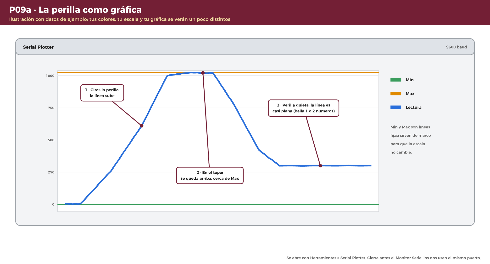

### Código

No hay nada nuevo que conectar: es el mismo circuito de P09. Abre `curso-arduino/sketches/P09a_perilla_plotter/P09a_perilla_plotter.ino`, sube, **cierra el Monitor Serie** y abre **Herramientas → Serial Plotter** (a 9600).

```cpp
Serial.print("Min:0,Max:1023,Lectura:");
Serial.println(lectura);
```

- El Serial Plotter lee líneas con el formato `nombre:valor`, separadas por **comas**. Cada nombre es una línea de color.
- `Min` y `Max` valen siempre 0 y 1023: son un **marco** para que la gráfica no cambie de escala mientras giras la perilla.
- Un solo `println` por vuelta: cada vuelta de `loop()` es un **punto** de la gráfica.

### Qué debes ver

Una línea azul que sube y baja al girar la perilla, entre dos líneas fijas (la del 0 y la del 1023). Con la perilla quieta, la línea es casi plana.

### Explora (5 min)

| Qué probar | Qué anotar |
|---|---|
| Gira la perilla despacio de un tope al otro | La forma de la línea: ¿es una recta o se tuerce? Si fuera logarítmico se vería torcida |
| Gírala lo más rápido que puedas | Si la línea alcanza a seguirte |
| Quita las líneas `Min` y `Max` del código y sube de nuevo | Qué pasa con la escala de la gráfica |

### Si no funciona

| Síntoma | Causa probable |
|---|---|
| El Serial Plotter no se abre o no recibe nada | El Monitor Serie sigue abierto: los dos usan el mismo puerto. Ciérralo; o la velocidad no es 9600 |
| Aparece una sola línea | Faltan las comas o los dos puntos en el texto del `print` |
| La línea de Lectura se ve plana y arriba o abajo | El cable amarillo del centro está en 5 V o en GND, como en P09 |

### Evidencia para la bitácora

- Una **captura del Serial Plotter** con la perilla girando de un tope al otro.

---

## P10a · PWM «a mano» (≈15 min)

### Idea de la práctica

¿Cómo logra el Arduino un brillo intermedio si un pin solo da 0 V o 5 V? **Enciende y apaga muy rápido.** Aquí se hace **despacio y a mano**, con `digitalWrite` y `delay`, para que se vea. La perilla decide qué parte del ciclo está **encendido** el LED, y la constante `PERIODO_MS` decide qué tan largo es el ciclo. Con ciclos de un segundo se ve parpadear (es el Blink de la Sesión 1); con ciclos cortos el parpadeo se junta y se ve un brillo medio.

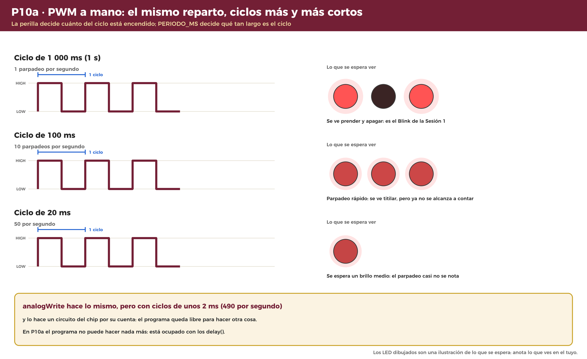

### Qué debe estar armado

Lo mismo que en P09: el **LED del pin 9** y el **potenciómetro en A0**. No hay nada nuevo que conectar (el diagrama de P10, más abajo, muestra el circuito completo).

### Código

Abre `curso-arduino/sketches/P10a_pwm_a_mano/P10a_pwm_a_mano.ino`, sube y gira la perilla.

```cpp
const int PERIODO_MS = 1000;      // duración de un ciclo completo

void loop() {
  int lectura = analogRead(PIN_PERILLA);                    // 0 a 1023
  int encendido = map(lectura, 0, 1023, 0, PERIODO_MS);     // milisegundos con el LED prendido
  int apagado = PERIODO_MS - encendido;                     // el resto del ciclo

  digitalWrite(PIN_LED, HIGH);
  delay(encendido);
  digitalWrite(PIN_LED, LOW);
  delay(apagado);
}
```

- Cada vuelta de `loop()` es **un ciclo**: el LED está encendido `encendido` milisegundos y apagado el resto.
- Con la perilla en un extremo `encendido` vale 0 (LED casi siempre apagado); en el otro vale `PERIODO_MS` (LED casi siempre encendido).
- La perilla se lee **una vez por ciclo**. Con `PERIODO_MS = 1000` el LED tarda hasta un segundo en responder a un cambio: el programa está ocupado con los `delay`.
- El programa **no escribe nada** en el Monitor Serie: cada línea tardaría tanto como el propio ciclo y estropearía el efecto.

### Qué debes ver

Con `PERIODO_MS = 1000`, el LED **parpadea**: con la perilla en un extremo casi no se enciende y en el otro casi no se apaga; a la mitad, medio segundo y medio segundo. Es lo que se espera: anota lo que veas.

### Explora (8 min)

Cambia `PERIODO_MS`, sube el programa cada vez y gira la perilla.

| `PERIODO_MS` | Qué anotar |
|---|---|
| 1000 | ¿Se ve parpadear? ¿Cuánto tarda en responder a la perilla? |
| 200 y 100 | ¿Sigue pareciendo parpadeo? ¿Se nota un temblor? |
| 20 | ¿Se ve brillo medio o todavía parpadea? (prueba también con la cámara del celular) |
| 10 | ¿Y ahora? ¿Qué pasa con los pasos de la perilla? (con 10 solo hay 10 niveles de brillo) |

**La conclusión.** A partir de cierto ciclo el ojo ya no ve el parpadeo y percibe un brillo **intermedio**: eso es PWM. `analogWrite` hace lo mismo con ciclos de **unos 2 milisegundos** (490 por segundo), con un circuito del propio chip, **sin ocupar el programa**. Por eso en P10 no hace falta ningún `delay` para mantener el brillo.

### Si no funciona

| Síntoma | Causa probable |
|---|---|
| El LED no enciende nunca | El cable morado no está en el pin 9; la perilla está en el extremo que da `encendido = 0` (gírala); el LED está al revés |
| El LED no responde a la perilla | El cable amarillo del centro no está en A0 (revisa como en P09) |
| Responde muy despacio | Es normal con `PERIODO_MS` grande: la perilla se lee una vez por ciclo |

### Evidencia para la bitácora

- El valor de `PERIODO_MS` en que **dejó de verse el parpadeo** (a simple vista) y qué se ve con la cámara del celular.
- Una frase: *«analogWrite lo hace más rápido y sin ocupar el programa»*.

---

## P10 · Perilla y brillo (≈40 min, con retos)

### Idea de la práctica

La perilla (entrada analógica, A0) controla el brillo del LED (salida PWM, pin 9). Se necesitan dos instrucciones nuevas: **`map`**, que convierte la lectura de 0-1023 en un brillo de 0-255, y **`analogWrite`**, que reparte el ciclo de PWM. **No hay nada nuevo que armar.**

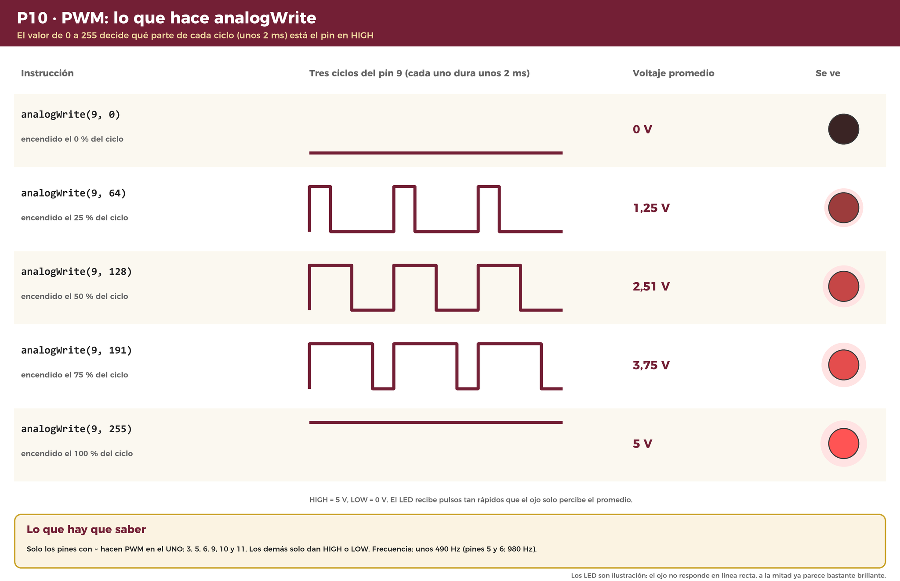

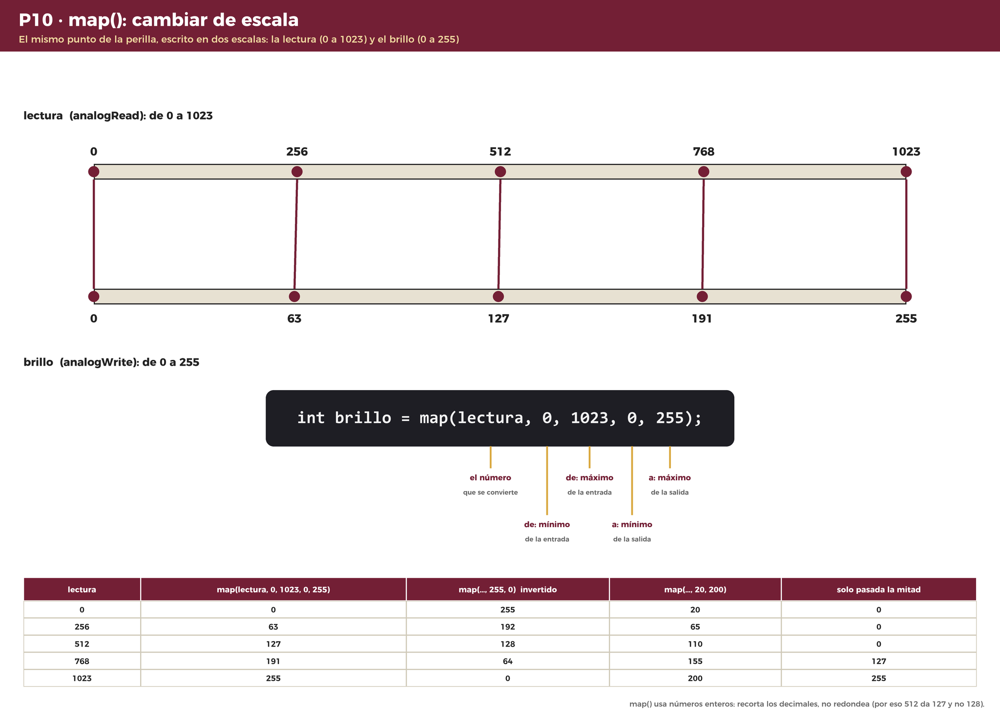

### Esquema de conexiones

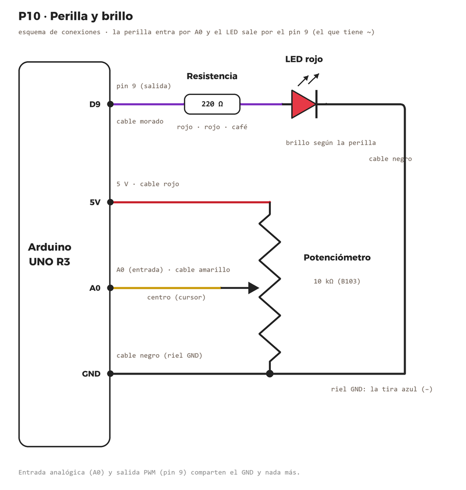

### Qué debe estar armado

| Pin | Qué | De dónde |
|---|---|---|
| 9 | LED con su resistencia de 220 Ω | Paso 0 |
| A0 | Centro del potenciómetro | P09 |
| 5V y GND | Extremos del potenciómetro | P09 |

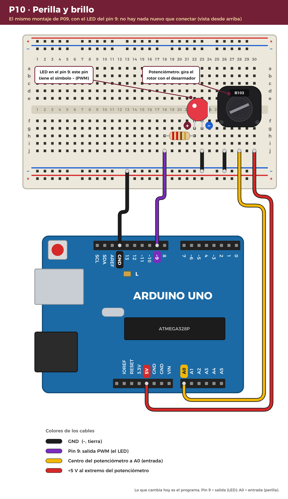

### Código: dos cosas nuevas

Abre `curso-arduino/sketches/P10_perilla_brillo/P10_perilla_brillo.ino`. Si vas a modificarlo, **Archivo → Guardar como…** con otro nombre (un solo `.ino` por carpeta).

```cpp
void loop() {
  int lectura = analogRead(PIN_PERILLA);          // 0 a 1023
  int brillo = map(lectura, 0, 1023, 0, 255);     // 0 a 255
  analogWrite(PIN_LED, brillo);

  Serial.print("Lectura:");
  Serial.print(lectura);
  Serial.print(",Brillo:");
  Serial.println(brillo);
  delay(50);
}
```

**Nuevo 1 · `map(valor, desdeMin, desdeMax, haciaMin, haciaMax)`.** Cambia un número de una escala a otra. Aquí, 0 se queda en 0, 1023 pasa a 255 y los demás quedan en proporción: 512 pasa a **127**. `map` usa números enteros: **recorta** los decimales, no redondea (por eso 512 da 127 y no 128).

**Nuevo 2 · `analogWrite(pin, valor)`.** El valor es de **0** (siempre apagado) a **255** (siempre encendido). Genera el PWM por su cuenta: después de esta línea el pin sigue encendiendo y apagando solo, hasta la siguiente orden. Solo funciona en los pines con **~**. El Language Reference del kit dice que no necesita `pinMode`; se deja para que el código diga claro que el pin es una salida.

**Lo que ya conoces.** `analogRead` y la lectura de P09; `Serial.print` de la Sesión 3. Los dos datos del `Serial.print` van con **nombre y dos puntos** (`Lectura:512,Brillo:127`) para que el Serial Plotter los dibuje, como en P09a; en el Monitor Serie también se leen bien.

### Qué debes ver

1. Al girar la perilla, el LED cambia **poco a poco** de apagado a su máximo brillo. Con la perilla en un extremo, el LED está apagado; en el otro, a tope. Recuerda que el ojo no responde en línea recta: **a la mitad del giro el LED ya se ve bastante brillante**.
2. El Monitor Serie escribe, por ejemplo: `Lectura:512,Brillo:127`.
3. Con el **Serial Plotter** se ven dos líneas de la **misma forma** y distinta altura: la lectura (de 0 a 1023) y el brillo (de 0 a 255). Ahí se ve qué hizo `map`.

### Modifica (retos)

1. **Básico:** que la perilla controle el brillo **al revés**. *Solución del instructor: `sketches/P10_brillo_invertido/`* (es el segundo de los arreglos del fallo de los extremos).
2. **Medio:** que el LED **solo encienda pasada la mitad** del giro (antes de la mitad, apagado; de la mitad al tope, de apagado a máximo). Pista: `map` con un rango de entrada distinto, y un `if` para el primer caso. *Solución del instructor: `sketches/P10_solo_pasada_la_mitad/`*. No es lo mismo que encender o apagar con un **umbral** (todo o nada): eso se ve en la Sesión 6.
3. **Medio:** que el brillo **nunca baje de 20 ni suba de 200**. *Solución del instructor: `sketches/P10_rango_20_200/`*.
4. **Medio:** cambiar el LED por **otro color**. ¿Se ve igual de brillante con el mismo valor? (El brillo depende también del color del LED.)
5. **Desafío:** un LED que **«respira»** solo, sin perilla: sube poco a poco al máximo y baja de nuevo. Pista: un `for` en el que el contador **es** el brillo, como la sirena de la Sesión 4. *Solución del instructor: `sketches/P10_led_respira/`*.

### Rompe y arregla

| Fallo plantado | Qué ocurre | Qué se aprende |
|---|---|---|
| **De cableado:** con el USB desconectado, **intercambiar los cables de los extremos** del potenciómetro | El brillo cambia **al revés**: sube al girar hacia donde antes bajaba | Dos soluciones, dos aprendizajes: cambiar los cables (hardware) o usar `map(lectura, 0, 1023, 255, 0)` (software). Es el reto 1 |
| **De cableado y de código:** pasar el cable morado al **pin 8** y escribir `const int PIN_LED = 8;` | Compila y sube, pero el LED ya no cambia de brillo poco a poco: **solo enciende o apaga**, y el cambio ocurre cerca de la **mitad del giro**. *Es lo que dice el código de Arduino y aún no lo he probado en la placa: anota lo que veas* | El pin 8 **no tiene ~**: en un pin sin PWM, `analogWrite` solo sabe poner `LOW` (valores menores de 128) o `HIGH` (de 128 en adelante) |
| **De código:** cambiar el último número de `map` a **100**: `map(lectura, 0, 1023, 0, 100)` | Compila y sube, pero el LED **nunca llega a su máximo**: el brillo se queda en 100 de 255 y el Monitor Serie muestra `Brillo:100` en el tope | Los dos últimos números de `map` son el **rango de salida**: si es chico, la salida es chica. Compara con el Plotter |

**No se planta** un fallo que conecte el centro del potenciómetro a 5 V o a GND, ni quitar `map` y escribir `analogWrite(PIN_LED, lectura)`: con lecturas de más de 255 el resultado de `analogWrite` no está definido y no está comprobado.

### Si no funciona

| Síntoma | Causa probable |
|---|---|
| El LED no enciende nunca | Cable morado en otro pin; LED al revés; la perilla en el extremo que da brillo 0 (gírala) |
| El LED siempre está al máximo | El cable amarillo (centro) está en 5 V, o `PIN_LED` apunta a un pin que está en `HIGH` |
| El LED no cambia con la perilla | El centro del potenciómetro no llega a A0 (revisa como en P09) |
| El LED solo enciende o apaga | El cable morado está en un pin sin **~** (8, 7, 4, 2...), o `PIN_LED` no es 9 |
| Parpadea o titila un poco | Un contacto flojo en el protoboard; vuelve a presionar las patas |
| El Serial Plotter muestra una sola línea | Faltan las comas o los dos puntos en el texto del `print` |

### Evidencia para la bitácora

- **Una captura del Serial Plotter** con las líneas de `Lectura` y `Brillo` al girar la perilla (o un video corto).
- El equipo explica **qué hace `map`** (con un ejemplo de números) y **qué es PWM**.
- Un reto resuelto (aunque sea el 1).

---

## Cierre de la sesión (10 min)

- En la bitácora: *«qué cambié, qué pasó, por qué»* para P09, P09a, P10a y P10, y el visto bueno del instructor en los tres puntos (funciona, lo explica, hizo una modificación propia).
- **No se desarma el circuito si sigue la Sesión 6 el mismo día**: el LED y los cables se reutilizan; el potenciómetro vuelve en P12. Si hay un descanso largo, se guarda el potenciómetro **sin forzar sus patas**.
- Pregunta de enlace con la Sesión 6: *«Hoy la resistencia variable la movíamos nosotros con un desarmador. ¿Y si fuera una resistencia que cambia sola con algo del ambiente, por ejemplo con la luz?»* (el sensor de luz es un divisor de voltaje igual que este: Sesión 6).

## Tu práctica: anota lo que encuentres

Haz las prácticas como lo haría un alumno y llena esto. Sirve para ajustar la sesión y las láminas.

| Dato | Anota aquí |
|---|---|
| Tiempo real del Paso 0, de P09, de P09a, de P10a y de P10 | |
| ¿Entró bien el potenciómetro en el protoboard? ¿Cuántos agujeros hay entre sus patas? ¿Van en línea? ¿El centro es la pata de en medio? | |
| ¿Es cómodo girarlo con el desarmador? ¿Qué desarmador usaste? ¿Cuántos grados de recorrido tiene? | |
| Número en los dos topes y a mitad del giro. ¿Llega a 0 y a 1023? ¿A la mitad sale cerca de 512? | |
| ¿Hacia dónde se gira (derecha o izquierda) para que el número suba con tu cableado? | |
| Ruido: ¿cuántos números «baila» la lectura con la perilla quieta? | |
| Si hay multímetro: voltaje del pin 5V de la placa; voltaje entre el cursor y GND; resistencia entre los dos extremos (¿10 kΩ?). ¿Coincide con lo que calcula el programa? | |
| ¿El Serial Plotter se abre bien con P09a? ¿Hay que cerrar el Monitor Serie? ¿Se ven las tres líneas? | |
| ¿La gráfica de la perilla es una recta o se tuerce? (si se tuerce, no es lineal) | |
| P10: ¿se ve parejo el cambio de brillo? ¿Desde qué punto del giro se nota que el LED enciende? ¿A la mitad cuánto brilla? | |
| P10a: ¿con qué `PERIODO_MS` dejó de verse el parpadeo a simple vista? ¿Y con la cámara del celular? | |
| P10a: con `PERIODO_MS = 1000`, ¿cuánto tarda el LED en responder a la perilla? | |
| ¿El fallo del pin 8 pasa lo que dice la guía (enciende o apaga cerca de la mitad)? | |
| ¿Funcionan los cuatro sketches de retos (invertido, solo pasada la mitad, 20 a 200 y respira)? ¿Qué ajustarías? | |
| Dudas o errores que tuviste | |
| Foto del circuito armado y captura del Serial Plotter | |

## Para recompilar o regenerar

- Los sketches se verifican con `curso-arduino/compilar-sketches.ps1` (66 en total).
- Los diagramas se generan con `python curso-arduino/diagramas/generar_diagramas.py P09 P10`. El script **comprueba las conexiones** al dibujar (por ejemplo, que el centro del potenciómetro llega a A0 y no toca 5 V ni GND, o que los extremos no se tocan) y se detiene si algo no coincide.
- Valores que **no** están verificados y salen de las hojas de datos o de la documentación de Arduino: la separación de las patas del potenciómetro, si es lineal, hacia dónde sube la lectura, el ruido de la lectura, cómo se ve el parpadeo del PWM a mano, cuánto brilla el LED a la mitad del giro, el comportamiento de `analogWrite` en un pin sin ~ (se espera encendido a partir de 128, según el código de Arduino) y el comportamiento exacto del Serial Plotter con `Min` y `Max`. Por eso están en la tabla de arriba.
