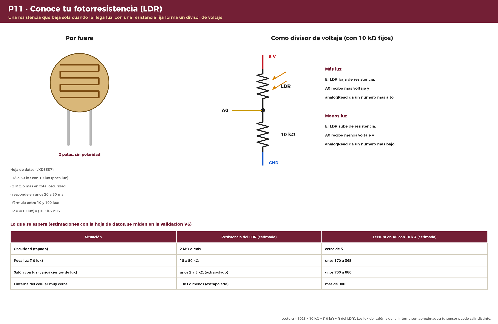
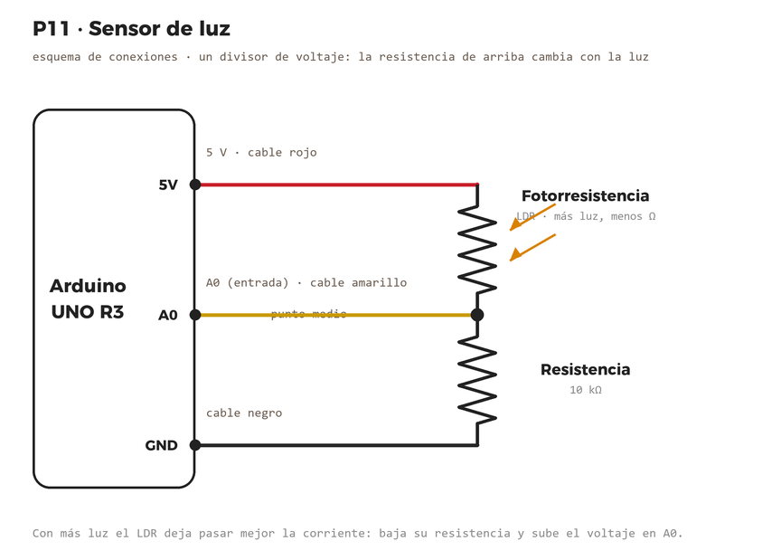
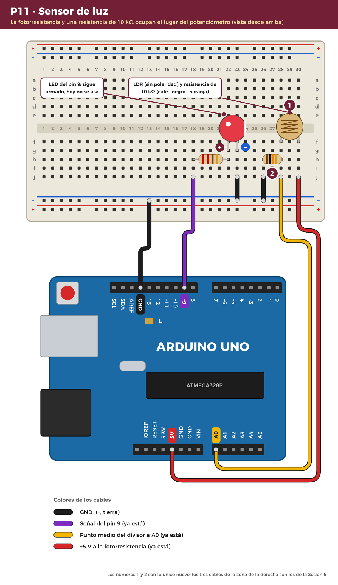
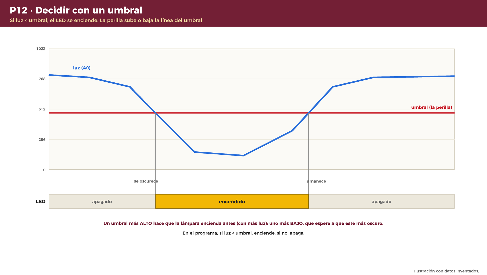
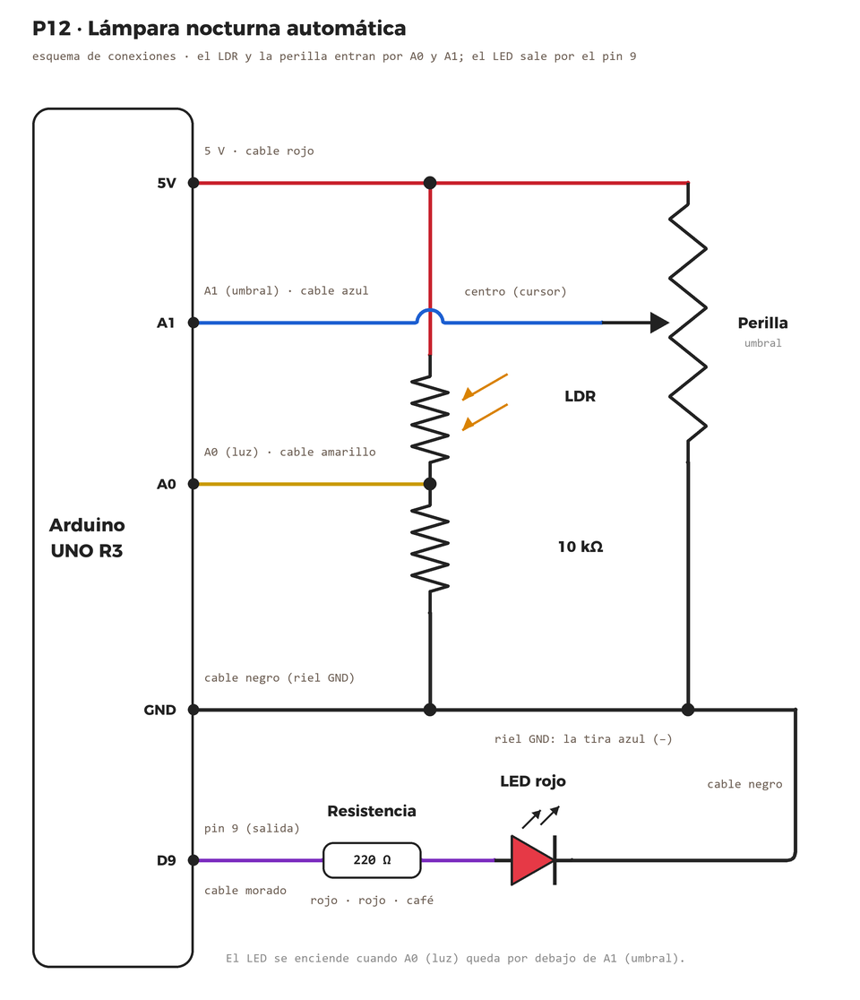
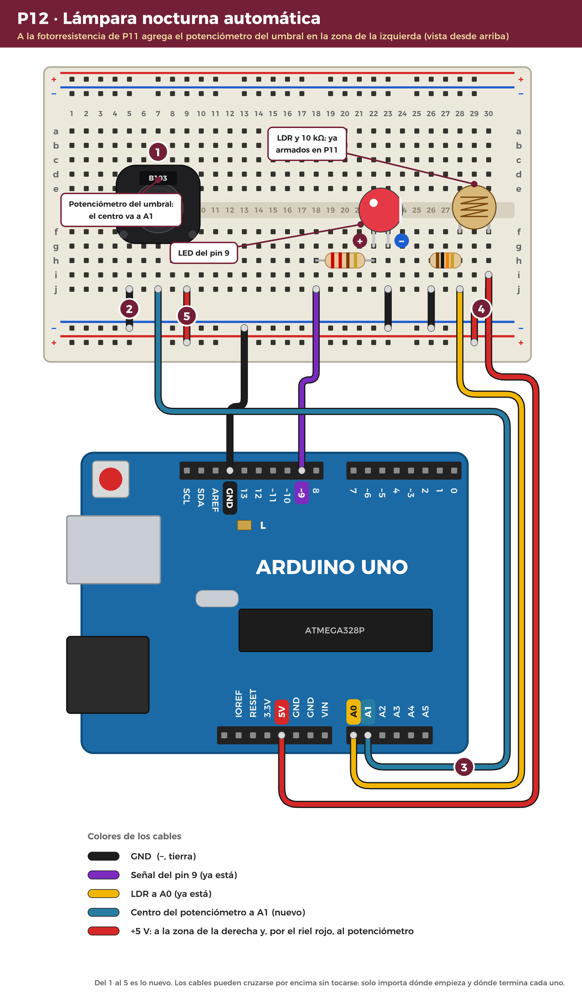
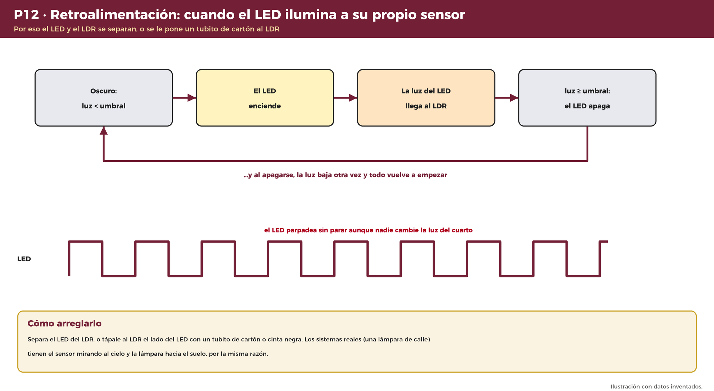

# Sesión 6 · Luz y decisiones

**Guía de práctica para el instructor** (de aquí saldrán después las láminas y las fichas de los alumnos)
**Prácticas y tiempos estimados (120 min):** idea 10 · P11 Sensor de luz 30 · P12 Lámpara nocturna automática (con retos y fallos) 60 · cierre 10 · holgura 10. Anota los tiempos reales en la tabla del final.
**Sketches:** `curso-arduino/sketches/P11_ldr_serie/` · `P12_lampara_automatica/` · soluciones de retos: `P12_media_luz/` y `P12_boton_de_paro/`
**Ideas nuevas de la sesión:** un **sensor resistivo** (una resistencia que cambia con el ambiente) se lee con el mismo divisor de voltaje de la perilla; con esa lectura el Arduino **decide** comparándola con un **umbral**; y una decisión mal diseñada puede **realimentarse** (el LED que ilumina a su propio sensor). Es la segunda sesión del primer día de la visita 2: **el circuito de la Sesión 5 sigue armado**.

## Cómo leer los diagramas de esta sesión

Hay dos diagramas por circuito (protoboard para **armar**, cableado para **entender**) y tres ayudas para las ideas nuevas:

| Diagrama | Para qué sirve |
|---|---|
| **Conoce tu fotorresistencia** (`P11_ldr_conoce.png`) | Qué es el LDR, cómo se convierte su resistencia en voltaje y qué números esperar (estimaciones) |
| **Protoboard y cableado de P11** (`P11_ldr_serie.png` y `_cableado.png`) | Cambiar el potenciómetro por el LDR y una resistencia de 10 kΩ |
| **Decidir con un umbral** (`P12_umbral.png`) | Cuándo enciende la lámpara según la luz y el umbral (ilustración) |
| **Protoboard y cableado de P12** (`P12_lampara_automatica.png` y `_cableado.png`) | Agregar el potenciómetro del umbral y ver todo el sistema |
| **Retroalimentación** (`P12_retroalimentacion.png`) | Por qué el LED no debe iluminar a su propio sensor (ilustración) |

## Materiales (lo que se agrega a la Sesión 5)

| Cantidad | Material |
|---|---|
| 1 | **Fotorresistencia** (LDR): disco con una pista en zigzag y dos patas. El kit trae 2 |
| 1 | Resistencia de **10 kΩ** (café · negro · naranja). El kit trae 10 |
| 1 | Potenciómetro (el de la Sesión 5; para P12 va en otro lugar) y su **desarmador plano pequeño** |
| 1 | Cable macho-macho **azul** (centro del potenciómetro a A1) y 2 cables **rojos** cortos (5 V al riel y del riel al potenciómetro) |
| 1 | **Linterna del celular** (de los alumnos) y un **tubito de cartón** o un poco de cinta negra para los fallos |
| 1 | *Solo para el reto del botón de paro:* un botón y un cable verde |

## La idea de la sesión (10 min, en el pizarrón)

1. **Hay sensores que son resistencias.** El potenciómetro era una resistencia que **tú** movías. La fotorresistencia (**LDR**, *light dependent resistor*) cambia **sola** con la luz: con más luz, **menos** resistencia.
2. **El Arduino lee voltajes, no resistencias.** Para leerla se pone en un **divisor de voltaje** con una resistencia fija de 10 kΩ, igual que el potenciómetro. Con el LDR del lado de 5 V: más luz → menos resistencia → **más** voltaje en A0 → número **más alto**.
3. **Decidir = comparar.** Un **umbral** es el número que separa «oscuro» de «hay luz». `if (luz < umbral)` enciende; si no, apaga.
4. **Calibrar.** El umbral correcto depende del salón y del sensor. En lugar de reprogramar, una **perilla** lo ajusta: la lectura de la perilla (A1) **es** el umbral.
5. **Retroalimentación.** Si la lámpara ilumina su propio sensor, el sistema se contradice solo: se enciende, el sensor ve luz, se apaga, el sensor ve oscuridad, se enciende… Pasa en cualquier sistema real con sensor y actuador cerca.

**Datos para el pizarrón** (de la hoja de datos del kit, `Datasheets/Photoresistor LXD-5537.pdf`)

- LDR LXD5537: **18 a 50 kΩ** a 10 lux · **2 MΩ o más** en total oscuridad · responde en **20 ms** al subir la luz y **30 ms** al bajar · fórmula entre 10 y 100 lux: R = R(10 lux) × (10 ÷ lux)^0,7.
- Con 10 kΩ fijos: lectura = 1023 × 10 kΩ ÷ (10 kΩ + R del LDR). En oscuridad total la lectura es de unas pocas unidades; con luz abundante pasa de 700. **Son estimaciones**: los lux del salón no están en ninguna hoja del kit (la validación V6 los mide).

---

## P11 · Sensor de luz (≈30 min)

### Idea de la práctica

Cambiar el potenciómetro por un LDR con una resistencia de 10 kΩ y ver cómo cambia el número al tapar el sensor o iluminarlo. **La zona de la derecha del protoboard ya está cableada** (los tres cables de la Sesión 5): solo cambia el componente que va entre ellos.

### Conoce tu fotorresistencia (5 min)



> **Para el instructor.** La tabla de «lo que se espera» sale de la hoja de datos con la fórmula de arriba, y **fuera de 10 a 100 lux es una extrapolación**. Los alumnos medirán los suyos; por eso la actividad pide **anotar** los números del salón. Compáralos con la tabla y anótalo en V6.

### Esquema de conexiones



El LDR hace de **resistencia de arriba** (del lado de 5 V) y la de 10 kΩ de **resistencia de abajo** (del lado de GND). A0 lee el punto medio.

### Conexión en el protoboard

**Con el USB desconectado.** Retira primero el **potenciómetro** (f26, f28 y f30); los **tres cables** de esa zona **se quedan donde están**: el negro de la columna 26, el amarillo de la 28 (a A0) y el rojo de la 30 (a 5 V).



| Paso | Qué | De | A |
|---|---|---|---|
| 1 | Fotorresistencia (sin polaridad) | una pata en **f28** | la otra pata en **f30** |
| 2 | Resistencia de **10 kΩ** (café · negro · naranja) | **h28** | **h26** |

> **La resistencia de la fila anterior abarca solo 2 agujeros** (de la columna 26 a la 28): su cuerpo mide más, así que se coloca **«parada»** (una pata en cada agujero y el cuerpo levantado) o con las patas dobladas hacia afuera. Pendiente de comprobar con el kit si cabe cómoda (V15).

> **Si el kit llegó desarmado** (por ejemplo, empezaste en esta sesión), primero arma los tres cables de la zona: cable **negro** de **j26** al riel azul (−) y otro negro de **GND** de la placa al riel azul; cable **amarillo** del pin **A0** a **j28**; cable **rojo** del pin **5V** a **j30**. Los de A0 y 5 V rodean la placa por la derecha, como en el diagrama de P09.

**Revisa antes de conectar el USB**

- [ ] Las dos patas del LDR están en **columnas distintas** (28 y 30).
- [ ] La resistencia es de **10 kΩ** (café · negro · naranja) y va de **h28** a **h26**, **no** de 220 Ω.
- [ ] El cable amarillo sigue en **j28** (la columna del punto medio) y va a **A0**.
- [ ] El rojo sigue en **j30** y el negro en **j26**.

### Código

Abre `curso-arduino/sketches/P11_ldr_serie/P11_ldr_serie.ino`, sube y abre el **Monitor Serie** (9600). Después cierra el Monitor y prueba **Herramientas → Serial Plotter**.

```cpp
void loop() {
  int luz = analogRead(PIN_LDR);
  Serial.println(luz);              // un solo número por línea para el Serial Plotter
  delay(100);
}
```

- Es **el mismo programa de P09 sin la cuenta del voltaje**: el LDR entra por A0 y se lee con `analogRead`. Al programa no le importa qué hay conectado: lee voltaje.
- Un solo número por línea: el Serial Plotter lo dibuja como una línea (como en P09a, sin nombre).

### Qué debes ver

Un número por línea que **baja al tapar** el LDR con la mano y **sube al iluminarlo** (**ejemplo con valores inventados**):

```
712
708
705
310
62
58
...
```

### Explora (10 min)

Cada equipo anota con números. Es la **evidencia** de la práctica.

| Qué probar | Qué anotar |
|---|---|
| Luz normal del salón | La lectura (anótala; la tabla del diagrama dice entre 700 y 880 si el salón está bien iluminado) |
| Mano a unos 5 cm sobre el LDR | La lectura |
| LDR tapado por completo (con el dedo o con un tubito de cartón) | La lectura (debe ser **muy baja**) |
| Linterna del celular a 5 cm | La lectura (debe ser **muy alta**) |
| Pasar la mano **despacio** sobre el LDR | La forma de la línea en el Serial Plotter: ¿sube y baja parejo? |
| Tapar y destapar **rápido** | Cuánto tarda el número en llegar a su valor (la hoja de datos dice 20 a 30 ms) |

> **¿Por qué «tapado» no da cero?** Aun tapado entra algo de luz por los lados y el LDR deja pasar una pizca de corriente. Con 2 MΩ en oscuridad total, la lectura queda en unos pocos números, no en 0 exacto.

### Modifica (retos)

1. **Básico:** anota la lectura con la luz del salón, con la mano encima y con la linterna del celular.
2. **Medio:** elige **un número** que sirva de umbral para decir «está oscuro» y explica por qué ese. (Se usa en P12.)
3. **Desafío:** calcula la **resistencia del LDR** en cada caso con la fórmula del divisor despejada: R ≈ 10 000 × (1023 ÷ lectura − 1). ¿Coincide con la hoja de datos (18 a 50 kΩ en poca luz)?

### Rompe y arregla

| Fallo plantado | Qué ocurre | Qué se aprende |
|---|---|---|
| **De cableado:** con el USB desconectado, **quitar la resistencia de 10 kΩ** | La lectura se queda **cerca de 1023** y casi no cambia con la luz. *Se espera por el circuito; anota lo que veas* | Sin la resistencia de abajo no hay divisor: A0 queda «colgando» del lado de 5 V |
| **De cableado:** **intercambiar los extremos** de los cables rojo y negro de las columnas 30 y 26 (el rojo pasa a **j26** y el negro a **j30**) | El sensor funciona, pero **al revés**: con más luz el número **baja** | El orden de las dos resistencias del divisor decide si «más luz» es un número más alto o más bajo. Es el fallo de los extremos del potenciómetro, con un sensor |

### Si no funciona

| Síntoma | Causa probable |
|---|---|
| El número no cambia con la luz | El cable amarillo no está en la columna del punto medio o no llega a A0; el LDR o la resistencia no hacen contacto |
| Siempre cerca de 1023 | No está la resistencia de 10 kΩ, o el cable negro (GND) está suelto |
| Siempre cerca de 0 | El cable rojo (5 V) está suelto, o el LDR está en corto |
| El número salta sin control | El cable amarillo está suelto o A0 no está conectado |
| Cambia muy poco | La luz del salón es muy pareja: prueba con la linterna del celular y con el LDR tapado |

### Evidencia para la bitácora

- La **tabla de lecturas** con la luz del salón, con la mano encima y con la linterna del celular, y el umbral elegido.
- El equipo explica **por qué un divisor de voltaje** sirve para leer un sensor resistivo.

---

## P12 · Lámpara nocturna automática (≈60 min)

### Idea de la práctica

El LED del pin 9 se enciende solo cuando **hay poca luz**. La **perilla** (A1) ajusta qué tan oscuro debe estar: es el **umbral**. Es el primer sistema con dos entradas analógicas y una salida: **medir, comparar, actuar**.



### Esquema de conexiones



### Conexión en el protoboard

**Con el USB desconectado**, sobre el circuito de P11. El potenciómetro va **a la izquierda**, en las columnas 5, 7 y 9, y toma los 5 V del **riel rojo**. Hasta hoy solo se usaba el riel azul (GND); **el riel rojo (+) recibirá los 5 V** para repartirlos.



| Paso | Qué | De | A |
|---|---|---|---|
| 1 | Potenciómetro | patas en **f5**, **f7** y **f9** (cada una en su columna) | el centro (f7) es el cursor |
| 2 | Cable negro | **j5** (la columna del extremo izquierdo) | riel azul **−** (debajo de la columna 5) |
| 3 | Cable azul | pin **A1** de la placa (hilera de abajo) | **j7** (la columna del centro) |
| 4 | Cable rojo (5 V al riel) | **i30** (la misma columna que el cable rojo de 5 V) | riel rojo **+** (debajo de la columna 29) |
| 5 | Cable rojo | riel rojo **+** (debajo de la columna 9) | **j9** (la columna del extremo derecho) |

El cable azul de **A1** rodea la placa por la derecha junto con los de A0 y 5 V y **cruza por encima** los cables de GND y del pin 9: no se tocan. Los pasos 4 y 5 llevan el **5 V de la columna 30 al riel rojo** y de ahí al potenciómetro.

**Revisa antes de conectar el USB**

- [ ] El cable **azul** va a la columna del **centro** (j7) y a **A1**; **no** va a 5 V ni a GND.
- [ ] El riel rojo (+) está conectado **solo** al 5 V (cable del paso 4) y al extremo del potenciómetro (paso 5); **nunca** toca el riel azul.
- [ ] El LDR y la resistencia de 10 kΩ siguen como en P11.
- [ ] El LED del pin 9 sigue armado con su resistencia de 220 Ω.

### Código

Abre `curso-arduino/sketches/P12_lampara_automatica/P12_lampara_automatica.ino`, sube y abre el **Serial Plotter** (9600).

```cpp
void loop() {
  int luz = analogRead(PIN_LDR);
  int umbral = analogRead(PIN_PERILLA);

  if (luz < umbral) {
    digitalWrite(PIN_LED, HIGH);    // está oscuro: enciende
  } else {
    digitalWrite(PIN_LED, LOW);     // hay luz: apaga
  }

  Serial.print("luz:");
  Serial.print(luz);
  Serial.print(",umbral:");
  Serial.println(umbral);
  delay(100);
}
```

- **Dos entradas analógicas:** A0 (la luz) y A1 (la perilla). Las dos se leen con `analogRead` y se **comparan** con `<`.
- `if (luz < umbral)` es la **decisión**: si la luz queda por debajo del umbral, está «oscuro».
- Los datos se escriben con **nombre y dos puntos** (`luz:712,umbral:480`) para que el Serial Plotter dibuje **dos líneas**, como en P10.

### Qué debes ver

1. En el **Serial Plotter**, una línea para `luz` y otra para `umbral`. Al girar la perilla, la línea del umbral sube y baja; al tapar el LDR, la de la luz cae.
2. El LED **se enciende cuando la línea de la luz queda por debajo de la del umbral**.

### Explora (15 min): calibrar la lámpara

| Qué probar | Qué anotar |
|---|---|
| Con la luz del salón, **sube el umbral** (gira la perilla) hasta que el LED encienda | El valor de la línea del umbral en ese momento: es «la luz del salón» medida por la perilla |
| **Baja el umbral** hasta que el LED apague otra vez | El valor |
| Deja el umbral **a medio camino** entre la luz del salón y la luz de la mano tapando | Que **tapando con la mano** el LED enciende y **destapando** apaga |
| Pon el umbral **justo** en el valor de la luz del salón | Si el LED **parpadea** (la luz y el umbral se cruzan por el ruido de la lectura) |

> **Lo último es una pista.** El LED que parpadea cuando la luz anda cerca del umbral es un problema real de cualquier decisión con umbral. La Sesión 12 enseña la solución (la **histéresis**).

### Modifica (retos)

1. **Básico:** cambia `luz < umbral` por `luz > umbral`. Ahora el LED enciende con **luz** y apaga en la oscuridad. ¿Para qué serviría? (Por ejemplo, para avisar que alguien abrió una caja o un cajón.)
2. **Medio:** que el LED encienda **a la mitad de su brillo**. Pista: el pin 9 tiene ~, y `analogWrite(PIN_LED, 128)` enciende a media luz. *Solución del instructor: `sketches/P12_media_luz/`.*
3. **Desafío:** un **botón de paro**: un toque apaga la lámpara aunque esté oscuro, y otro toque la deja otra vez en automático. Une la variable de estado de la Sesión 3 con esta sesión. *Solución del instructor: `sketches/P12_boton_de_paro/`.* El botón se arma como en la Sesión 3: una pata al **pin 2** y la pata **opuesta** (en diagonal) a **GND**; colócalo en las columnas 12 a 14, que están libres.

### Rompe y arregla

| Fallo plantado | Qué ocurre | Qué se aprende |
|---|---|---|
| **De uso:** **acercar el LED al LDR** (a un centímetro, apuntándole) y poner el umbral cerca de la luz del salón | La lámpara **parpadea sin parar** aunque nadie cambie la luz | **Retroalimentación:** la luz de la lámpara cambia lo que mide el sensor. Se arregla separando el LED del LDR o poniéndole al LDR un **tubito de cartón** o cinta negra |
| **De cableado:** con el USB desconectado, **soltar el cable azul** de j7 (o pasarlo a otro pin) | El LED **enciende y apaga sin sentido** y la línea del umbral se ve desordenada | Una entrada analógica sin conectar «flota», igual que en la Sesión 5 |



### Si no funciona

| Síntoma | Causa probable |
|---|---|
| El LED nunca enciende | El umbral está muy bajo (gira la perilla hacia el otro lado); el LED está al revés; el cable morado no está en el pin 9 |
| El LED siempre enciende | El umbral está muy alto; o el LDR está tapado todo el tiempo |
| La línea del umbral no se mueve al girar la perilla | El cable azul no llega a A1; el rojo del riel no llega a j9; el negro de j5 está suelto |
| La línea de la luz no cambia al tapar | Revisa P11 (cable amarillo, resistencia de 10 kΩ) |
| El LED parpadea con la luz quieta | El umbral está muy cerca de la luz del salón (es el ruido); o el LED ilumina al LDR |

### Evidencia para la bitácora

- El valor del **umbral que funcionó** en el salón y un **video corto** de la lámpara encendiendo al tapar el LDR.
- El equipo explica **qué es el umbral** y **qué es la retroalimentación** con un ejemplo.
- Un reto resuelto (aunque sea el 1).

---

## Cierre de la sesión (10 min)

- En la bitácora: *«qué cambié, qué pasó, por qué»* para P11 y P12, y el visto bueno del instructor en los tres puntos (funciona, lo explica, hizo una modificación propia).
- **Es el final del primer día de la visita 2:** desarmar y guardar el kit completo. Los **LDR** y las resistencias de 10 kΩ **por separado y marcados**, los **potenciómetros sin forzar sus patas**, el LED con su resistencia de 220 Ω y los cables por color. Contar con la hoja de inventario.
- Pregunta de enlace con la Sesión 7: *«Hoy el Arduino decidió prender o apagar un LED. ¿Y si en lugar de encender algo tuviera que **mover** algo a un ángulo preciso, por ejemplo una barrera?»* (el servo: Sesión 7).

## Tu práctica: anota lo que encuentres

Haz las prácticas como lo haría un alumno y llena esto. Sirve para ajustar la sesión y las láminas. **Lo del LDR cubre la validación V6 del plan.**

| Dato | Anota aquí |
|---|---|
| Tiempo real de P11 y de P12 | |
| ¿Entró bien el LDR en el protoboard? ¿Cuántos agujeros hay entre sus patas? | |
| Lectura del LDR: luz normal del salón / mano encima / linterna del celular / tapado por completo | |
| ¿Coinciden con la tabla estimada de `P11_ldr_conoce.png` (700 a 880 en el salón, cerca de 5 en oscuridad)? | |
| Con las lecturas, resistencia estimada del LDR en cada caso (R ≈ 10 000 × (1023 ÷ lectura − 1)) | |
| Tiempo que tarda el número en llegar a su valor al tapar y destapar rápido | |
| ¿Funciona el fallo «sin la resistencia de 10 kΩ» (lectura cerca de 1023)? ¿Y el de intercambiar los extremos? | |
| P12: umbral que funcionó en el salón (valor de la línea del umbral) | |
| P12: ¿llegó el riel rojo con 5 V (el potenciómetro responde)? ¿Alcanzan los cables rojos cortos? | |
| P12: ¿parpadea el LED con la luz cerca del umbral? ¿A partir de cuántos números de diferencia deja de parpadear? | |
| P12: ¿parpadea al acercar el LED al LDR (retroalimentación)? ¿A qué distancia? ¿Lo arregla el tubito de cartón? | |
| ¿Funcionan `P12_media_luz` y `P12_boton_de_paro`? ¿El botón de paro cambia solo una vez por toque? | |
| Dudas o errores que tuviste | |
| Foto del circuito armado y captura del Serial Plotter con `luz` y `umbral` | |

## Para recompilar o regenerar

- Los sketches se verifican con `curso-arduino/compilar-sketches.ps1`.
- Los diagramas se generan con `python curso-arduino/diagramas/s06_s08.py P11 P12`. El script **comprueba las conexiones** al dibujar (por ejemplo, que A0 llega al punto medio del divisor y no toca 5 V ni GND, o que el centro de la perilla llega a A1) y se detiene si algo no coincide.
- Valores que **no** están verificados: las lecturas del LDR en el salón (la tabla es una estimación con la fórmula de la hoja de datos), la separación de las patas del LDR, el comportamiento sin la resistencia de 10 kΩ, y el parpadeo cerca del umbral.
