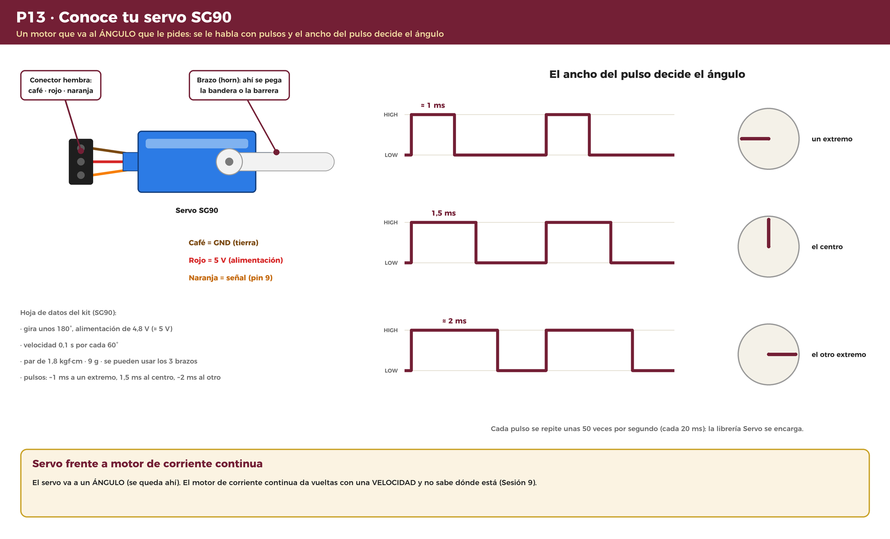
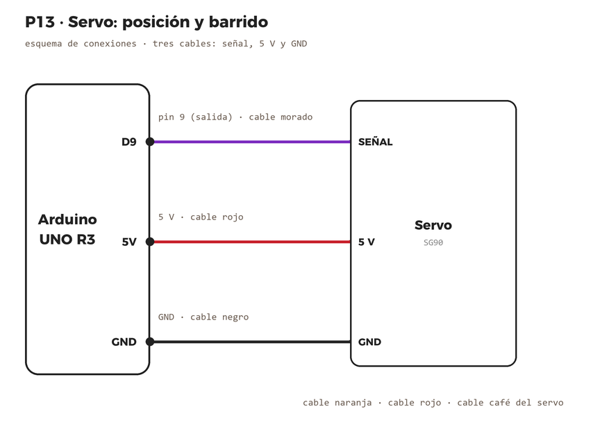
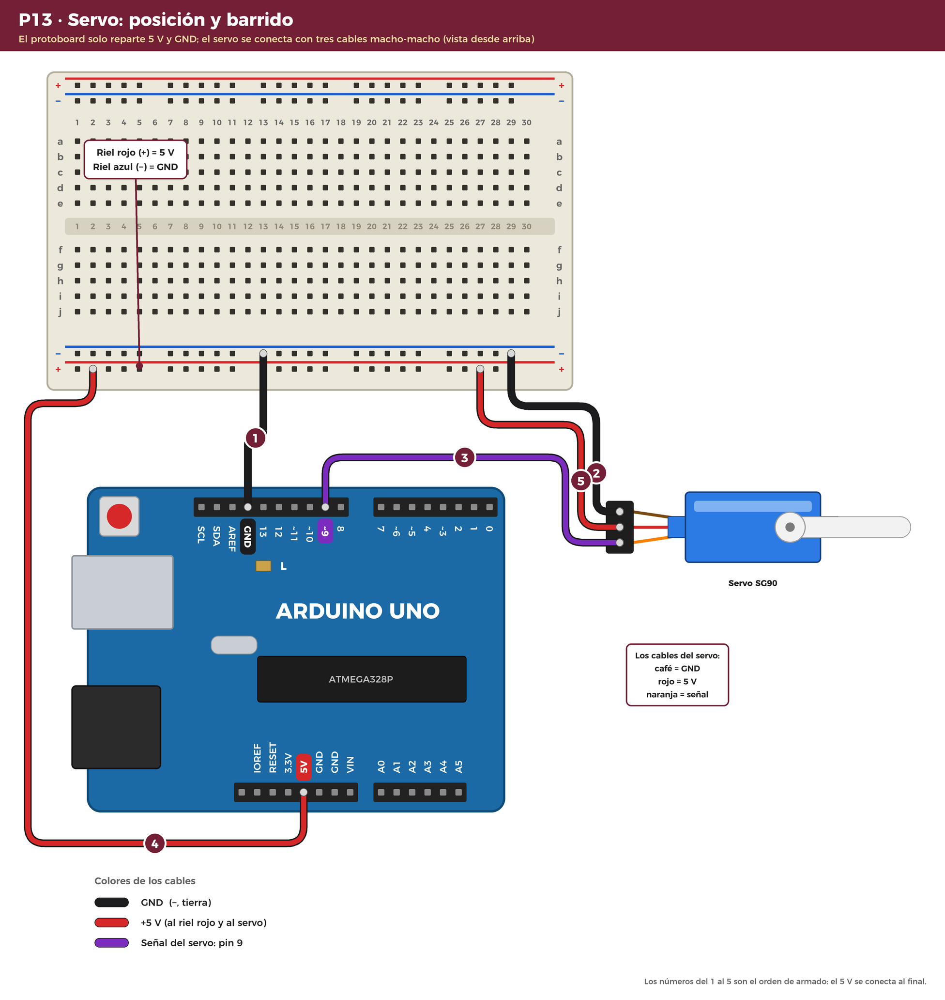
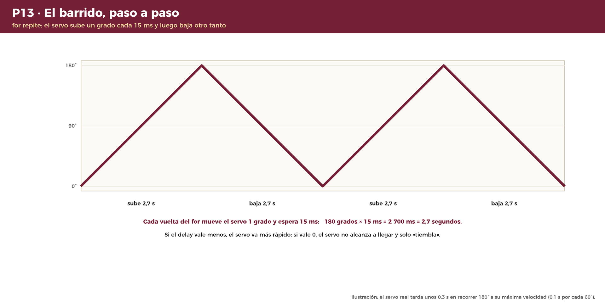
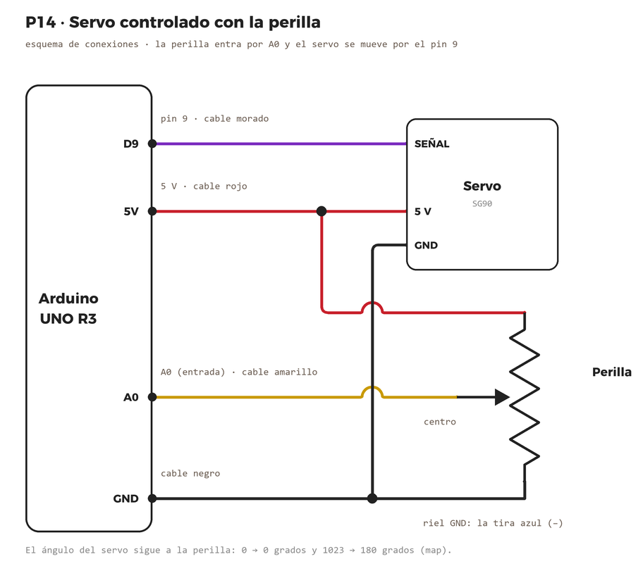
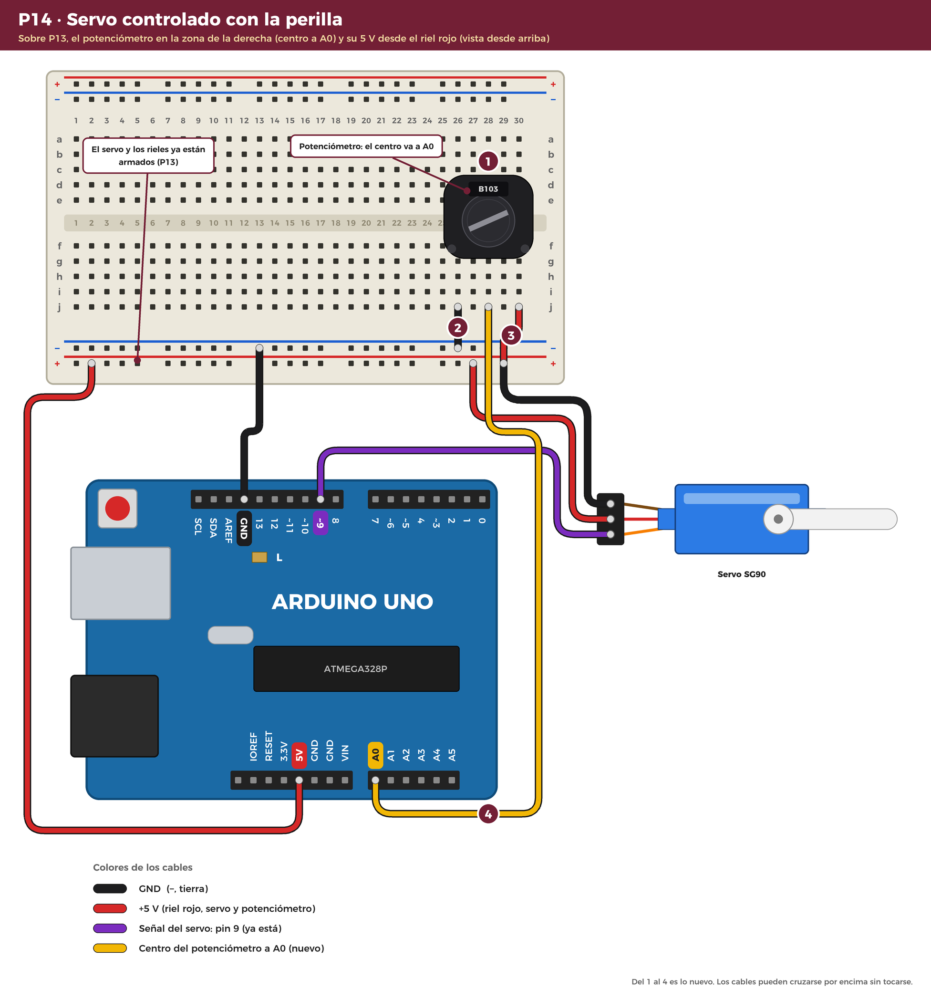

# Sesión 7 · Servo

**Guía de práctica para el instructor** (de aquí saldrán después las láminas y las fichas de los alumnos)
**Prácticas y tiempos estimados (120 min):** idea 10 · P13 Servo: posición y barrido (con los rieles) 55 · P14 Servo controlado con la perilla 35 · cierre 10 · holgura 10. Anota los tiempos reales en la tabla del final.
**Sketches:** `curso-arduino/sketches/P13_servo_barrido/` · `P14_servo_perilla/` · soluciones de retos: `P13_rango_45_135/`, `P13_saludo/`, `P14_servo_limitado/` y `P14_servo_invertido/`
**Ideas nuevas de la sesión:** un **servo** va a un **ángulo** que se le pide (no da vueltas libres); se le habla con **pulsos** y una **librería** (`Servo`) se encarga; el protoboard se usa para **repartir 5 V y GND** con sus rieles. Es la primera sesión del segundo día de la visita 2 (con la Sesión 8, termina con la barrera automática). **El kit llega desarmado del día anterior.**

## Cómo leer los diagramas de esta sesión

Hay dos diagramas por circuito (protoboard para **armar**, cableado para **entender**) y dos ayudas para las ideas nuevas:

| Diagrama | Para qué sirve |
|---|---|
| **Conoce tu servo** (`P13_servo_conoce.png`) | Las partes y los cables del SG90, y cómo el ancho del pulso decide el ángulo |
| **Protoboard y cableado de P13** (`P13_servo_barrido.png` y `_cableado.png`) | Armar los rieles y conectar el servo |
| **El barrido, paso a paso** (`P13_barrido.png`) | Qué hace el `for` del barrido y cuánto tarda (ilustración) |
| **Protoboard y cableado de P14** (`P14_servo_perilla.png` y `_cableado.png`) | Agregar el potenciómetro |

## Materiales

| Cantidad | Material |
|---|---|
| 1 | **Servo SG90** con su brazo (el kit trae 3 brazos y tornillos) |
| 1 | Potenciómetro (para P14) y su **desarmador plano pequeño** |
| 4 | Cables macho-macho: **2 negros** (GND de la placa al riel y GND del servo), **2 rojos** (5 V de la placa al riel y 5 V del servo) y **1 morado** (señal al pin 9). En P14: 1 negro, 1 rojo corto y 1 amarillo más |
| — | Una **bandera de papel** o un palito de paleta, y cinta, para los retos |

> **Cables del servo.** El conector hembra del servo tiene tres colores: **café** (GND), **rojo** (5 V) y **naranja** (señal). Los cables macho-macho se meten en ese conector y los otros extremos van a la placa o al protoboard. **No inviertas el rojo y el café:** el servo podría dañarse.

## La idea de la sesión (10 min, en el pizarrón)

1. **Un servo va a un ángulo.** Un motor de corriente continua da vueltas con una velocidad y no sabe dónde está. Un **servo** tiene un motor, unos engranes y un circuito que busca la posición que se le pide: de 0 a unos 180 grados.
2. **Se le habla con pulsos.** Cada 20 ms (unas 50 veces por segundo) el Arduino manda un pulso; el **ancho** del pulso decide el ángulo. Según la hoja de datos del kit: ≈1 ms en un extremo, 1,5 ms al centro, ≈2 ms en el otro. La librería **`Servo`** (viene con el IDE) hace la traducción: `miServo.write(90)` y listo.
3. **Una librería es código ya hecho.** `#include <Servo.h>` la trae; `Servo miServo;` crea «un servo» con nombre; `attach(9)` le dice en qué pin está; `write(ángulo)` lo mueve. Es la primera vez que se usa un **objeto**.
4. **Alimentación aparte de la señal.** El servo tiene tres cables: señal, 5 V y GND. La señal es un pulso de poca corriente; el 5 V mueve el motor y **pide más corriente** que un LED.
5. **Los rieles reparten.** Los rieles rojo (+) y azul (−) del protoboard llevan 5 V y GND a donde se necesiten, sin que cada componente use un pin de la placa. **Hoy se arman los dos.**

**Datos para el pizarrón** (de la hoja de datos y la lección 17 del kit)

- SG90: 9 g · gira unos 180° · alimentación de 4,8 V (≈5 V) · velocidad 0,1 s por cada 60° · par de 1,8 kgf·cm · banda muerta de 10 µs · trae 3 brazos y tornillos.
- Pulsos: ≈1 ms a un extremo, 1,5 ms al centro, ≈2 ms al otro. La librería Servo traduce `write(0)` a `write(180)` en pulsos de unos 0,5 a 2,4 ms, un poco más amplios que los de la hoja de datos.

---

## P13 · Servo: posición y barrido (≈55 min)

### Idea de la práctica

Conectar el servo, verlo ir al centro y luego **barrer** de 0 a 180 grados y de vuelta con un `for`. De paso se arman los **rieles**: el 5 V y el GND llegan a ellos y de ahí al servo.

### Conoce tu servo (5 min)



> **Para el instructor.** Es el momento de explicar que **el servo no es un LED**: si se atora o se fuerza, consume mucho más. **No se fuerza el brazo con la mano mientras está energizado** y no se bloquea con un objeto. Mide el consumo real (V9) si hay multímetro.

### Esquema de conexiones



### Conexión en el protoboard

**Con el USB desconectado.** Los números del diagrama son el orden de armado: **primero GND, al final el 5 V**.



| Paso | Qué | De | A |
|---|---|---|---|
| 1 | Cable negro | **GND** de la placa (hilera de arriba) | riel azul **−** (debajo de la columna 13) |
| 2 | Cable negro | **conector del servo, agujero del cable café** (el de arriba) | riel azul **−** (debajo de la columna 29) |
| 3 | Cable morado | **conector del servo, agujero del cable naranja** (el de abajo) | **pin 9** de la placa |
| 4 | Cable rojo | **5V** de la placa (hilera de abajo; rodea la placa por la izquierda) | riel rojo **+** (debajo de la columna 2) |
| 5 | Cable rojo | **conector del servo, agujero del cable rojo** (el de en medio) | riel rojo **+** (debajo de la columna 27) |

El protoboard queda **vacío**: solo sus rieles reparten la energía. Los cables del servo salen por la derecha; el de la señal cruza por encima de los otros sin tocarlos.

**Revisa antes de conectar el USB**

- [ ] **Café a GND** (riel azul), **rojo a 5 V** (riel rojo), **naranja al pin 9**: revisa los colores del conector antes de meter cada cable.
- [ ] El riel rojo (+) y el azul (−) **no se tocan** entre sí y cada uno tiene un solo cable de la placa.
- [ ] El brazo del servo **no está atornillado todavía**: se coloca después de ver que el servo va al centro.

### Código

Abre `curso-arduino/sketches/P13_servo_barrido/P13_servo_barrido.ino` (**Archivo → Abrir**) y sube.

```cpp
#include <Servo.h>

Servo miServo;                  // objeto que representa al servo
const int PIN_SERVO = 9;

void setup() {
  miServo.attach(PIN_SERVO);
  miServo.write(90);            // posición central
  delay(1000);
}

void loop() {
  for (int angulo = 0; angulo <= 180; angulo++) {
    miServo.write(angulo);
    delay(15);                  // da tiempo al servo para llegar
  }
  for (int angulo = 180; angulo >= 0; angulo--) {
    miServo.write(angulo);
    delay(15);
  }
}
```

- `#include <Servo.h>` trae la librería; `Servo miServo;` crea el servo; `miServo.attach(PIN_SERVO)` le dice en qué pin va.
- `miServo.write(90)` manda al servo al **centro**. En `loop`, el **`for`** de la Sesión 4 barre todos los ángulos: aquí el contador **es** el ángulo.
- `angulo--` es lo contrario de `angulo++`: resta 1 en cada vuelta (como `f = f - PASO` de la sirena).
- Cada grado espera **15 ms** (`delay(15)`): 180 grados × 15 ms = **2,7 segundos** de ida.



### Qué debes ver

1. Al subir, el servo se va al **centro** (90°) y espera un segundo.
2. Luego **barre** de un extremo al otro en unos 2,7 s y regresa. Se repite.
3. **Pon el brazo:** con el servo en el centro (justo después de subir), presiona el brazo en el eje en posición recta, mirando a un lado. Se atornilla con el tornillo pequeño. Si el brazo no queda bien, se saca con cuidado y se vuelve a poner.

### Explora (10 min)

| Qué probar | Qué anotar |
|---|---|
| Cambiar `delay(15)` por **30** y por **5** | Cómo cambia la velocidad del barrido. ¿Qué pasa con **1**? |
| `delay(0)` (quita el `delay`) | Si el servo alcanza a llegar o solo «tiembla» |
| Mirar los **extremos** (0 y 180) | Si el servo **zumba** al llegar a los topes (la librería puede pedir un poco más de lo que da el servo; si zumba, usa de 10 a 170) |
| Poner la mano **sin forzar** en el brazo mientras se mueve | Si se nota fuerza al frenarlo |

### Modifica (retos)

1. **Básico:** cambia el `delay(15)` y observa la velocidad.
2. **Medio:** que el servo vaya **solo de 45 a 135 grados**. *Solución del instructor: `sketches/P13_rango_45_135/` (los límites son constantes con nombre).*
3. **Desafío:** pega una **bandera de papel** al brazo y haz que **salude** (tres vaivenes cortos y descanso). *Solución del instructor: `sketches/P13_saludo/`.*

### Rompe y arregla

| Fallo plantado | Qué ocurre | Qué se aprende |
|---|---|---|
| **De cableado:** con el USB desconectado, pasar el cable morado del **pin 9** al **pin 10** | Compila y sube, pero el servo **no se mueve** | El número del código (`PIN_SERVO = 9`) es el pin físico, como en la Sesión 1 |
| **De cableado:** con el USB desconectado, **quitar el cable rojo (5 V)** del servo | El servo **no se mueve ni hace ruido** | Sin 5 V no hay energía: la señal sola no basta. **No se quita el cable de GND** como fallo: sin GND el servo podría buscar su camino de regreso por la señal y forzar el pin |
| **De código:** cambiar `delay(15)` por `delay(0)` | El servo se ve nervioso: no alcanza a llegar a cada ángulo antes de recibir el siguiente. *Aún no lo he probado en la placa: anota lo que veas* | Un servo necesita **tiempo** para llegar: el `delay` no es adorno |

### Si no funciona

| Síntoma | Causa probable |
|---|---|
| El servo no se mueve | Cable morado fuera del pin 9; cable rojo o café mal conectado; el conector está al revés; el servo está bloqueado |
| El servo se mueve a saltos, **zumba** o tiembla | Poca corriente (ver abajo); el brazo está topando en un extremo; contacto flojo en un cable |
| El **Arduino se reinicia** cuando el servo arranca o se mueve (el LED de la placa parpadea y el Monitor Serie se desconecta) | El USB no alcanza a dar la corriente del servo: ver el «Plan B» |
| El servo se mueve solo, sin sentido | El cable de señal está suelto o en un pin que no es el 9 |
| Se calienta el servo | Está trabado o forzado: **desconecta el USB** y revisa que el brazo no toque nada |

> **Plan B (solo si el Arduino se reinicia o el servo tiembla):** alimentar el servo con el **módulo de fuente** del kit (el mismo de la Sesión 9). El módulo se monta en los rieles con su **(−) en el riel azul** y su **(+) en el riel rojo**, el jumper en **5 V** y se enchufa el adaptador de 9 V. **Hay que quitar el cable rojo de 5 V de la placa (paso 4)** para no unir dos fuentes de 5 V; el GND de la placa sigue unido al riel azul. Se anota en V9.

### Evidencia para la bitácora

- El servo hace el barrido y el equipo explica **qué hace el `for`**, **qué hace `write`** y **por qué el servo va a un ángulo y no da vueltas**.
- Un reto resuelto (aunque sea el 1).

---

## P14 · Servo controlado con la perilla (≈35 min)

### Idea de la práctica

La **perilla** decide el ángulo del servo: es la misma conversión de la Sesión 5 (`map`), pero ahora la escala de salida es de **0 a 180 grados** en lugar de 0 a 255. El potenciómetro va en la **zona de la derecha** (columnas 26, 28 y 30), como en las Sesiones 5 y 6, y toma su 5 V del riel rojo.

### Esquema de conexiones



### Conexión en el protoboard

**Con el USB desconectado**, sobre el circuito de P13.



| Paso | Qué | De | A |
|---|---|---|---|
| 1 | Potenciómetro | patas en **f26**, **f28** y **f30** (cada una en su columna) | el centro (f28) es el cursor |
| 2 | Cable negro | **j26** | riel azul **−** (debajo de la columna 26) |
| 3 | Cable rojo (corto) | riel rojo **+** (debajo de la columna 29) | **j30** |
| 4 | Cable amarillo | pin **A0** de la placa (hilera de abajo; rodea la placa por la derecha) | **j28** |

**Revisa antes de conectar el USB**

- [ ] El **cable amarillo** va al **centro** (j28) y a **A0**; el rojo, a un extremo; el negro, al otro.
- [ ] El servo sigue como en P13.

### Código

Abre `curso-arduino/sketches/P14_servo_perilla/P14_servo_perilla.ino`.

```cpp
void loop() {
  int lectura = analogRead(PIN_PERILLA);
  int angulo = map(lectura, 0, 1023, 0, 180);
  miServo.write(angulo);
  delay(15);
}
```

- Es lo de P10 con un cambio: el rango de salida es **0 a 180** y la salida se manda a `miServo.write` en lugar de `analogWrite`.
- Algunos valores de ejemplo de `map(lectura, 0, 1023, 0, 180)`: 0 → 0°, 256 → 45°, 512 → 90°, 768 → 135°, 1023 → 180°.

### Qué debes ver

El servo **sigue** a la perilla: al girarla, el brazo se mueve al ángulo correspondiente; con la perilla quieta, el brazo se queda quieto (puede «bailar» un grado por el ruido de la lectura).

### Modifica (retos)

1. **Básico:** que el movimiento quede limitado entre **30 y 150 grados**. *Solución del instructor: `sketches/P14_servo_limitado/` (también muestra el ángulo en el Monitor Serie).*
2. **Medio:** que el servo se mueva **al revés** respecto a la perilla. Pista: `map(lectura, 0, 1023, 180, 0)`. *Solución del instructor: `sketches/P14_servo_invertido/`.*
3. **Desafío:** que la perilla controle la **velocidad del barrido** de P13: el `delay` entre un grado y el siguiente cambia con la perilla, por ejemplo de 2 a 30 ms con `map`.

### Rompe y arregla

| Fallo plantado | Qué ocurre | Qué se aprende |
|---|---|---|
| **De cableado:** con el USB desconectado, **intercambiar los cables de los extremos** del potenciómetro | El servo se mueve **al revés** | Igual que en la Sesión 5: se arregla cambiando los cables o con `map(…, 180, 0)` |
| **De cableado:** con el USB desconectado, **soltar el cable amarillo** (A0) | El servo **se mueve solo y tiembla** | La entrada analógica sin conectar «flota» (Sesión 5) |
| **De código:** cambiar el último número de `map` a **360** | La perilla mueve el servo **solo en la primera mitad**: en la segunda mitad se queda en 180. *Según el código de la librería Servo, que recorta los ángulos a 180; aún no lo he probado en la placa* | El rango de salida de `map` debe ser el que entiende quien recibe: `write` entiende de 0 a 180 |

### Si no funciona

| Síntoma | Causa probable |
|---|---|
| El servo no sigue a la perilla | El cable amarillo no está en la columna del centro o no llega a A0; el rojo del riel no llega a j30 |
| El servo solo se mueve en un pedazo del giro | Normal si la perilla llega a un tope antes de lo esperado; revisa `map` |
| Se mueve solo, aunque no toques la perilla | El cable amarillo está suelto |
| El Arduino se reinicia | Mismo caso de P13: ver el «Plan B» |

### Evidencia para la bitácora

- Un **video corto** del servo siguiendo la perilla.
- El equipo explica **por qué se usó `map` con 0 a 180** y qué pasaría con 0 a 255.
- Un reto resuelto (aunque sea el 1).

---

## Cierre de la sesión (10 min)

- En la bitácora: *«qué cambié, qué pasó, por qué»* para P13 y P14, y el visto bueno del instructor en los tres puntos (funciona, lo explica, hizo una modificación propia).
- **No se desarma el circuito:** sigue la Sesión 8 el mismo día (el servo y los rieles se reutilizan). Si hay un descanso largo, se desconecta el USB y se guarda el servo sin jalar sus cables.
- Pregunta de enlace con la Sesión 8: *«Hoy el servo se movió porque nosotros lo dijimos. ¿Y si tuviera que moverse **solo**, cuando algo se acerque a una barrera? ¿Cómo sabría el Arduino que algo se acerca?»* (el sensor de distancia: Sesión 8).

## Tu práctica: anota lo que encuentres

Haz las prácticas como lo haría un alumno y llena esto. Sirve para ajustar la sesión y las láminas. **Lo del consumo y los reinicios cubre la validación V9 del plan.**

| Dato | Anota aquí |
|---|---|
| Tiempo real de P13 y de P14 | |
| ¿El conector del servo es hembra y entran bien los cables macho-macho? ¿Los colores son café, rojo y naranja? | |
| ¿El servo va al centro al subir P13? ¿Se reinicia el Arduino o se desconecta el USB cuando barre? ¿Tiembla? | |
| Si hay multímetro: corriente del servo moviéndose (multímetro en serie con el cable rojo) y al forzarlo con la mano | |
| ¿El servo zumba en los extremos (0 y 180)? ¿Con 10 a 170 ya no? | |
| Con `delay(0)` o `delay(1)`, ¿qué hace el servo? | |
| ¿Cuánto tarda el barrido de ida con `delay(15)` (2,7 s esperados)? | |
| ¿Alcanzan los cables del servo hasta los rieles? ¿Se cruzan sin problema? | |
| P14: ¿qué ángulo marca la perilla en el centro de su giro? ¿Llega a 0 y a 180? | |
| P14: ¿el servo «baila» con la perilla quieta? ¿Cuánto? | |
| ¿Se comprueba que con `map(…, 0, 360)` el servo se queda en 180 en la segunda mitad? | |
| ¿Funcionan `P13_rango_45_135`, `P13_saludo`, `P14_servo_limitado` y `P14_servo_invertido`? ¿Qué ajustarías? | |
| Si usaste el plan B del módulo de fuente: ¿qué pasó? | |
| Dudas o errores que tuviste | |
| Foto del circuito armado | |

## Para recompilar o regenerar

- Los sketches se verifican con `curso-arduino/compilar-sketches.ps1`.
- Los diagramas se generan con `python curso-arduino/diagramas/s06_s08.py P13 P14`. El script **comprueba las conexiones** al dibujar (por ejemplo, que el pin 9 llega a la señal del servo, que su 5 V y su GND no se tocan, y que el centro del potenciómetro llega a A0) y se detiene si algo no coincide.
- Valores que **no** están verificados: el consumo real del servo con USB (V9), si el servo zumba en los extremos con `write(0)` y `write(180)`, el comportamiento con `delay(0)` y con `map` hasta 360, y la separación de patas del potenciómetro.
