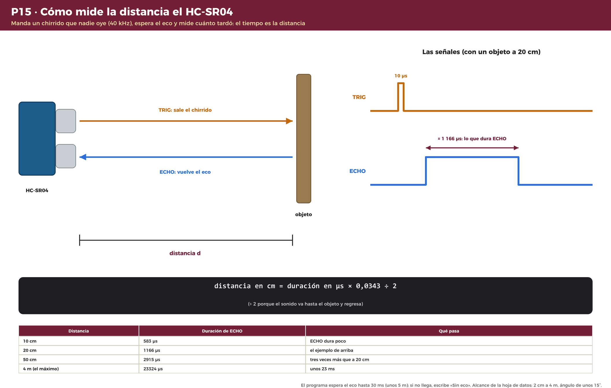
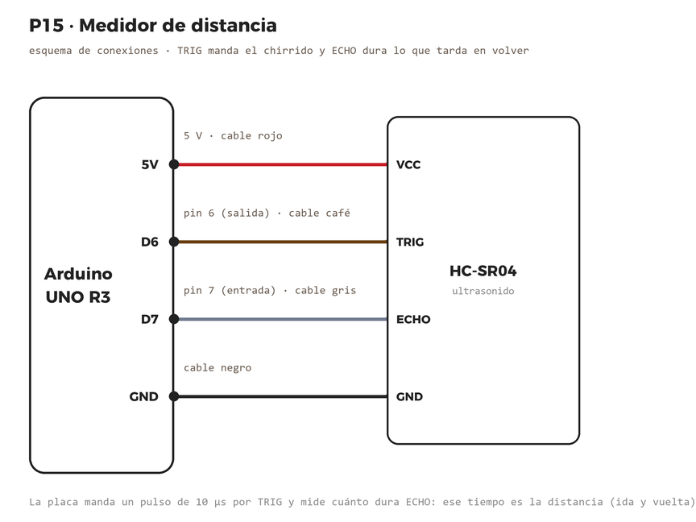
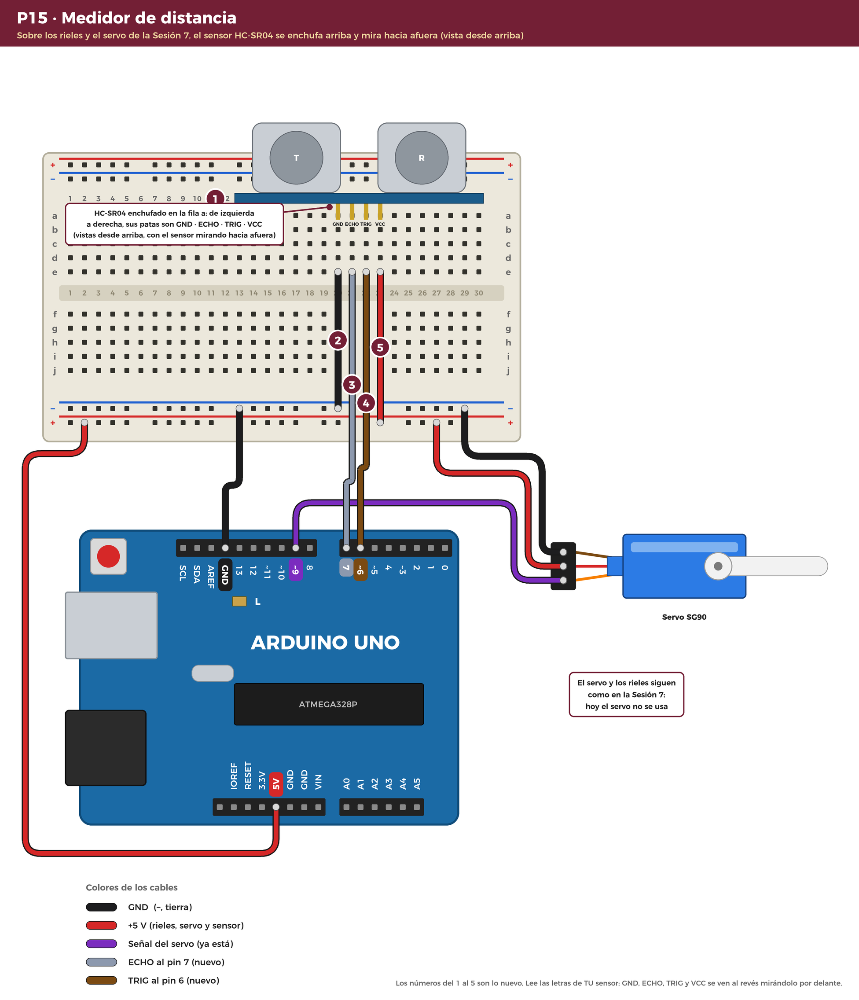
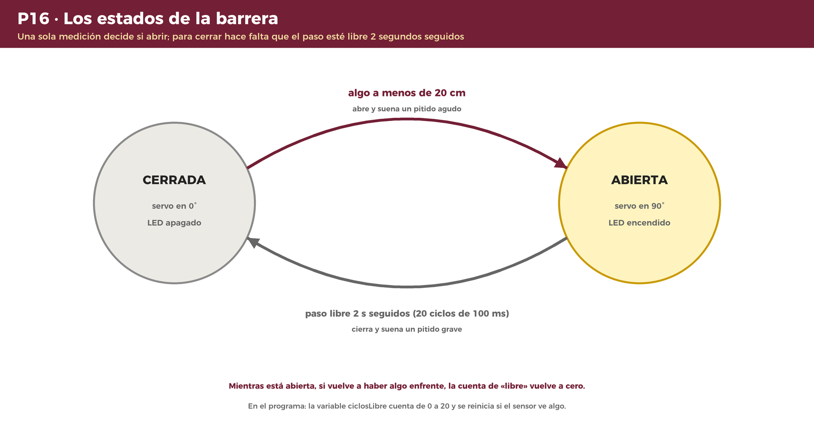
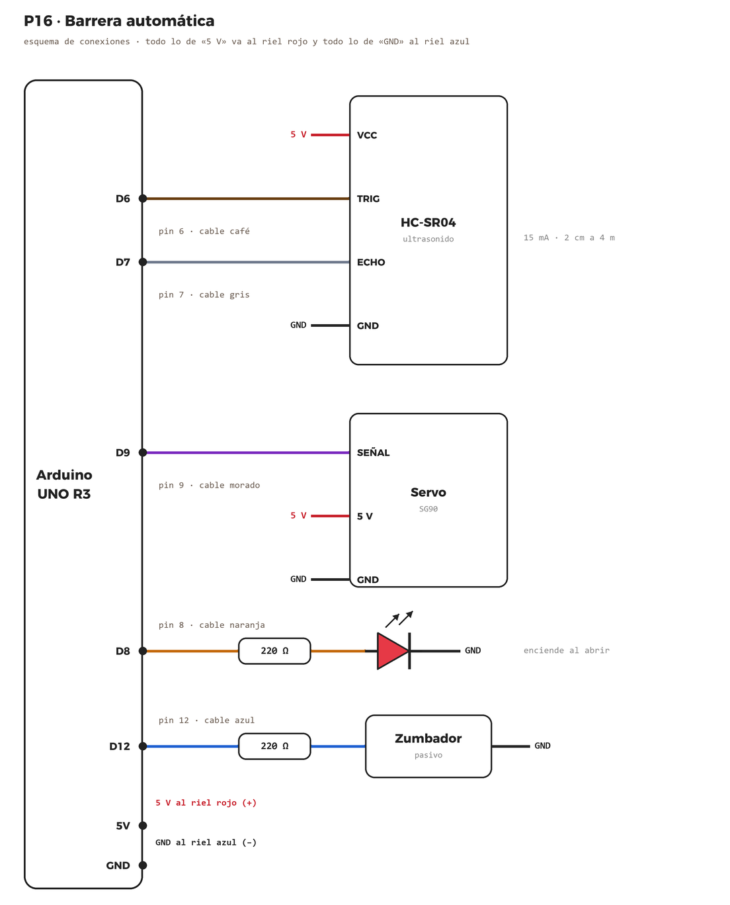
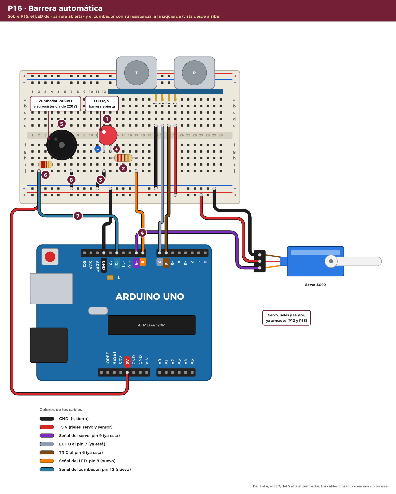

# Sesión 8 · Distancia y barrera automática

**Guía de práctica para el instructor** (de aquí saldrán después las láminas y las fichas de los alumnos)
**Prácticas y tiempos estimados (120 min):** idea 10 · P15 Medidor de distancia 40 · P16 Barrera automática 55 · cierre de la visita 15. Anota los tiempos reales en la tabla del final.
**Sketches:** `curso-arduino/sketches/P15_distancia/` · `P16_barrera_automatica/` · soluciones de retos: `P16_contador_vehiculos/` y `P16_objeto_quieto/`
**Ideas nuevas de la sesión:** un sensor que mide el **tiempo de vuelo de un eco** y lo convierte en una distancia; una **función que devuelve un valor** (`medirDistancia()`); un ciclo que **espera mientras** se cumpla algo (`while`); y la **integración** de un sensor, una decisión y dos actuadores en un sistema. Es la segunda sesión del segundo día de la visita 2: **la visita termina con la barrera automática**. El servo y los rieles de la Sesión 7 siguen armados.

## Cómo leer los diagramas de esta sesión

Hay dos diagramas por circuito (protoboard para **armar**, cableado para **entender**) y dos ayudas para las ideas nuevas:

| Diagrama | Para qué sirve |
|---|---|
| **Cómo mide el HC-SR04** (`P15_eco.png`) | El eco, el tiempo y la cuenta de la distancia, con valores de ejemplo |
| **Protoboard y cableado de P15** (`P15_distancia.png` y `_cableado.png`) | Enchufar el sensor y conectarlo |
| **Los estados de la barrera** (`P16_estados.png`) | Qué recuerda el programa de P16 y qué cambia de un estado a otro |
| **Protoboard y cableado de P16** (`P16_barrera_automatica.png` y `_cableado.png`) | Agregar el LED y el zumbador y ver todo el sistema |

## Materiales (lo que se agrega a la Sesión 7)

| Cantidad | Material |
|---|---|
| 1 | Sensor **HC-SR04** de ultrasonido (el kit trae 1) |
| 4 | Cables macho-macho para el sensor: **negro** (GND), **gris** (ECHO), **café** (TRIG) y **rojo** (VCC). Los colores son una sugerencia |
| 1 | LED rojo y 1 resistencia de **220 Ω** (rojo · rojo · café) |
| 1 | Zumbador **pasivo** (disco negro con orificio) y 1 resistencia de **220 Ω** |
| 4 | Cables macho-macho para el LED y el zumbador: **naranja** (pin 8), **azul** (pin 12) y 2 **negros** |
| — | Una **regla** de 30 cm o un flexómetro, un palito de paleta y cinta (la barrera), y objetos para probar el sensor (libro, tela, la mano) |

> **Si quieres el sensor separado del protoboard,** usa los cables **macho-hembra** del kit: el extremo hembra va a las patas del sensor y el macho al protoboard o a la placa. El diagrama enchufa el sensor directo en el protoboard porque así queda fijo y mirando hacia afuera.

### Paso 0 · Retirar el potenciómetro de P14 (2 min)

Hoy no se usa. Retira el potenciómetro (f26, f28 y f30) y sus tres cables: el negro de **j26**, el rojo del riel a **j30** y el amarillo de **A0**. **El servo, los rieles y sus cables se quedan.**

## La idea de la sesión (10 min, en el pizarrón)

1. **El sonido tarda en ir y volver.** El HC-SR04 manda un chirrido de **40 kHz** (que nadie oye), espera el eco y mide **cuánto tardó** (`ECHO` se queda en `HIGH` mientras espera). A menos tiempo, más cerca el objeto.
2. **La cuenta.** La velocidad del sonido es de unos **343 m/s = 0,0343 cm por microsegundo**. La distancia es **tiempo × velocidad ÷ 2**: se divide entre dos porque el sonido va **y** regresa. Con un objeto a 20 cm, `ECHO` dura unos 1 166 µs.
3. **Una función que entrega un resultado.** `medirDistancia()` no solo «hace algo» como `abrirBarrera()`: **devuelve** un número (`return`). Se usa dentro de una condición: `if (medirDistancia() < 20)`.
4. **Esperar mientras se cumpla algo.** `while (condición) { … }` repite **mientras** la condición sea verdadera (es primo del `for`, pero sin contador fijo).
5. **Un sistema, no un circuito.** Hay un sensor (mide), un programa (decide) y dos actuadores (el servo mueve la barrera, el zumbador avisa, el LED dice «abierta»). **Medir → decidir → actuar** es el esquema de casi todos los sistemas de control.

**Datos para el pizarrón** (de la hoja de datos del kit, `Datasheets/HC-SR04_ultrasonic_module.pdf`)

- HC-SR04: alimentación **5 V** · **15 mA** · frecuencia 40 kHz · alcance de **2 cm a 4 m** · ángulo de medición de unos **15°** · pulso de disparo de **10 µs** como mínimo.
- La hoja habla de 340 m/s; el programa usa 343 m/s (0,0343 cm/µs). La diferencia es de 1 %.

---

## P15 · Medidor de distancia (≈40 min)

### Idea de la práctica

Enchufar el sensor, medir la distancia a un objeto y verla en centímetros en el Monitor Serie. Es la práctica de **calibrar con una regla**.

### Conoce el eco (5 min)



> **Para el instructor.** Las telas, la espuma y las superficies **inclinadas** devuelven mal el eco (el sonido se dispersa o rebota hacia otro lado). Es el mejor momento para decirlo: **un sensor «mide mal» según el objeto**, no solo según el sensor.

### Esquema de conexiones



### Conexión en el protoboard

**Con el USB desconectado.** El sensor se enchufa en la **fila a**, columnas **20 a 23**, con los dos «ojos» **mirando hacia afuera** del protoboard. Se conecta en este orden: **primero GND, al final el 5 V**.



| Paso | Qué | De | A |
|---|---|---|---|
| 1 | Sensor HC-SR04 | sus 4 patas en **a20**, **a21**, **a22** y **a23** | de izquierda a derecha, vistas desde arriba: **GND, ECHO, TRIG, VCC** |
| 2 | Cable negro | **e20** (la columna de **GND**) | riel azul **−** (debajo de la columna 20) |
| 3 | Cable gris | **e21** (la columna de **ECHO**) | **pin 7** de la placa |
| 4 | Cable café | **e22** (la columna de **TRIG**) | **pin 6** de la placa |
| 5 | Cable rojo | **e23** (la columna de **VCC**) | riel rojo **+** (debajo de la columna 23) |

> **Lee las letras de TU sensor.** Mirando el sensor **de frente** (por donde están los dos «ojos»), las patas dicen, de izquierda a derecha, **VCC · Trig · Echo · GND**. En el protoboard, con el sensor **mirando hacia afuera** y visto desde arriba, quedan **al revés**: GND · ECHO · TRIG · VCC. Si lo enchufas al revés, **VCC y GND se invierten** y el sensor puede dañarse: comprueba las letras antes de conectar el USB.

**Revisa antes de conectar el USB**

- [ ] La pata **GND** del sensor va al riel **azul** y la pata **VCC** al riel **rojo**: revisa las letras impresas.
- [ ] **TRIG** (café) va al pin **6** y **ECHO** (gris) al pin **7**.
- [ ] El servo y los rieles de la Sesión 7 siguen armados.

### Código

Abre `curso-arduino/sketches/P15_distancia/P15_distancia.ino` (**Archivo → Abrir**), sube y abre el **Monitor Serie** (9600).

```cpp
void loop() {
  // 1) manda un pulso de 10 microsegundos
  digitalWrite(PIN_TRIG, LOW);
  delayMicroseconds(2);
  digitalWrite(PIN_TRIG, HIGH);
  delayMicroseconds(10);
  digitalWrite(PIN_TRIG, LOW);

  // 2) mide cuánto tarda el eco (máximo 30 ms de espera = unos 5 m)
  long duracion = pulseIn(PIN_ECHO, HIGH, 30000UL);

  // 3) convierte a centímetros
  if (duracion == 0) {
    Serial.println("Sin eco (fuera de alcance)");
  } else {
    float distanciaCm = duracion * 0.0343 / 2.0;
    ...
```

- **TRIG** es una salida: un pulso corto de 10 µs le dice al sensor «mide». **ECHO** es una entrada.
- `pulseIn(PIN_ECHO, HIGH, 30000UL)` **mide cuánto tiempo** se queda `ECHO` en `HIGH` y lo devuelve en microsegundos. El tercer número es el **máximo de espera**: 30 000 µs = 30 ms, unos 5 m. Si no llega eco en ese tiempo devuelve **0**.
- `if (duracion == 0)` avisa «sin eco» en lugar de mostrar un número falso. Con `float` y `long` se hace la cuenta con decimales.

### Qué debes ver

Una línea nueva cada 0,3 s (**ejemplo con valores inventados**):

```
Distancia: 21.3 cm
Distancia: 21.4 cm
Distancia: 8.9 cm
Sin eco (fuera de alcance)
```

### Explora (15 min): calibrar con una regla

Cada equipo anota con números. Es la **evidencia** de la práctica.

| Qué probar | Qué anotar |
|---|---|
| Un objeto plano (un libro) a **10, 20 y 50 cm** medidos con la regla | La distancia que escribe el Monitor y la **diferencia** con la regla |
| Distintos materiales a 20 cm: libro, tela, la mano, una hoja de papel | Cuál se mide peor y por qué |
| Inclinar el libro | Qué pasa con la medida |
| Acercar el objeto a **menos de 2 cm** | Qué mide el sensor (la hoja dice que el mínimo es 2 cm) |
| Alejar el objeto hacia 3 o 4 m | Hasta dónde mide bien y cuándo aparece «Sin eco» |
| Mover el objeto hacia un lado (fuera del ángulo de 15°) | A qué ángulo deja de verlo |

### Modifica (retos)

1. **Básico:** compara la medida con una regla a 10, 20 y 50 cm y calcula el error.
2. **Medio:** prueba cuatro materiales y ordénalos del que mejor al que peor se mide.
3. **Desafío:** que el programa escriba el **promedio de 5 mediciones** (un `for` de la Sesión 4 que suma y divide) para que el número salte menos.

### Rompe y arregla

| Fallo plantado | Qué ocurre | Qué se aprende |
|---|---|---|
| **De cableado:** con el USB desconectado, **quitar el cable café (TRIG)** | Compila y sube, pero escribe **«Sin eco»** siempre | Sin el pulso de disparo el sensor no mide: el sensor no «sabe» que debe medir |
| **De código:** quitar la división entre dos (`duracion * 0.0343`) | El sensor «mide **el doble**»: a 10 cm escribe unos 20 | Por qué se divide entre 2: el sonido va y regresa |
| **De código:** cambiar `30000UL` por `1000UL` en `pulseIn` | Solo mide hasta unos **17 cm**; más lejos escribe «Sin eco» | El tercer número es el **tiempo máximo de espera**: 1 000 µs ≈ 17 cm |

**No se planta** el cambio de TRIG y ECHO entre sí (conecta dos salidas) ni invertir VCC y GND (puede dañar el sensor).

### Si no funciona

| Síntoma | Causa probable |
|---|---|
| Siempre «Sin eco» | TRIG o ECHO en otro pin o sueltos; VCC sin 5 V (el rojo no está en el riel rojo); el objeto está a menos de 2 cm o a más de 4 m |
| Mide mal con un objeto concreto | Es de tela o espuma, o está inclinado: prueba con un libro plano |
| El número salta mucho | El objeto está en el borde del ángulo de 15°; hay otro objeto cerca; el sensor está flojo |
| Mide siempre una distancia corta y fija | El sensor apunta a algo muy cercano (el protoboard, la mesa, un cable): gíralo hacia un lugar libre |
| El sensor se calienta | **VCC y GND al revés:** desconecta el USB de inmediato y revisa las letras |

### Evidencia para la bitácora

- La **tabla de comparación con la regla** a 10, 20 y 50 cm.
- El equipo explica **por qué se divide entre 2** y **qué material se mide peor**.

---

## P16 · Barrera automática (≈55 min)

### Idea de la práctica

Cuando algo se acerca a **menos de 20 cm**, el servo **levanta la barrera**, el LED se enciende y suena un pitido agudo. Cuando el paso queda **libre 2 segundos seguidos**, la barrera baja con un pitido grave. Es un **sistema**: medir, decidir y actuar.



### Esquema de conexiones



### Conexión en el protoboard

**Con el USB desconectado**, sobre el circuito de P15. El LED va en las columnas **12 a 17** y el zumbador, con su resistencia, en las columnas **2 a 7**.



| Paso | Qué | De | A |
|---|---|---|---|
| 1 | LED rojo | pata **larga (+)** en **g13** | pata corta (−) en **g12** |
| 2 | Resistencia 220 Ω | **h13** | **h17** |
| 3 | Cable negro | **j12** | riel azul **−** (debajo de la columna 11) |
| 4 | Cable naranja | **pin 8** de la placa | **j17** |
| 5 | Zumbador **pasivo** | una pata en **f4** | la otra pata en **f7** |
| 6 | Resistencia 220 Ω | **i2** | **i4** |
| 7 | Cable azul | **pin 12** de la placa | **j2** |
| 8 | Cable negro | **j7** | riel azul **−** (debajo de la columna 7) |

> **La resistencia de la fila anterior abarca solo 2 agujeros** (de la columna 2 a la 4): su cuerpo mide más, así que se coloca **«parada»** (una pata en cada agujero y el cuerpo levantado) o con las patas dobladas hacia afuera. Pendiente de comprobar con el kit si cabe cómoda (V15).

> **El zumbador va siempre con su resistencia de 220 Ω** (como en la Sesión 4): sin ella pediría más corriente de la que aguanta un pin.

**Para armar la barrera:** con el servo en su posición de 0° (justo después de subir un sketch), pega un **palito de paleta** al brazo con cinta, apuntando hacia adelante. A 90° queda levantado.

**Revisa antes de conectar el USB**

- [ ] El LED tiene la pata **larga a la resistencia** y la corta al riel azul.
- [ ] El zumbador es el **pasivo** y su resistencia de 220 Ω va **entre el pin 12 y el zumbador**.
- [ ] El sensor, el servo y los rieles siguen como en P15 y P13.
- [ ] Nada toca el brazo del servo.

### Código: lo que ya conoces y dos cosas nuevas

Abre `curso-arduino/sketches/P16_barrera_automatica/P16_barrera_automatica.ino`. Si vas a modificarlo, **Archivo → Guardar como…** con otro nombre (un solo `.ino` por carpeta).

**Lo que ya conoces.** El servo y `attach`/`write` (Sesión 7); `pulseIn` y la cuenta de la distancia (P15); `tone` y el zumbador pasivo (Sesión 4); `if` y las constantes con nombre.

**Nuevo 1 · Una función que devuelve un valor.**

```cpp
float medirDistancia() {
  ...
  long duracion = pulseIn(PIN_ECHO, HIGH, 30000UL);
  if (duracion == 0) {
    return 999.0;                     // sin eco: no hay nada cerca
  }
  return duracion * 0.0343 / 2.0;
}
```

- `float` antes del nombre dice **qué tipo de resultado entrega**. `return` es la **entrega**: la función termina y manda ese valor a quien la llamó.
- Se usa como si fuera un número: `if (medirDistancia() < DISTANCIA_ABRIR)`.
- Si no hay eco devuelve **999**: «no hay nada cerca» (un número grande, mayor que 20).

**Nuevo 2 · `while`: esperar mientras se cumpla algo.**

```cpp
int ciclosLibre = 0;
while (ciclosLibre < CICLOS_LIBRE) {
  if (medirDistancia() < DISTANCIA_ABRIR) {
    ciclosLibre = 0;              // hay alguien: reinicia la cuenta
  } else {
    ciclosLibre = ciclosLibre + 1;
  }
  delay(100);
}
cerrarBarrera();
```

- El `while` **repite mientras** `ciclosLibre < CICLOS_LIBRE`. Cada vuelta dura 100 ms; 20 vueltas seguidas sin nadie = **2 segundos libres**.
- Si algo vuelve a pasar, `ciclosLibre` se pone en 0 y la cuenta **empieza de nuevo**. Al salir del `while`, el paso estuvo libre 2 s seguidos y la barrera baja.

### Qué debes ver

1. En reposo, la barrera cerrada (servo en 0°) y el LED apagado.
2. Acercas la mano a menos de 20 cm: **pitido agudo**, el servo sube a 90° y el LED se enciende; el Monitor Serie escribe `Barrera ABIERTA`.
3. Retiras la mano y esperas **2 segundos**: **pitido grave**, la barrera baja, el LED se apaga y escribe `Barrera CERRADA`.
4. Si la mano vuelve **antes** de los 2 segundos, la barrera **sigue abierta**.

### Modifica (retos)

1. **Básico:** cambia la distancia de activación (`DISTANCIA_ABRIR`) y comprueba el efecto.
2. **Medio:** que cuente los **vehículos** (cada vez que se abre la barrera) y lo escriba en el Monitor Serie. *Solución del instructor: `sketches/P16_contador_vehiculos/`.*
3. **Desafío:** que suene una **alarma** si el objeto se queda **más de 5 segundos** frente al sensor con la barrera abierta. *Solución del instructor: `sketches/P16_objeto_quieto/`.*

### Rompe y arregla

| Fallo plantado | Qué ocurre | Qué se aprende |
|---|---|---|
| **De cableado:** con el USB desconectado, pasar el cable azul del pin 12 al **pin 11** | La barrera funciona, pero **no suena**, y el Monitor sí escribe | El número del código es el pin físico (como en la Sesión 4). Se aísla la falla: sensor y servo bien, zumbador mal |
| **De cableado:** con el USB desconectado, **quitar el cable café (TRIG)** | La barrera **nunca abre**: el sensor no mide | Se encuentra con P15: si P15 dice «Sin eco», el problema está en el sensor, no en el servo ni en el programa |
| **De código:** cambiar `CICLOS_LIBRE` de 20 a **1** | La barrera se cierra casi enseguida y puede **abrirse y cerrarse varias veces** si el objeto se mueve | La espera de 2 segundos evita que la barrera cierre sobre un vehículo que apenas se movió |
| **De código:** cambiar `<` por `>` en la condición de `loop` | La barrera abre cuando **no** hay nada cerca y cierra cuando algo se acerca | Una condición al revés hace lo contrario de lo que se quería; el programa hace lo que se escribió |

### Si no funciona

| Síntoma | Causa probable |
|---|---|
| El servo no se mueve | Revisa P13 (cables del servo, pin 9); revisa P15 (si el sensor no mide, no abre) |
| La barrera abre sola | El sensor ve algo (la mesa, una pared): prueba con un objeto más lejos o baja `DISTANCIA_ABRIR` |
| La barrera nunca cierra | Hay algo frente al sensor; o `CICLOS_LIBRE` es muy grande |
| No suena el zumbador | Pin 12; resistencia mal puesta; es el activo y no el pasivo |
| El **Arduino se reinicia** cuando se mueve el servo | Poca corriente por USB: ver el «Plan B» de la Sesión 7 |
| El LED no enciende | Patas al revés; cable naranja fuera del pin 8 |

### Evidencia para la bitácora

- Un **video corto** de la barrera abriendo al acercar un objeto y cerrando después.
- El equipo explica **qué hace `medirDistancia()`**, **qué hace el `while`** y **por qué espera 2 segundos para cerrar**.
- Un reto resuelto (aunque sea el 1).

---

## Cierre de la visita (15 min)

- En la bitácora: *«qué cambié, qué pasó, por qué»* para P15 y P16, y el visto bueno del instructor en los tres puntos (funciona, lo explica, hizo una modificación propia).
- **Demostración de la visita:** cada equipo muestra su **barrera automática** (acerca un objeto, abre, espera, cierra).
- **Es el final de la visita 2: desarmar y guardar el kit completo.** El sensor **HC-SR04 sin doblar sus patas**, el servo con su brazo y sus cables sin jalarlos, los dos zumbadores por separado y marcados, los LED con sus resistencias. Contar con la hoja de inventario.
- Pregunta de enlace con la Sesión 9: *«El servo se movió con la energía del USB. ¿Y un motor que da vueltas libres y pide mucha más corriente? ¿Cómo lo manejarías desde un pin que solo da unos 20 mA?»* (el transistor: Sesión 9).

## Tu práctica: anota lo que encuentres

Haz las prácticas como lo haría un alumno y llena esto. Sirve para ajustar la sesión y las láminas.

| Dato | Anota aquí |
|---|---|
| Tiempo real de P15 y de P16 | |
| ¿El HC-SR04 entra bien en el protoboard? ¿Qué letras trae y en qué orden se ven al enchufarlo mirando hacia afuera? ¿Coinciden con GND · ECHO · TRIG · VCC? | |
| Comparación con la regla: lo que mide a 10, 20 y 50 cm (la diferencia en cm) | |
| ¿Qué materiales se miden peor (tela, espuma, papel inclinado)? | |
| ¿Mide bien a menos de 2 cm y a más de 3 m? ¿A qué ángulo deja de ver la mano? | |
| ¿Funciona el fallo de quitar el TRIG («Sin eco» siempre)? ¿Y el de `30000UL` por `1000UL` (solo ve hasta unos 17 cm)? | |
| P16: ¿abre y cierra la barrera como se describe? ¿Cuántos segundos tarda en cerrar? | |
| P16: ¿se reinicia el Arduino o tiembla el servo cuando se mueve junto con el sensor y el zumbador? | |
| ¿Se oye bien el zumbador pasivo con su resistencia en este montaje? | |
| ¿La barrera de palito de paleta queda bien a 0° y a 90°? ¿Qué ajustarías? | |
| ¿Funcionan `P16_contador_vehiculos` y `P16_objeto_quieto`? ¿La alarma de 5 s suena como se espera? | |
| Dudas o errores que tuviste | |
| Foto del circuito armado y la tabla de comparación con la regla | |

## Para recompilar o regenerar

- Los sketches se verifican con `curso-arduino/compilar-sketches.ps1`.
- Los diagramas se generan con `python curso-arduino/diagramas/s06_s08.py P15 P16`. El script **comprueba las conexiones** al dibujar (por ejemplo, que TRIG llega al pin 6 y ECHO al pin 7, que VCC y GND del sensor no se tocan y que el zumbador solo recibe el pin 12 a través de su resistencia) y se detiene si algo no coincide.
- Valores que **no** están verificados: el orden real de las letras de tu HC-SR04 al enchufarlo, el comportamiento con `delay` cortos, el error de la medición frente a la regla, el consumo del servo con USB junto con el sensor y el zumbador (V9) y la separación de patas de los zumbadores (V13).
