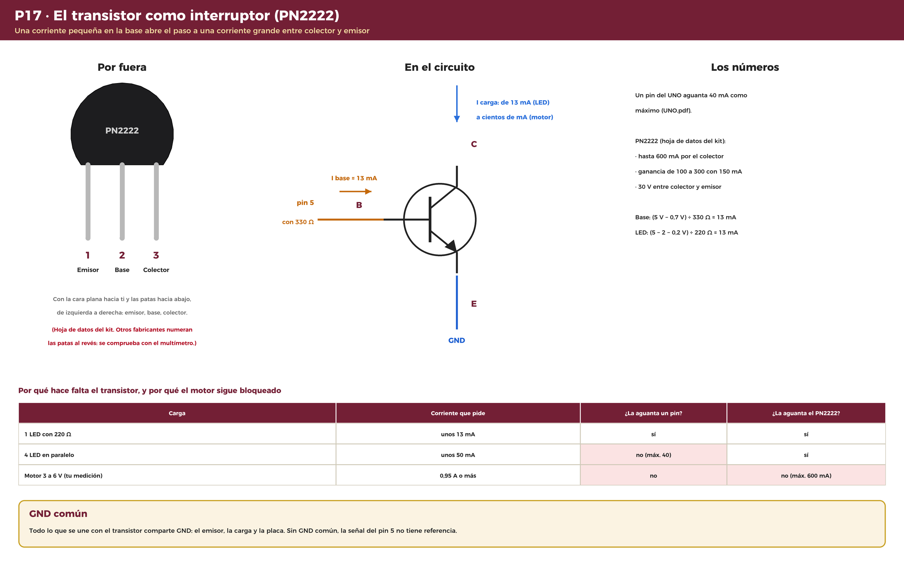
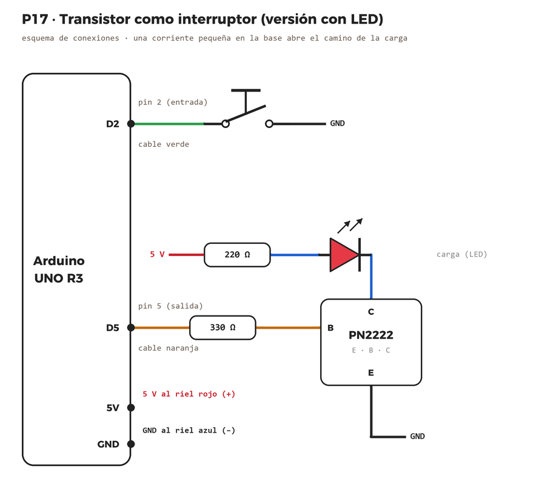
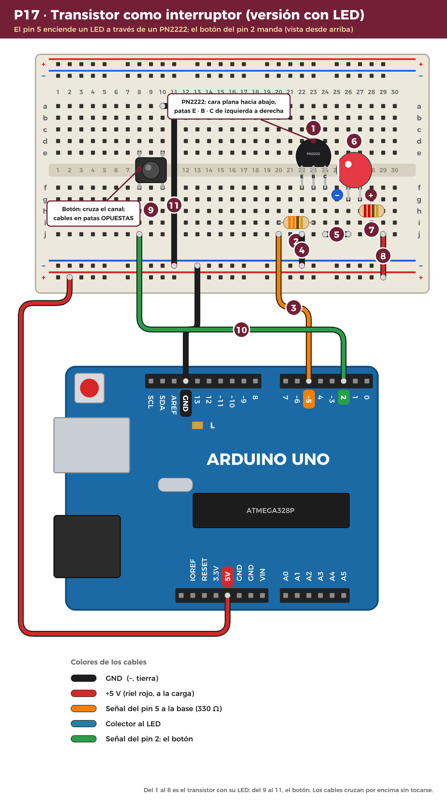
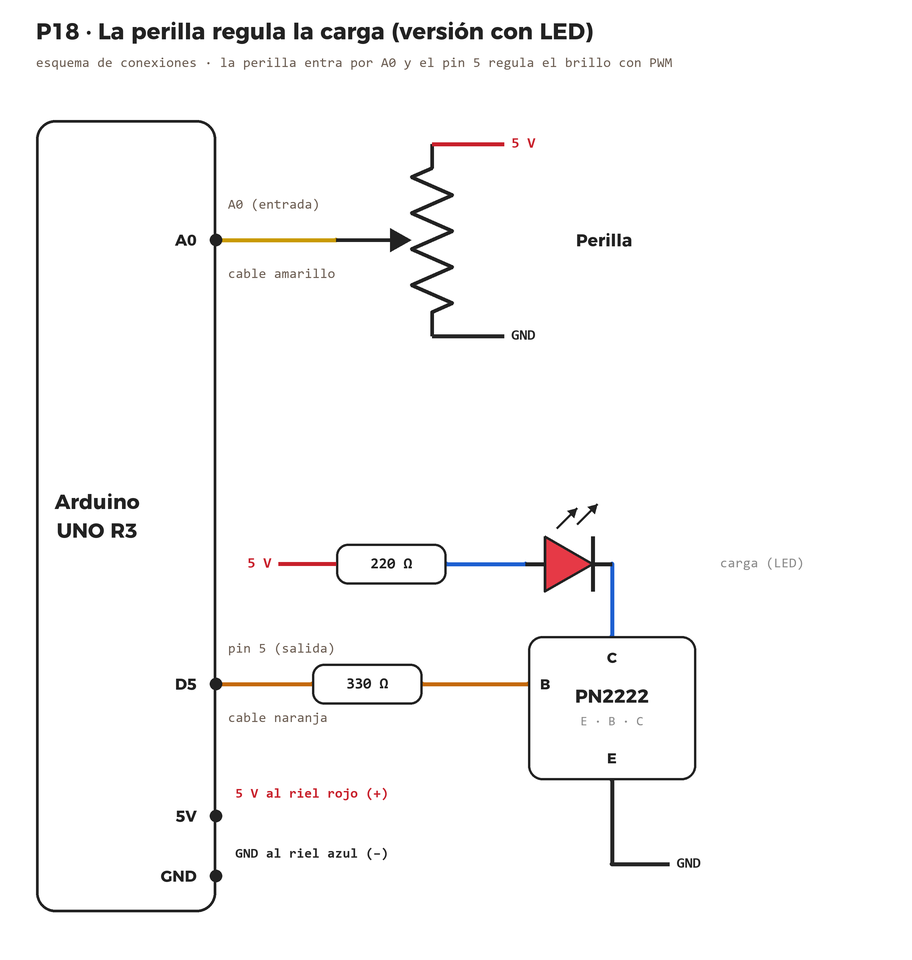
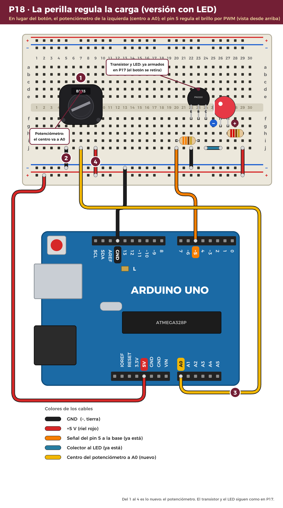
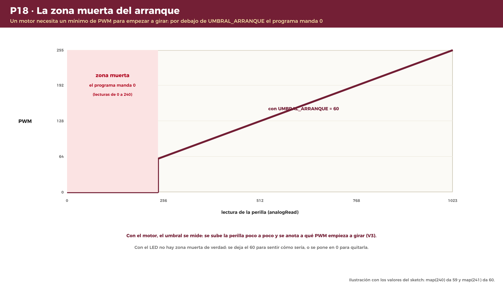

# Sesión 9 · Transistor y motor

> ## ⚠ El motor sigue BLOQUEADO
> Miguel midió (16 nov) que el motor «3–6 V» funciona a partir de **0,95 A**. El circuito del motor de esta sesión (PN2222 y módulo de fuente) aguanta **0,6 A** y **0,7 A**. **No se arma el motor hasta resolver la validación V1** (`plan-curso-arduino.md`, sección 11).
> **Mientras tanto, la sesión se hace completa con un LED como carga**: es el mismo circuito, el mismo programa y la misma idea (el transistor como interruptor). Cuando V1 se resuelva, se cambia el LED por el motor.

**Guía de práctica para el instructor** (de aquí saldrán después las láminas y las fichas de los alumnos)
**Prácticas y tiempos estimados (120 min):** idea 15 · P17 Transistor como interruptor (con LED) 45 · P18 La perilla regula la carga 35 · cierre 10 · holgura 15. Anota los tiempos reales en la tabla del final.
**Sketches:** `curso-arduino/sketches/P17_motor_boton/` · `P18_motor_perilla/` (el nombre dice «motor» por el destino de la sesión; hoy se arman con LED) · soluciones de retos: `P17_un_toque/`, `P17_tres_segundos/` y `P18_dos_botones/`
**Ideas nuevas de la sesión:** un pin del Arduino **no aguanta** cargas grandes; un **transistor** deja que una corriente pequeña (la de la base) controle una corriente grande (la de la carga); **GND común** y, con motor, un **diodo de protección**. Es la primera sesión de la visita 3 (con la Sesión 10 el mismo día). **El kit llega desarmado de la visita anterior.**

## Cómo leer los diagramas de esta sesión

Hay dos diagramas por circuito (protoboard para **armar**, cableado para **entender**) y dos ayudas para las ideas nuevas:

| Diagrama | Para qué sirve |
|---|---|
| **El transistor como interruptor** (`P17_transistor.png`) | Las patas del PN2222, las corrientes y por qué hace falta; la tabla de por qué el motor sigue bloqueado |
| **Protoboard y cableado de P17** (`P17_transistor_led.png` y `_cableado.png`) | Armar el transistor con su LED y el botón |
| **Protoboard y cableado de P18** (`P18_transistor_perilla.png` y `_cableado.png`) | Cambiar el botón por la perilla |
| **La zona muerta del arranque** (`P18_zona_muerta.png`) | Qué hace `UMBRAL_ARRANQUE` y por qué un motor lo necesita |

**El circuito del motor no se dibuja** hasta resolver V1: puede cambiar el motor, el transistor o la fuente, y un diagrama de hoy podría llevar a armar algo que no es seguro.

## Materiales

| Cantidad | Material |
|---|---|
| 1 | Transistor **PN2222** (el kit trae 5) |
| 1 | Resistencia de **330 Ω** (naranja · naranja · café) para la base |
| 1 | LED rojo y 1 resistencia de **220 Ω** (rojo · rojo · café) para la carga |
| 1 | Botón (de los 5 del kit) |
| 1 | Potenciómetro para P18 y su desarmador plano pequeño |
| 8 a 9 | Cables macho-macho: 2 **negros** y 1 **rojo** para los rieles y la carga, **naranja** (pin 5), **azul** (colector al LED), **verde** (pin 2) y otro negro (botón). En P18: 1 negro, 1 rojo y 1 amarillo |
| — | *Solo si hay:* un **multímetro** para las pruebas de V2 y de V1 |

### Paso 0 · Los rieles (3 min)

Con el USB desconectado, arma los dos rieles como en la Sesión 7 (el diagrama los muestra sin número porque son lo primero): un cable **negro** de **GND** de la placa al riel azul (debajo de la columna 13) y un cable **rojo** de **5V** de la placa, que rodea la placa por la **izquierda**, al riel rojo (debajo de la columna 2).

## La idea de la sesión (15 min, en el pizarrón)

1. **Un pin tiene un límite.** Según la hoja del UNO, un pin entrega como máximo **40 mA**. Un LED con su resistencia pide unos 13 mA y no hay problema. **Cuatro LED** piden unos 50 mA y **un motor** cientos de mA: no se pueden conectar directo a un pin.
2. **El transistor es un interruptor que se manda con una corriente pequeña.** Tiene tres patas: **base** (B, por donde entra la orden), **colector** (C, por donde entra la corriente de la carga) y **emisor** (E, por donde sale hacia GND). Cuando por la base pasa una corriente pequeña, se abre el paso entre colector y emisor.
3. **Por qué la resistencia de 330 Ω en la base.** Sin ella, el pin y la base quedarían unidos casi sin resistencia y pasaría una corriente enorme. Con 330 Ω: (5 V − 0,7 V) ÷ 330 Ω ≈ **13 mA** por la base. Es poco, y alcanza para controlar cientos de mA (la ganancia del PN2222 es de 100 a 300 con 150 mA).
4. **GND común.** El emisor, la carga y el Arduino comparten GND: el riel azul. Sin él, la señal del pin 5 no tendría de dónde «medir».
5. **Con PWM, la misma perilla.** `analogWrite` sobre la base enciende y apaga el transistor muy rápido (como en la Sesión 5): la carga recibe más o menos energía.
6. **Solo con motor: el diodo.** Un motor es una bobina: al apagarse genera un pico de voltaje que puede dañar al transistor. Un diodo **1N4007** en paralelo con el motor lo desvía, con la **raya (cátodo) hacia +5 V**. Con un LED no hace falta.

**Datos para el pizarrón** (de las hojas de datos del kit)

- UNO: un pin entrega hasta **40 mA** (`Datasheets/UNO.pdf`).
- PN2222: hasta **600 mA** por el colector · 30 V entre colector y emisor · ganancia de 100 a 300 con 150 mA · patas **1 emisor, 2 base, 3 colector** (con la cara plana hacia ti y las patas hacia abajo) · es del fabricante Fairchild; **otros fabricantes de transistores parecidos** numeran las patas al revés (`Datasheets/PN2222.pdf`).
- Motor del kit: tres datos que **no coinciden** (lección 20: 3 a 6 V y 0,35 a 0,4 A; hoja de datos: 250 mA con carga y 500 mA bloqueado; tu medición: 0,95 A). Módulo de fuente: **700 mA** máximo. Adaptador de 9 V: **1 A**.

### ¿Por qué el motor sigue bloqueado?

Con 0,95 A el motor rebasa al PN2222 (0,6 A) y al módulo de fuente (0,7 A), y el regulador del módulo (de 9 V a 5 V) se sobrecalentaría. Opciones, de más simple a menos (están en el plan, V1):

1. **Cambiar el motor** por uno de menor consumo para los 6 kits.
2. **Bajar el voltaje** del motor (es de 3 a 6 V) y medir si a unos 3 V consume mucho menos.
3. **Relé** del kit solo para encender y apagar (no sirve para variar la velocidad).
4. **Un transistor de potencia o MOSFET de nivel lógico** con una fuente de más capacidad (cambia el diagrama).

Cuándo y cómo medirlo está al final de esta guía.

---

## P17 · El transistor como interruptor (≈45 min)

### Idea de la práctica

Un **botón** manda al pin 5; el pin 5 manda la **base** del transistor; y el transistor enciende un LED que está conectado **a 5 V**, no al pin. Es la forma de controlar cualquier carga.

### Conoce tu transistor (10 min)



> **Para el instructor.** Revisa **cada** equipo antes de energizar. La causa principal de fallas es el **orden de las patas**. En P17 el transistor se dibuja con la cara plana hacia abajo y las patas, de izquierda a derecha, **E · B · C**. **Comprueba el tuyo** (V2): con el multímetro en prueba de diodo, entre base y emisor y entre base y colector debe marcar una caída de unos 0,6 a 0,7 V con la punta roja en la base; entre colector y emisor no debe marcar nada.

### Esquema de conexiones



### Conexión en el protoboard

**Con el USB desconectado.** Después del Paso 0.



| Paso | Qué | De | A |
|---|---|---|---|
| 1 | Transistor **PN2222** (cara plana hacia abajo) | patas en **f22**, **f23** y **f24** | de izquierda a derecha: **emisor, base, colector** |
| 2 | Resistencia **330 Ω** (naranja · naranja · café) | **i23** (la columna de la base) | **i20** |
| 3 | Cable naranja | **pin 5** de la placa | **j20** |
| 4 | Cable negro | **j22** (la columna del emisor) | riel azul **−** (debajo de la columna 22) |
| 5 | Cable azul | **j24** (la columna del colector) | **j26** |
| 6 | LED rojo | pata **larga (+)** en **g27** | pata corta (−) en **g26** |
| 7 | Resistencia **220 Ω** | **h27** | **h29** |
| 8 | Cable rojo | **j29** | riel rojo **+** (debajo de la columna 29) |
| 9 | Botón (4 patas, cruza el canal) | columnas **8** y **10**, filas **e** y **f** | los dos cables van en patas **opuestas** |
| 10 | Cable verde | **pin 2** de la placa | **j8** |
| 11 | Cable negro | riel azul **−** (debajo de la columna 11) | **a10** (arriba del canal, en la pata opuesta) |

> **La resistencia de la fila anterior abarca solo 2 agujeros** (de la columna 27 a la 29): su cuerpo mide más, así que se coloca **«parada»** (una pata en cada agujero y el cuerpo levantado) o con las patas dobladas hacia afuera. Pendiente de comprobar con el kit si cabe cómoda (V15).

El camino de la carga es: 5 V → riel rojo → cable rojo (paso 8) → resistencia de 220 Ω → LED → cable azul (paso 5) → **colector** → transistor → **emisor** → cable negro (paso 4) → GND. El pin 5 solo toca la **base**, a través de los 330 Ω.

**Revisa antes de conectar el USB**

- [ ] El **emisor** (izquierda) va a GND, la **base** (centro) a la resistencia de 330 Ω y el **colector** (derecha) al LED. Comprueba el orden de **tu** transistor (V2).
- [ ] El pin 5 va **solo** a la resistencia de 330 Ω, **nunca** directo a la base.
- [ ] El LED tiene la pata **larga hacia la resistencia de 220 Ω** y la corta hacia el colector.
- [ ] El botón tiene sus cables en patas **opuestas** (como en la Sesión 3).
- [ ] El riel rojo solo recibe el cable de 5 V de la placa y el de la carga.

### Código

Abre `curso-arduino/sketches/P17_motor_boton/P17_motor_boton.ino` (**Archivo → Abrir**) y sube.

```cpp
const int PIN_BOTON = 2;
const int PIN_CARGA = 5;      // va a la base del transistor (con resistencia de 330 ohm)

void loop() {
  if (digitalRead(PIN_BOTON) == LOW) {
    digitalWrite(PIN_CARGA, HIGH);     // el transistor deja pasar corriente a la carga
  } else {
    digitalWrite(PIN_CARGA, LOW);
  }
}
```

- Es **el mismo programa de P05** (botón y LED), pero la salida ya no enciende un LED directo: manda la **base** del transistor. El programa no «sabe» si la carga es un LED o un motor.
- `PIN_CARGA` se llama así (y no «LED») porque en la Sesión 12 será un ventilador.

### Qué debes ver

Al **mantener presionado** el botón, el LED se enciende; al soltarlo, se apaga. Brilla igual que un LED en un pin directo: la carga del LED es la misma (unos 13 mA).

### Explora (10 min)

| Qué probar | Qué anotar |
|---|---|
| Presionar y soltar el botón | Que el LED enciende solo mientras se presiona |
| Tocar el transistor después de un minuto de uso | Si está tibio, frío o caliente (**debe estar frío**: si se calienta, desconecta el USB y revisa las patas) |
| Si hay multímetro: voltaje **base–emisor** con el LED encendido | Unos 0,7 V |
| Si hay multímetro: voltaje **colector–emisor** con el LED encendido | Unos 0,1 a 0,3 V (el transistor «cerrado» casi no cae voltaje: es un interruptor) |
| Si hay multímetro: voltaje en los **330 Ω** con el LED encendido | Unos 4,3 V; con eso, 4,3 ÷ 330 ≈ 13 mA de base |

### Modifica (retos)

1. **Básico:** que con **un toque se encienda** y con **otro se apague** (como en la Sesión 3). *Solución del instructor: `sketches/P17_un_toque/`.*
2. **Medio:** que la carga se encienda **3 segundos** al presionar y luego se **apague sola**. *Solución del instructor: `sketches/P17_tres_segundos/`.*
3. **Desafío:** agrega **más LED en paralelo**, **cada uno con su propia resistencia de 220 Ω**, de la misma conexión del colector a 5 V. Con 4 LED la carga pide unos **50 mA**, más de lo que aguanta un pin: el transistor sí lo aguanta (600 mA). Cada LED necesita su resistencia; **no** compartas una sola.

### Rompe y arregla

| Fallo plantado | Qué ocurre | Qué se aprende |
|---|---|---|
| **De cableado:** con el USB desconectado, **quitar el cable negro del emisor** (paso 4) | Compila y sube, pero el LED **nunca enciende** | El transistor necesita su camino a GND: sin el emisor conectado no pasa corriente de la carga |
| **De cableado:** con el USB desconectado, pasar el cable naranja del **pin 5** al **pin 4** | El LED **no responde** al botón | El número del código (`PIN_CARGA = 5`) es el pin físico (Sesión 1) |
| **De cableado:** pasar el cable verde del botón del **pin 2** al **pin 3** | El botón **no hace nada** | El mismo error, en la entrada (Sesión 3) |

**No se planta:** quitar la resistencia de 330 Ω de la base (el pin quedaría casi directo a la base), poner la carga directo al pin, ni invertir el diodo o el módulo de fuente cuando haya motor.

### Si no funciona

| Síntoma | Causa probable |
|---|---|
| El LED no enciende | Pinout del transistor distinto (V2); el cable naranja no llega al pin 5 o a la resistencia de 330 Ω; el riel rojo sin 5 V (revisa el cable rojo de la izquierda); el LED al revés; el emisor sin GND |
| El LED siempre enciende | El cable de 5 V llega directo al colector sin pasar por el LED; el botón tiene un cable en la misma pata (siempre cerrado) |
| El LED apenas brilla | Es el valor de 220 Ω; es normal. Si es mucho más tenue que en la Sesión 1, revisa la base |
| El transistor se calienta | **Desconecta el USB.** Patas al revés o en la columna equivocada |
| El Arduino se reinicia | Hay un corto: desconecta y revisa que 5 V y GND no se toquen |

### Evidencia para la bitácora

- El LED responde al botón y el equipo explica **por qué el LED no va directo al pin** y **qué hace cada pata del transistor**.
- Un reto resuelto (aunque sea el 1) y, si hay multímetro, las tres mediciones.

---

## P18 · La perilla regula la carga (≈35 min)

### Idea de la práctica

Es **P10 con transistor**: la perilla manda el PWM del pin 5 y el transistor reparte la energía a la carga. Con un LED se ve el brillo; con un motor, la **velocidad**. Es el ejemplo 4 de tu secuencia («velocidad del motor con un potenciómetro»), listo para el día en que se destrabe el motor.

### Esquema de conexiones



### Conexión en el protoboard

**Con el USB desconectado**, sobre el circuito de P17. Se **retira el botón** (columnas 8 y 10) y sus dos cables.



| Paso | Qué | De | A |
|---|---|---|---|
| 1 | Potenciómetro | patas en **f5**, **f7** y **f9** (cada una en su columna) | el centro (f7) es el cursor |
| 2 | Cable negro | **j5** | riel azul **−** (debajo de la columna 5) |
| 3 | Cable amarillo | pin **A0** de la placa (hilera de abajo; rodea la placa por la derecha) | **j7** |
| 4 | Cable rojo | riel rojo **+** (debajo de la columna 9) | **j9** |

**Revisa antes de conectar el USB**

- [ ] El cable amarillo va al **centro** del potenciómetro y a **A0**; el rojo y el negro, a los extremos.
- [ ] El transistor y el LED siguen como en P17.

### Código

Abre `curso-arduino/sketches/P18_motor_perilla/P18_motor_perilla.ino`.

```cpp
void loop() {
  int lectura = analogRead(PIN_PERILLA);
  int velocidad = map(lectura, 0, 1023, 0, 255);

  if (velocidad < UMBRAL_ARRANQUE) {
    velocidad = 0;                      // por debajo de este valor el motor no arranca
  }
  analogWrite(PIN_CARGA, velocidad);
  ...
```

- **Todo es de la Sesión 5:** `analogRead`, `map` y `analogWrite`. Lo único nuevo es la salida: `PIN_CARGA` manda la base del transistor.
- `UMBRAL_ARRANQUE` = 60: por debajo de ese PWM el programa manda 0. Un motor necesita un mínimo para empezar a girar; ese número **se mide** con el motor (V3).



### Qué debes ver

Al girar la perilla, el LED cambia de brillo. Con el umbral en 60, **la primera cuarta parte del giro no enciende nada** (zona muerta) y después sube. El Monitor Serie muestra el PWM y la intensidad en porcentaje.

### Explora (10 min)

| Qué probar | Qué anotar |
|---|---|
| Girar la perilla de un tope al otro | En qué lectura empieza a encender el LED (alrededor de 241) |
| Cambiar `UMBRAL_ARRANQUE` a **0** y subir de nuevo | Que la zona muerta desaparece |
| Cambiarlo a **200** | Que la perilla solo hace algo en el último cuarto del giro |
| Si hay multímetro: voltaje promedio entre colector y emisor | Cómo cambia con el brillo |

### Modifica (retos)

1. **Básico:** ajusta `UMBRAL_ARRANQUE` y explica qué cambia en la perilla.
2. **Medio:** muestra la intensidad en **porcentaje** (ya lo escribe: revisa qué `map` lo hace).
3. **Desafío:** sustituye la perilla por **dos botones** (pines 2 y 3): uno sube y otro baja la intensidad de 10 % en 10 %. *Solución del instructor: `sketches/P18_dos_botones/`.* Los botones se arman como en P17.

### Rompe y arregla

| Fallo plantado | Qué ocurre | Qué se aprende |
|---|---|---|
| **De cableado:** con el USB desconectado, **intercambiar los cables de los extremos** del potenciómetro | El brillo cambia **al revés** | Igual que en la Sesión 5 (cambiar los cables o `map` al revés) |
| **De cableado:** **soltar el cable amarillo** (A0) | El brillo **salta solo** | La entrada analógica sin conectar «flota» |
| **De código:** `UMBRAL_ARRANQUE = 200` | La perilla casi no hace nada hasta pasar el 78 % del giro | El umbral es un valor que se **mide** con el motor y no se adivina |

### Si no funciona

| Síntoma | Causa probable |
|---|---|
| El LED no enciende | Revisa P17; el pin 5 tiene `~`, pero el umbral deja la primera cuarta parte apagada |
| El brillo no cambia con la perilla | El cable amarillo no llega a A0; el centro del potenciómetro está en otra columna |
| El brillo salta | El cable amarillo está suelto |

### Evidencia para la bitácora

- Un **video corto** del LED cambiando de brillo con la perilla.
- El número de lectura en que **empieza a encender** y qué pasó al cambiar `UMBRAL_ARRANQUE`.
- Un reto resuelto (aunque sea el 1).

---

## Versión con motor (BLOQUEADA hasta resolver V1)

**No se arma todavía.** Cuando se resuelva V1 (y el instructor confirme el motor, el transistor y la fuente), el circuito de la carga cambia así; **el programa no cambia**:

| Parte | Cómo queda |
|---|---|
| Fuente | **Módulo de fuente** en los rieles con el **+ en el riel rojo** y el **− en el azul**; los dos jumpers del módulo en **5 V**; se enchufa el **adaptador de 9 V**. Se quita el cable rojo de 5 V de la placa para **no unir dos fuentes de 5 V** |
| GND común | El riel azul sigue unido a un GND de la placa |
| Carga | El **motor** reemplaza al LED: un cable al **colector** y el otro al riel rojo (+5 V del módulo). Sin la resistencia de 220 Ω |
| Diodo | **1N4007** en paralelo con el motor: la **raya (cátodo) hacia +5 V** y el otro extremo al colector |
| Base | Igual: resistencia de 330 Ω entre el pin 5 y la base |

**Antes de energizar (el instructor revisa cada equipo):** pinout del PN2222 (V2), diodo con la raya hacia +5 V, GND común, módulo de fuente con el + en el riel rojo y los jumpers en 5 V, y el adaptador **sin enchufar** hasta terminar de revisar. **No bloquear el aspa:** el regulador del módulo se calienta si el motor se traba.

**Cómo resolver V1 (para el instructor):**

1. Con una **fuente de laboratorio a 5 V** (el voltaje del curso) y el **límite de corriente** puesto en 1 A, conecta solo el motor. Anota la corriente **al arrancar** (pico) y con el **aspa girando libre**.
2. Repite con **3 V** (el motor es de «3 a 6 V»).
3. Anota si los **0,95 A** de tu medición fueron el consumo real o el límite de corriente que ajustaste.
4. Si a 5 V el consumo sostenido está bien por debajo de **0,5 A**, el circuito de arriba sirve. Si no, se elige entre cambiar el motor, bajar el voltaje o usar un transistor de potencia (plan, V1).

---

## Cierre de la sesión (10 min)

- En la bitácora: *«qué cambié, qué pasó, por qué»* para P17 y P18, y el visto bueno del instructor en los tres puntos (funciona, lo explica, hizo una modificación propia).
- **No se desarma el circuito si sigue la Sesión 10 el mismo día:** los rieles y la perilla se reutilizan (la sesión 10 retira el transistor). Si hay un descanso, se desconecta el USB.
- Pregunta de enlace con la Sesión 10: *«Hoy el Arduino prendió y reguló una carga. ¿Y si tuviera que **medir** qué tan caliente está algo para decidir cuándo prenderla?»* (la temperatura: Sesión 10).

## Tu práctica: anota lo que encuentres

Haz las prácticas como lo haría un alumno y llena esto. Sirve para ajustar la sesión y las láminas. **Lo del orden de patas cubre la validación V2 del plan, y lo del motor, V1 y V3.**

| Dato | Anota aquí |
|---|---|
| Tiempo real de P17 y de P18 | |
| Orden real de las patas de tu PN2222 (prueba de diodo con el multímetro): ¿emisor, base, colector de izquierda a derecha con la cara plana hacia ti? | |
| ¿Entra bien el transistor en los agujeros contiguos (las patas están muy juntas)? | |
| P17: ¿enciende el LED con el botón? ¿Brilla como un LED directo? | |
| Si hay multímetro: Vbe, Vce y voltaje en los 330 Ω con el LED encendido | |
| ¿El transistor se calienta? Con 4 LED en paralelo, ¿qué pasa? | |
| P18: lectura a partir de la cual enciende con `UMBRAL_ARRANQUE = 60`; ¿qué pasa con 0 y con 200? | |
| **V1:** corriente del motor con la fuente a 5 V al arrancar y con el aspa libre; lo mismo a 3 V; ¿los 0,95 A fueron consumo o límite? | |
| ¿Funcionan `P17_un_toque`, `P17_tres_segundos` y `P18_dos_botones`? | |
| Dudas o errores que tuviste | |
| Foto del circuito armado | |

## Para recompilar o regenerar

- Los sketches se verifican con `curso-arduino/compilar-sketches.ps1`.
- Los diagramas se generan con `python curso-arduino/diagramas/s09_s10.py P17 P18`. El script **comprueba las conexiones** al dibujar (por ejemplo, que el pin 5 llega a la base solo a través de los 330 Ω, que el colector no toca 5 V ni GND, y que la carga lleva su resistencia) y se detiene si algo no coincide.
- Valores que **no** están verificados: el orden de patas del PN2222 de tu kit (V2), si entran bien en agujeros contiguos, las tensiones medidas con el LED, y todo lo del motor (V1 y V3).
