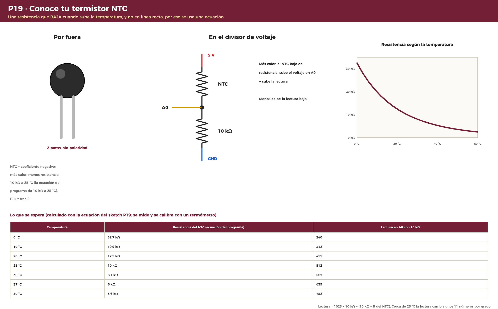
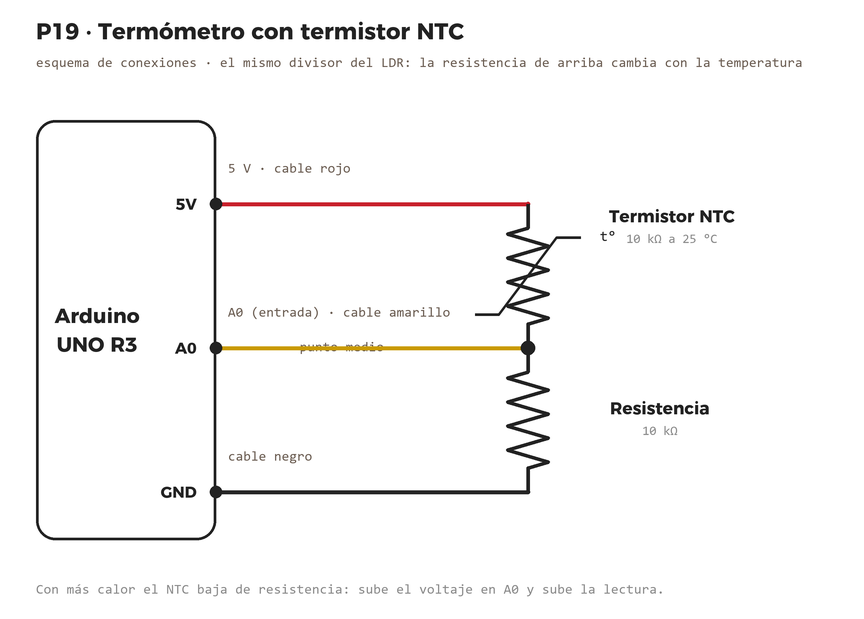
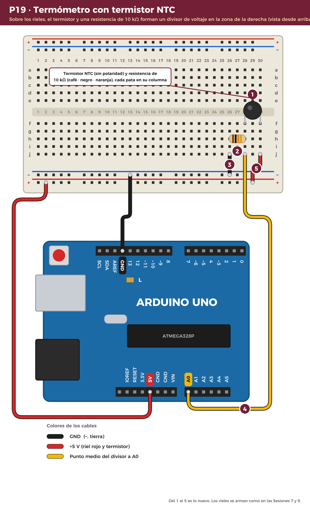
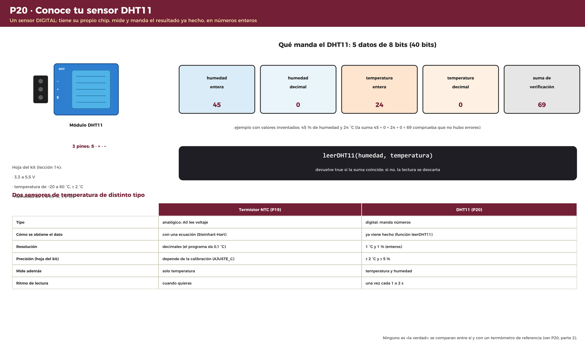
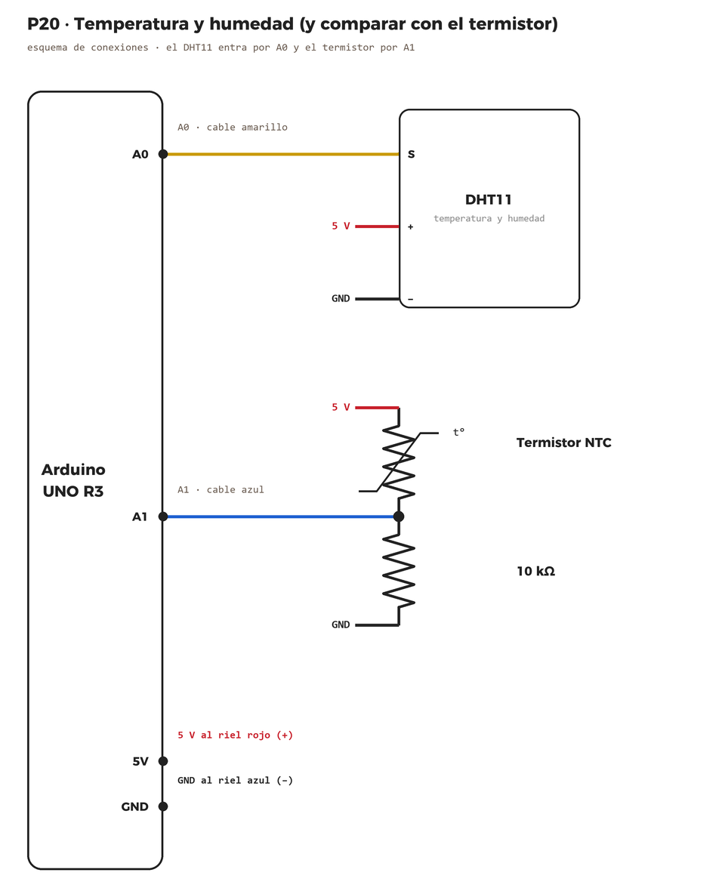
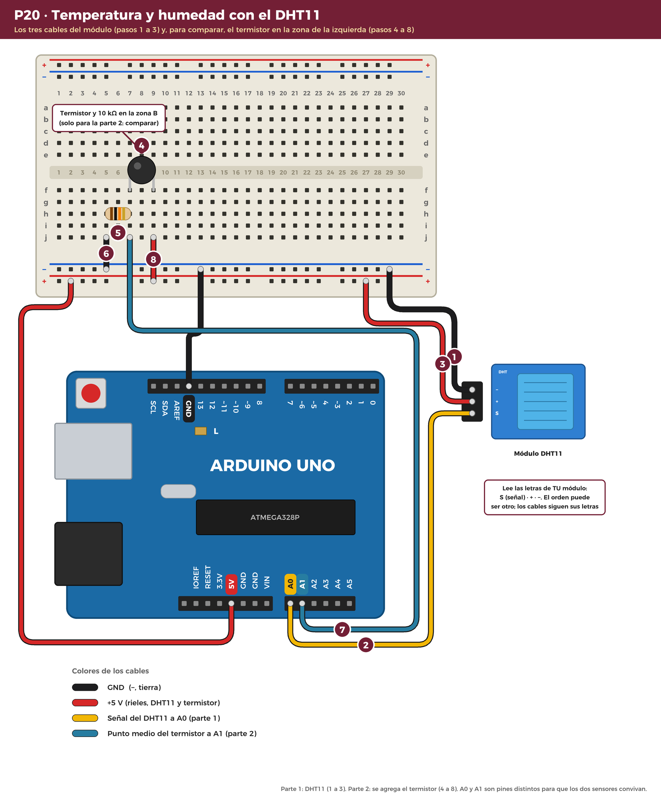

# Sesión 10 · Temperatura

**Guía de práctica para el instructor** (de aquí saldrán después las láminas y las fichas de los alumnos)
**Prácticas y tiempos estimados (120 min):** idea 10 · P19 Termómetro con termistor 45 · P20 Temperatura y humedad con el DHT11 (parte 1 y comparación con el termistor) 45 · cierre 10 · holgura 10. Anota los tiempos reales en la tabla del final.
**Sketches:** `curso-arduino/sketches/P19_termistor_celsius/` · `P20_dht11/` · `P20_comparar_sensores/` (parte 2 de P20) · soluciones de retos: `P19_led_30c/` y `P19_registro_minuto/`
**Ideas nuevas de la sesión:** medir **una misma magnitud con dos sensores distintos** (uno **analógico** que se calcula con una ecuación y uno **digital** que manda el número ya hecho) y **compararlos**; la diferencia entre **resolución** y **precisión**; y **calibrar** contra un termómetro de referencia. Es la segunda sesión del primer día de la visita 3. **Los rieles de la Sesión 9 siguen armados.**

## Cómo leer los diagramas de esta sesión

Hay dos diagramas por circuito (protoboard para **armar**, cableado para **entender**) y dos ayudas para las ideas nuevas:

| Diagrama | Para qué sirve |
|---|---|
| **Conoce tu termistor** (`P19_termistor_conoce.png`) | Cómo baja la resistencia del NTC con el calor y qué lectura esperar (calculada con la ecuación del programa) |
| **Protoboard y cableado de P19** (`P19_termistor_ntc.png` y `_cableado.png`) | Armar el termistor con su resistencia de 10 kΩ |
| **Conoce tu DHT11** (`P20_dht11_conoce.png`) | Los 5 datos que manda el sensor y la comparación con el termistor |
| **Protoboard y cableado de P20** (`P20_dht11.png` y `_cableado.png`) | Conectar el DHT11 (parte 1) y agregar el termistor para comparar (parte 2) |

## Materiales

| Cantidad | Material |
|---|---|
| 1 | **Termistor NTC** (una pequeña gota negra con dos patas). El kit trae 2 |
| 1 | Resistencia de **10 kΩ** (café · negro · naranja) |
| 1 | Módulo **DHT11** de 3 pines (azul, con una rejilla de plástico). El kit trae 1 |
| 3 | Cables **macho-hembra** del kit (para el DHT11: el extremo hembra va a las patas del módulo y el macho a la placa o a los rieles) |
| 4 | Cables macho-macho: **negro**, **rojo**, **amarillo** (A0) y **azul** (A1); más un **negro** y un **rojo** cortos para la zona de la izquierda |
| 1 | LED y resistencia de **220 Ω** (solo para el reto de P19) |
| — | **Un termómetro de referencia** (de cocina, clínico o de ambiente): **no viene en el kit**. Para calibrar. Si no hay, se compara solo entre sensores y se dice |
| — | Un vaso con agua fría, para acercar (no sumergir) el sensor |

### Paso 0 · Limpiar lo de la Sesión 9 (3 min)

Retira el transistor, sus resistencias, el LED, el potenciómetro (y el botón, si quedó) y sus cables. **Los rieles se quedan** (el cable negro de GND al riel azul y el rojo de 5 V, que rodea la placa por la izquierda, al riel rojo).

## La idea de la sesión (10 min, en el pizarrón)

1. **Medir temperatura con un termistor.** Un **NTC** es una resistencia que **baja** cuando sube la temperatura. Con un divisor de voltaje (como el del LDR en la Sesión 6) el Arduino lee el voltaje y de ahí calcula la resistencia.
2. **No es una recta.** A cada grado, la resistencia baja distinto: por eso se usa una **ecuación** (la de Steinhart-Hart). En este curso es una **caja negra**: entra la resistencia, sale la temperatura. `log()` es el logaritmo natural que usa la ecuación.
3. **Un sensor digital.** El **DHT11** tiene su propio chip: mide, calcula y manda **números enteros**. Lo único que hace el Arduino es **leer** los pulsos con precisión de tiempo; esa lectura está en una función ya hecha, `leerDHT11()`.
4. **Resolución y precisión no son lo mismo.** La **resolución** es el escalón más pequeño que muestra (el DHT11, 1 °C; el termistor del programa, 0,1 °C). La **precisión** es qué tan cerca está de la **realidad** (el DHT11, ±2 °C según su hoja). Un sensor con muchos decimales puede estar equivocado.
5. **Calibrar.** Se pone el sensor junto a un **termómetro de referencia**, se anota la diferencia y se corrige con `AJUSTE_C`. **Ningún sensor es «la verdad»**: se comparan entre sí y con la referencia.
6. **Promediar.** Leer 10 veces y sacar el promedio reduce el ruido de la lectura.

**Datos para el pizarrón** (de las hojas del kit y del programa)

- DHT11 (lección 14): 3,3 a 5,5 V · −20 a 60 °C con ±2 °C · 5 a 95 % de humedad con ±5 % · una lectura cada 1 o 2 segundos como mínimo.
- NTC: las constantes del programa son las del código del kit para un termistor de 10 kΩ. Según la ecuación, con 10 kΩ fijos: **0 °C → 240**, **20 °C → 455**, **25 °C → 512**, **30 °C → 567**, **37 °C → 639**, **50 °C → 752** (lectura de A0). Cerca de 25 °C, la lectura cambia unos **11 números por grado**.

---

## P19 · Termómetro con termistor (≈45 min)

### Idea de la práctica

Convertir la lectura de A0 en **grados Celsius** con la ecuación del termistor y escribirla en el Monitor Serie. Es el mismo divisor de voltaje del LDR con otro sensor.

### Conoce tu termistor (5 min)



> **Para el instructor.** La tabla sale de la ecuación del sketch y **no es una medición**: el termistor real puede dar unos grados de diferencia. Para eso está `AJUSTE_C`. Es buen momento para decir que **la ecuación se usa sin demostrarla**.

### Esquema de conexiones



### Conexión en el protoboard

**Con el USB desconectado.** En la **zona de la derecha** (columnas 26, 28 y 30), como en las Sesiones 5 y 6.



| Paso | Qué | De | A |
|---|---|---|---|
| 1 | Termistor NTC (sin polaridad) | una pata en **f28** | la otra pata en **f30** |
| 2 | Resistencia de **10 kΩ** (café · negro · naranja) | **h28** | **h26** |
| 3 | Cable negro | **j26** | riel azul **−** (debajo de la columna 26) |
| 4 | Cable amarillo | pin **A0** de la placa (hilera de abajo; rodea la placa por la derecha) | **j28** |
| 5 | Cable rojo (corto) | riel rojo **+** (debajo de la columna 29) | **j30** |

> **La resistencia de la fila anterior abarca solo 2 agujeros** (de la columna 26 a la 28): su cuerpo mide más, así que se coloca **«parada»** (una pata en cada agujero y el cuerpo levantado) o con las patas dobladas hacia afuera. Pendiente de comprobar con el kit si cabe cómoda (V15).

**Revisa antes de conectar el USB**

- [ ] Las patas del termistor están en **columnas distintas** (28 y 30) y la resistencia es de **10 kΩ**, no de 220 Ω.
- [ ] El cable amarillo va a **A0** y a la columna del **punto medio** (28).
- [ ] El riel rojo (+) solo recibe el cable de 5 V de la placa y el de la columna 29.

### Código

Abre `curso-arduino/sketches/P19_termistor_celsius/P19_termistor_celsius.ino` y sube. Abre el **Monitor Serie** (9600).

```cpp
float leerTemperatura() {
  long suma = 0;
  for (int i = 0; i < 10; i++) {
    suma = suma + analogRead(PIN_TERMISTOR);
    delay(2);
  }
  float lectura = suma / 10.0;

  if (lectura < 1.0 || lectura > 1022.0) {
    return -273.0;                // sensor desconectado o en corto
  }
  float resistencia = 10000.0 * (1024.0 / lectura - 1.0);
  float lnR = log(resistencia);
  float tempK = 1.0 / (0.001129148 + (0.000234125 + (0.0000000876741 * lnR * lnR)) * lnR);
  return tempK - 273.15 + AJUSTE_C;
}
```

- Es una **función que devuelve un valor** (como `medirDistancia()` de la Sesión 8). `loop()` solo la llama.
- El `for` suma **10 lecturas** y se divide entre 10: un **promedio**. `delay(2)` deja pasar un instante entre una y otra.
- Si la lectura es casi 0 o casi 1023, el sensor está **desconectado o en corto** y la función devuelve **−273**: es un número imposible que el resto del programa reconoce como «avería».
- `resistencia = 10000 × (1024 ÷ lectura − 1)` despeja la resistencia del termistor del divisor. La línea de `log` es la ecuación (**caja negra**). `+ AJUSTE_C` suma la calibración.

### Qué debes ver

Una línea cada medio segundo (**ejemplo con valores inventados**):

```
Temperatura: 24.6 C
Temperatura: 24.7 C
Temperatura: 29.8 C
```

### Explora (15 min)

| Qué probar | Qué anotar |
|---|---|
| Esperar un minuto sin tocar el sensor | La temperatura ambiente |
| **Sostener** el termistor entre los dedos | Cuánto sube y en cuántos segundos |
| Soltarlo | Cuánto tarda en volver |
| Acercar un **vaso con agua fría** (sin mojarlo) | Cuánto baja |
| Comparar con el **termómetro de referencia** (junto al sensor 3 a 5 minutos, sin tocarlos) | La diferencia: temperatura de referencia **menos** la del sensor. Ese número es el `AJUSTE_C` |

> **Calibrar.** Si la referencia marca 24,0 °C y el sensor 25,5 °C, `AJUSTE_C = -1.5` (el que ya viene ajustado, en esa dirección). Se vuelve a subir y se comprueba. Se hace a **una** temperatura; a otras puede seguir habiendo diferencia.

> **Cuidado.** No mojes el termistor ni sus patas, y **no lo calientes con una flama** ni con un encendedor. El calor de los dedos y el de una taza tibia bastan.

### Modifica (retos)

1. **Básico:** anota la temperatura **ambiente** y la de tu **dedo**.
2. **Medio:** que un **LED** se encienda al pasar de **30 °C** (el LED va al pin 8, como en la Sesión 2). *Solución del instructor: `sketches/P19_led_30c/`.*
3. **Desafío:** que escriba la temperatura **cada minuto** con su número de minuto, para llenar una tabla durante la clase. *Solución del instructor: `sketches/P19_registro_minuto/`.*

### Rompe y arregla

| Fallo plantado | Qué ocurre | Qué se aprende |
|---|---|---|
| **De cableado:** con el USB desconectado, **quitar la resistencia de 10 kΩ** | El programa escribe **«Revisa la conexion del termistor»**. *Se espera porque la lectura queda cerca de 1023; anota lo que veas* | El programa **sabe** cuándo la lectura es imposible y avisa en lugar de inventar un dato |
| **De cableado:** **intercambiar los extremos** de los cables rojo y negro de las columnas 30 y 26 (el termistor queda del lado de GND) | A la temperatura ambiente marca casi lo mismo, pero **al calentar el sensor, la temperatura BAJA** | Igual que con el LDR: el orden de las dos resistencias decide hacia dónde sube la lectura, y el programa supone al termistor del lado de 5 V |
| **De código:** poner `AJUSTE_C = 5.0` | Todas las temperaturas salen **5 grados más** | Qué hace la calibración: suma o resta un número fijo a todo |

### Si no funciona

| Síntoma | Causa probable |
|---|---|
| «Revisa la conexion del termistor» | Falta la resistencia de 10 kΩ; el cable amarillo está suelto o no llega a A0; el rojo (5 V) o el negro (GND) están sueltos |
| Siempre marca lo mismo | El cable amarillo no llega a la columna del punto medio; el termistor no hace contacto |
| Marca una temperatura absurda (por ejemplo, 80 °C) | Resistencia que no es de 10 kΩ; termistor y resistencia al revés; cables flojos |
| Baja al calentar | El termistor y la resistencia están intercambiados (fallo de arriba) |
| Marca bien pero con 2 o 3 grados de diferencia | Normal: hay que calibrar con `AJUSTE_C` |

### Evidencia para la bitácora

- La **temperatura ambiente y la del dedo**, y el `AJUSTE_C` calculado contra el termómetro (si hay).
- El equipo explica **por qué se promedian 10 lecturas** y **qué significa −273** en el programa.
- Un reto resuelto (aunque sea el 1).

---

## P20 · Temperatura y humedad con el DHT11 (≈45 min)

### Idea de la práctica

El DHT11 mide **temperatura y humedad** y manda el resultado ya hecho. **Parte 1:** conectarlo y verlo en el Monitor Serie (15 min). **Parte 2:** ponerlo junto al **termistor** y compararlos con la referencia (30 min), que es la **evidencia** de la sesión.

### Conoce tu DHT11 (5 min)



### Esquema de conexiones



### Conexión en el protoboard

**Con el USB desconectado.** **El DHT11 usa A0**, igual que el termistor de P19: para la parte 1 se retiran el termistor, su resistencia de 10 kΩ y sus cables de la zona de la derecha. Los **pasos 1 a 3** son el DHT11 (parte 1); los **4 a 8** son el termistor en la **zona de la izquierda**, con A1 (parte 2).



| Paso | Qué | De | A |
|---|---|---|---|
| 1 | Cable negro (macho-hembra) | pata **−** del módulo | riel azul **−** (debajo de la columna 29) |
| 2 | Cable amarillo (macho-hembra) | pata **S** (señal) del módulo | pin **A0** de la placa |
| 3 | Cable rojo (macho-hembra) | pata **+** del módulo | riel rojo **+** (debajo de la columna 27) |
| 4 | Termistor NTC *(parte 2)* | una pata en **f7** | la otra en **f9** |
| 5 | Resistencia de **10 kΩ** *(parte 2)* | **h7** | **h5** |
| 6 | Cable negro *(parte 2)* | **j5** | riel azul **−** (debajo de la columna 5) |
| 7 | Cable azul *(parte 2)* | pin **A1** de la placa | **j7** |
| 8 | Cable rojo corto *(parte 2)* | riel rojo **+** (debajo de la columna 9) | **j9** |

> **La resistencia de la fila anterior abarca solo 2 agujeros** (de la columna 5 a la 7): su cuerpo mide más, así que se coloca **«parada»** (una pata en cada agujero y el cuerpo levantado) o con las patas dobladas hacia afuera. Pendiente de comprobar con el kit si cabe cómoda (V15).

> **Lee las letras de TU módulo.** El orden de las tres patas del DHT11 puede variar entre módulos (**S**, **+** y **−**). El diagrama muestra uno; los cables siguen **sus letras**. Conectar **+** y **−** al revés puede dañar el sensor: el 5 V **al final**.

**Revisa antes de conectar el USB**

- [ ] **S** va a **A0**, **+** al riel **rojo** y **−** al riel **azul**: revisa las letras impresas.
- [ ] La zona de la derecha está **vacía** (se retiró el termistor de P19; si no, A0 tendría dos cables).
- [ ] *(Parte 2)* El termistor de la izquierda va a **A1**, no a A0.

### Código (parte 1)

Abre `curso-arduino/sketches/P20_dht11/P20_dht11.ino` y sube. Monitor Serie a 9600.

```cpp
void loop() {
  byte humedad;
  byte temperatura;

  if (leerDHT11(humedad, temperatura)) {
    Serial.print("Temperatura: ");
    Serial.print(temperatura);
    Serial.print(" C    Humedad: ");
    Serial.print(humedad);
    Serial.println(" %");
  } else {
    Serial.println("Error al leer el DHT11. Revisa las conexiones.");
  }
  delay(2000);
}
```

- `leerDHT11(humedad, temperatura)` es la **caja negra** adaptada del código del kit (lección 14): entrega la humedad y la temperatura **en enteros** y devuelve `true` si la lectura fue buena (la suma de verificación coincide).
- `byte` es un número entero chico (0 a 255), suficiente para una temperatura o un porcentaje.
- `delay(2000)`: el sensor necesita **1 a 2 segundos** entre lecturas.

### Qué debes ver (parte 1)

```
Temperatura: 24 C    Humedad: 45 %
Temperatura: 24 C    Humedad: 46 %
Temperatura: 25 C    Humedad: 62 %
```

(**ejemplo con valores inventados**)

### Explora (parte 1, 5 min)

| Qué probar | Qué anotar |
|---|---|
| **Soplar** suavemente al sensor | Cuánto sube la humedad y cuánto tarda en volver a su valor normal |
| Calentarlo con las manos (sin tapar la rejilla) | Cuánto tarda en subir la temperatura (es más lento que el termistor) |

### Parte 2: comparar los dos sensores (30 min)

Arma el termistor en la **zona de la izquierda** (pasos 4 a 8; **A1**). Abre `curso-arduino/sketches/P20_comparar_sensores/P20_comparar_sensores.ino` y sube: escribe la temperatura de **los dos sensores** y su diferencia. También se puede abrir el **Serial Plotter** (9600).

```cpp
Serial.print("Termistor:");
Serial.print(temperaturaNTC, 1);
Serial.print(",DHT11:");
Serial.print(temperaturaDHT);
Serial.print(",Diferencia:");
Serial.println(temperaturaNTC - temperaturaDHT, 1);
```

| Qué hacer | Qué anotar |
|---|---|
| Dejar los dos sensores y el **termómetro de referencia** juntos 3 a 5 minutos | Los tres valores: termistor, DHT11 y referencia |
| Calcular el `AJUSTE_C` del termistor (referencia **menos** termistor) | El número y la diferencia que queda después de corregir |
| Soplar a los dos sensores a la vez | Cuál reacciona más rápido |
| Poner un **vaso con agua fría** cerca de los dos | Cuál baja primero y cuánto |
| Revisar las dos líneas en el **Serial Plotter** | Si la diferencia entre los dos cambia con la temperatura |

**La conclusión.** Los dos sensores pueden marcar temperaturas distintas y ninguno es «la verdad»: el termistor tiene **resolución fina** (décimas), el DHT11 solo **enteros**, pero la **precisión** (qué tan cerca están del termómetro) se descubre **comparando**.

### Modifica (retos)

1. **Básico:** anota cuánto tarda en volver la humedad a su valor normal después de soplar.
2. **Medio:** calcula el **promedio de 5 lecturas** del DHT11 (un `for`, de la Sesión 4).
3. **Desafío:** ajusta `AJUSTE_C` del termistor con tu referencia y compruébalo a una **segunda temperatura** (por ejemplo, acercando el agua fría): ¿sigue coincidiendo?

### Rompe y arregla

| Fallo plantado | Qué ocurre | Qué se aprende |
|---|---|---|
| **De cableado:** con el USB desconectado, pasar el cable amarillo del DHT11 de **A0** a **A1** (parte 1) | **«Error al leer el DHT11. Revisa las conexiones.»** siempre | El programa lee el pin A0 (`DHT11_PIN 0`); el sensor está bien, pero el programa mira otro pin |
| **De código:** cambiar `delay(2000)` por `delay(100)` | Aparecen **errores de lectura** seguido. *Se espera por lo que dice la hoja del kit; anota lo que veas* | El sensor necesita su tiempo entre lecturas |
| **De cableado:** con el USB desconectado, **soltar el cable rojo (+)** del DHT11 | «Error al leer el DHT11…» | Sin 5 V no hay sensor |

**No se planta** invertir **+** y **−** del DHT11 (puede dañarlo).

### Si no funciona

| Síntoma | Causa probable |
|---|---|
| «Error al leer el DHT11» siempre | **S** no está en A0; las letras del módulo son otras; falta el 5 V (+) o el GND (−); el cable macho-hembra no encaja bien |
| Da errores a ratos | El tiempo entre lecturas es muy corto; contacto flojo en los cables |
| La humedad no cambia al soplar | El aliento tarda unos segundos; sopla más cerca y espera |
| El termistor y el DHT11 difieren mucho (más de 4 °C) | El termistor o la resistencia al revés; AJUSTE_C sin calibrar; uno de los dos está cerca de una fuente de calor (la mano, la computadora) |
| El sensor se calienta | **+ y − al revés:** desconecta el USB de inmediato |

### Evidencia para la bitácora

- La **tabla** con la temperatura del termistor, la del DHT11 y la de la referencia, y el **`AJUSTE_C` calculado**.
- El equipo explica **la diferencia entre un sensor analógico y uno digital** y **por qué ninguno es «la verdad»**.
- Un reto resuelto (aunque sea el 1).

---

## Cierre de la sesión (10 min)

- En la bitácora: *«qué cambié, qué pasó, por qué»* para P19 y P20, y el visto bueno del instructor en los tres puntos (funciona, lo explica, hizo una modificación propia).
- **No se desarma** si sigue otro bloque ese día. Si no, se guardan: el **termistor** y las resistencias por separado y marcadas, el **módulo DHT11 sin forzar sus patas**, y los cables macho-hembra en su paquete.
- Pregunta de enlace con la Sesión 11: *«Hoy los números aparecieron en la computadora. ¿Y si queremos verlos **sin computadora**, en una pantallita junto al sensor?»* (la pantalla LCD: Sesión 11).

## Tu práctica: anota lo que encuentres

Haz las prácticas como lo haría un alumno y llena esto. Sirve para ajustar la sesión y las láminas. **Lo del termistor cubre la validación V5 y lo del DHT11, la V4.**

| Dato | Anota aquí |
|---|---|
| Tiempo real de P19 y de P20 (parte 1 y parte 2) | |
| Temperatura del termistor al encender (ambiente) y la del termómetro de referencia, junto al sensor | |
| `AJUSTE_C` que sale de comparar con la referencia, y la diferencia que queda | |
| ¿Coincide la lectura con la tabla estimada (512 a 25 °C)? ¿Qué lectura cruda marca a tu temperatura ambiente? | |
| Tiempo en que sube y en que baja el termistor al sostenerlo y soltarlo | |
| DHT11: ¿lee bien a la primera? ¿Qué letras trae el módulo y en qué orden? ¿Encajan los cables macho-hembra? | |
| DHT11 frente a la referencia: temperatura y humedad (¿dentro de ±2 °C?) | |
| Tiempo en que la humedad vuelve a su valor después de soplar | |
| ¿Cuál reacciona más rápido al calor, el termistor o el DHT11? | |
| ¿Funciona el fallo de quitar los 10 kΩ («Revisa la conexion del termistor»)? ¿Y el de intercambiar extremos (baja al calentar)? | |
| ¿Con `delay(100)` el DHT11 da errores? | |
| ¿Funcionan `P19_led_30c`, `P19_registro_minuto` y `P20_comparar_sensores`? | |
| Dudas o errores que tuviste | |
| Foto del circuito armado y captura del Serial Plotter con los dos sensores | |

## Para recompilar o regenerar

- Los sketches se verifican con `curso-arduino/compilar-sketches.ps1`.
- Los diagramas se generan con `python curso-arduino/diagramas/s09_s10.py P19 P20`. El script **comprueba las conexiones** al dibujar (por ejemplo, que A0 llega al punto medio del divisor y no toca 5 V ni GND, que el 5 V llega al DHT11 y a los termistores, y que A0 y A1 no se tocan) y se detiene si algo no coincide. La tabla del termistor se calcula con la misma ecuación del sketch P19.
- Valores que **no** están verificados: la lectura real del termistor frente a la tabla, la precisión de los dos sensores frente a un termómetro (V4 y V5), el orden de las letras del módulo DHT11, el comportamiento del DHT11 con `delay(100)` y la separación de patas del termistor.
