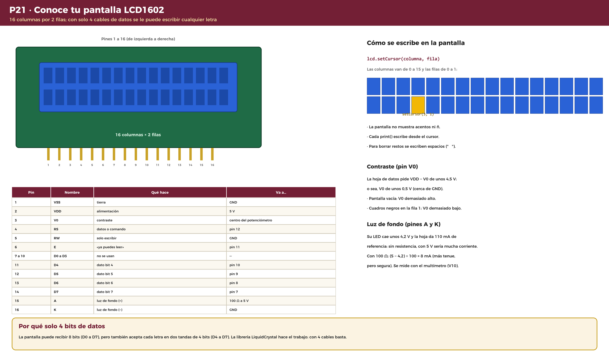
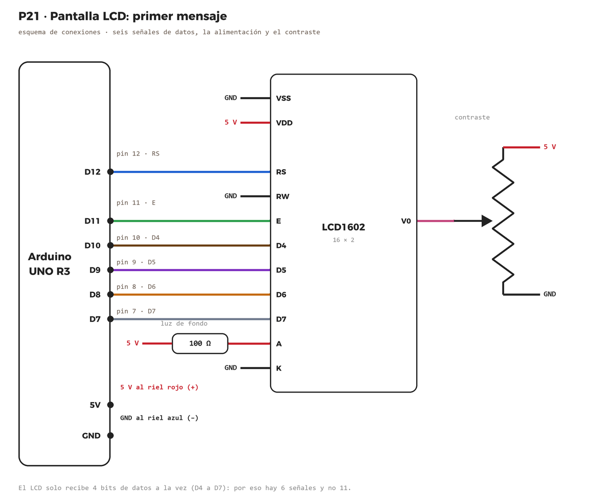
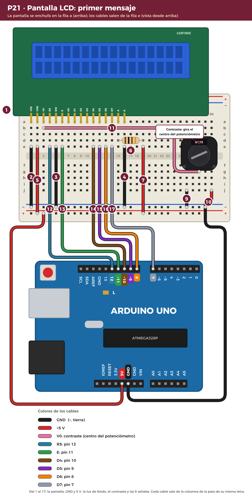
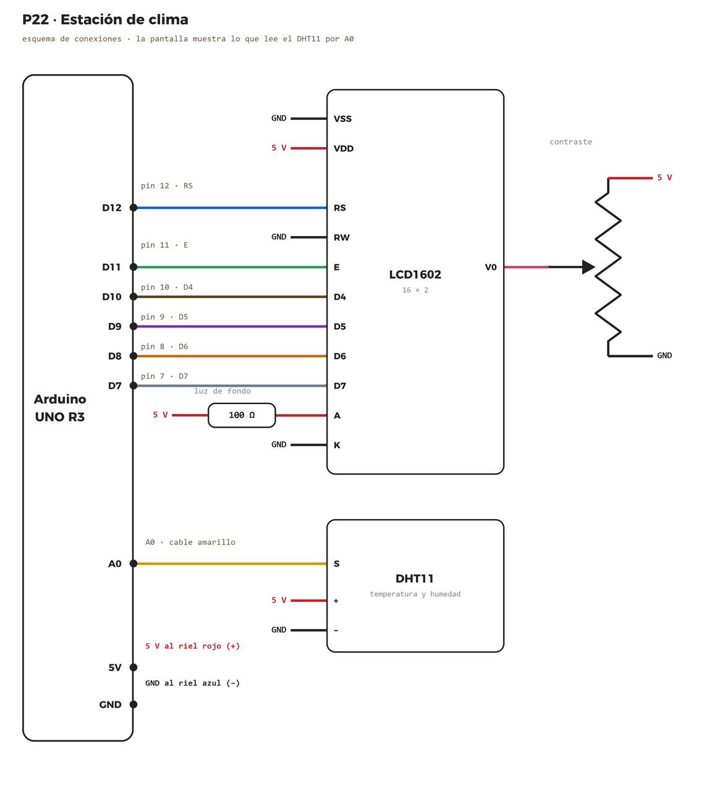
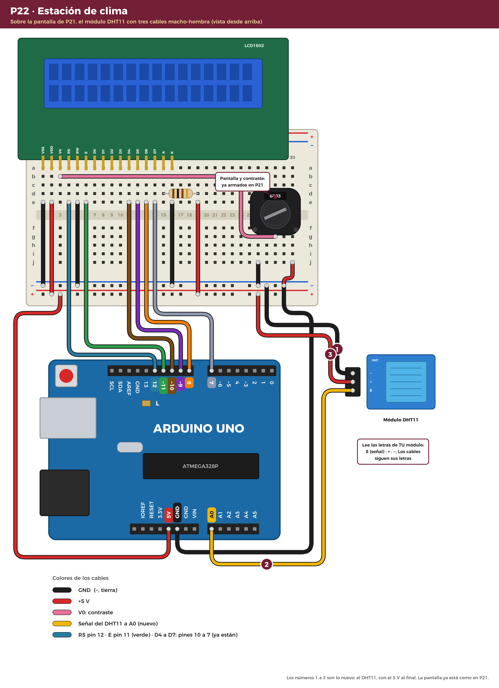

# Sesión 11 · Pantalla LCD

**Guía de práctica para el instructor** (de aquí saldrán después las láminas y las fichas de los alumnos)
**Prácticas y tiempos estimados (120 min):** idea 10 · P21 Pantalla LCD: primer mensaje (con el armado) 55 · P22 Estación de clima 40 · cierre 10 · holgura 5. Anota los tiempos reales en la tabla del final.
**Sketches:** `curso-arduino/sketches/P21_lcd_hola/` · `P22_estacion_clima/` · soluciones de retos: `P21_desplazar/`, `P22_alterna_mensajes/` y `P22_led_humedad/`
**Ideas nuevas de la sesión:** una **pantalla** para mostrar datos **sin computadora**; una segunda **librería** (`LiquidCrystal`) con su objeto `lcd`; el **modo de 4 bits** (con 4 cables de datos basta); y `millis()`, el reloj que cuenta los milisegundos desde que se enciende el Arduino. Es la primera sesión del segundo día de la visita 3 (con la Sesión 12 termina con el ventilador automático). **El kit llega desarmado del día anterior. Es la sesión con más cables: el instructor revisa cada circuito antes de energizar.**

## Cómo leer los diagramas de esta sesión

Hay dos diagramas por circuito (protoboard para **armar**, cableado para **entender**) y una ayuda para las ideas nuevas:

| Diagrama | Para qué sirve |
|---|---|
| **Conoce tu pantalla LCD1602** (`P21_lcd_conoce.png`) | Los 16 pines, a dónde va cada uno, cómo se escribe con `setCursor`, el contraste y la luz de fondo |
| **Protoboard y cableado de P21** (`P21_lcd_hola.png` y `_cableado.png`) | Enchufar la pantalla y conectar sus cables |
| **Protoboard y cableado de P22** (`P22_estacion_clima.png` y `_cableado.png`) | Agregar el DHT11 |

## Materiales

| Cantidad | Material |
|---|---|
| 1 | Pantalla **LCD1602** con sus 16 pines soldados |
| 1 | Potenciómetro (contraste) y su **desarmador plano pequeño** |
| 1 | Resistencia de **100 Ω** (café · negro · café) para la luz de fondo. El kit trae 10 |
| 1 | Módulo **DHT11** y 3 cables **macho-hembra** (para P22) |
| 17 | Cables macho-macho. Sugeridos: **negros** para GND (5), **rojos** para 5 V (4), **azul**, **verde**, **café**, **morado**, **naranja** y **gris** para las seis señales, y **rosa** para el contraste. Los colores son una sugerencia: cualquier color distinto sirve, y negro solo para GND |

### Paso 0 · Los rieles (3 min)

Con el USB desconectado, arma los rieles. **Esta vez el GND no sale del pin de arriba de la placa:** ese pin quedaría cruzado por los cables de la pantalla. Sale del **GND de la hilera de abajo** (junto al 5V) y rodea la placa por la **derecha**; el 5 V rodea la placa por la **izquierda**.

| Qué | De | A |
|---|---|---|
| Cable negro | **GND** de la hilera de abajo de la placa (el pegado al 5V) | riel azul **−** (debajo de la columna 29) |
| Cable rojo | **5V** de la placa | riel rojo **+** (debajo de la columna 3) |

## La idea de la sesión (10 min, en el pizarrón)

1. **Mostrar sin computadora.** Hasta hoy los números salían por el Monitor Serie. Una **pantalla LCD de 16 × 2** (16 columnas, 2 filas) muestra letras y números junto al sensor, como el tablero de una báscula o un termostato.
2. **Otra librería.** Como `Servo`, `LiquidCrystal` ya viene con el IDE. `LiquidCrystal lcd(12, 11, 10, 9, 8, 7);` crea «una pantalla» llamada `lcd` y le dice en qué pines está. `lcd.begin(16, 2)` la inicia; `lcd.setCursor(columna, fila)` elige dónde escribir; `lcd.print(...)` escribe. Es la segunda vez que se usa un **objeto**.
3. **Solo 4 bits de datos.** La pantalla puede recibir 8 bits a la vez, pero también acepta cada letra **en dos tandas de 4 bits** (D4 a D7). Por eso se conectan solo **seis** cables de señal (RS, E y D4 a D7) y no once.
4. **El contraste.** La pata V0 decide qué tan oscuros se ven los cuadritos. Hace falta una tensión baja (unos 0,5 V, cerca de GND): un **potenciómetro** la ajusta. Si está mal, la pantalla se ve **vacía** o con **cuadros negros**.
5. **La luz de fondo** tiene su propio LED (pines A y K) y se conecta aparte, **con una resistencia**.
6. **El reloj interno.** `millis()` devuelve los milisegundos desde que se encendió el Arduino; `millis() / 1000` son segundos. Se usa para el contador de la pantalla.
7. **Sin acentos.** La pantalla no tiene `á` ni `ñ`: se escribe sin ellos.

**Datos para el pizarrón** (de la hoja de datos del kit, `Datasheets/LCD1602A.pdf`)

- LCD1602: 16 columnas × 2 filas · se alimenta con **5 V** (también 3,3 V) · consume unos 1,5 mA la pantalla y **aparte** la luz de fondo · tamaño 80 × 36 mm.
- Contraste: la hoja pide una diferencia VDD − V0 de **unos 4,5 V** a 25 °C (entre 4,3 y 4,7 V); o sea, V0 de **unos 0,5 V**.
- Luz de fondo: el LED cae **unos 4,2 V** y la hoja da 110 mA como corriente de referencia. Con la resistencia de **100 Ω** del curso: (5 V − 4,2 V) ÷ 100 Ω ≈ **8 mA** (más tenue, pero segura). *La lección 19 del kit la conecta directo a 5 V; aquí se agrega la resistencia por prudencia (V10).*

---

## P21 · Pantalla LCD: primer mensaje (≈55 min)

### Idea de la práctica

Escribir un mensaje en la primera fila y un contador de segundos en la segunda. Lo difícil es el **armado**: 17 cables. La tabla los ordena por grupos.

### Conoce tu pantalla (5 min)



> **Para el instructor.** El orden de los pines del programa (RS 12, E 11, D4 10, D5 9, D6 8, D7 7) **no es el de la lección 19 del kit**: se eligió para que los cables salgan **en paralelo y sin cruzarse**. Lo importante: **cada cable sale de la columna de la pata de su misma letra** y llega al pin del dibujo.

### Esquema de conexiones



Las líneas con la etiqueta «5 V» se unen al **riel rojo** y las de «GND» al **riel azul**.

### Conexión en el protoboard

**Con el USB desconectado.** La pantalla se enchufa en la **fila a** (la de arriba), con la **pata 1 (VSS) en a1**, y su cuerpo queda **sobre** el protoboard. Los cables salen de la **fila e** (la de abajo de ese bloque), **en la misma columna** de cada pata.



| Paso | Qué | De | A |
|---|---|---|---|
| 1 | Pantalla LCD1602 | sus 16 patas en **a1** a **a16** | de izquierda a derecha: VSS, VDD, V0, RS, RW, E, D0, D1, D2, D3, D4, D5, D6, D7, A, K |
| 2 | Cable negro (**VSS**) | **e1** | riel azul **−** (debajo de la columna 1) |
| 3 | Cable negro (**RW**) | **e5** | riel azul **−** (debajo de la columna 5) |
| 4 | Cable negro (**K**) | **e16** | riel azul **−** (debajo de la columna 16) |
| 5 | Cable rojo (**VDD**) | **e2** | riel rojo **+** (debajo de la columna 2) |
| 6 | Resistencia de **100 Ω** (luz de fondo) | **d15** (la columna de **A**) | **d19** |
| 7 | Cable rojo | **e19** | riel rojo **+** (debajo de la columna 19) |
| 8 | Potenciómetro (contraste) | patas en **f26**, **f28** y **f30** | el centro (f28) es el cursor |
| 9 | Cable negro | **j26** | riel azul **−** (debajo de la columna 26) |
| 10 | Cable rojo (corto) | riel rojo **+** (debajo de la columna 29) | **j30** |
| 11 | Cable rosa (**V0**) | **b3** (la columna de **V0**, arriba) | **g28** (la columna del centro del potenciómetro) |
| 12 | Cable azul (**RS**) | **e4** | **pin 12** de la placa |
| 13 | Cable verde (**E**) | **e6** | **pin 11** |
| 14 | Cable café (**D4**) | **e11** | **pin 10** |
| 15 | Cable morado (**D5**) | **e12** | **pin 9** |
| 16 | Cable naranja (**D6**) | **e13** | **pin 8** |
| 17 | Cable gris (**D7**) | **e14** | **pin 7** |

**Para el instructor.** Los pasos 2 a 7 son la **alimentación**; el 8 a 11, el **contraste**; el 12 a 17, las **seis señales** (los seis cables paralelos que van a los pines 12, 11, 10, 9, 8 y 7). Se arma en ese orden y el **5 V al final**.

**Revisa antes de conectar el USB**

- [ ] La **pata 1 (VSS)** está en **a1**: la pantalla **no** está desplazada una columna. Lee las letras impresas en tu módulo.
- [ ] Los tres cables negros (VSS, RW, K) van al riel **azul**; **VDD** va al riel **rojo**; la pata **A** pasa por la resistencia de **100 Ω**.
- [ ] Las seis señales van a **12, 11, 10, 9, 8 y 7**, **en ese orden** (RS, E, D4, D5, D6, D7).
- [ ] El potenciómetro tiene el **cable rosa en el centro** (g28), el negro en un extremo y el rojo en el otro.
- [ ] El riel rojo (+) solo recibe cables de 5 V y el azul (−) solo cables de GND.

### Código

Abre `curso-arduino/sketches/P21_lcd_hola/P21_lcd_hola.ino`, sube y **gira el potenciómetro** hasta que se vean las letras.

```cpp
#include <LiquidCrystal.h>

//                RS, E, D4, D5, D6, D7
LiquidCrystal lcd(12, 11, 10, 9, 8, 7);

void setup() {
  lcd.begin(16, 2);               // 16 columnas, 2 filas
  lcd.setCursor(0, 0);
  lcd.print("Hola, IPPI!");
}

void loop() {
  lcd.setCursor(0, 1);
  lcd.print("Segundos: ");
  lcd.print(millis() / 1000);     // segundos desde que se encendió
  lcd.print("   ");               // borra restos de números más largos
}
```

- `#include <LiquidCrystal.h>` trae la librería; `LiquidCrystal lcd(12, 11, 10, 9, 8, 7);` crea la pantalla `lcd` y le dice en qué pines está **en el orden RS, E, D4, D5, D6, D7**.
- `lcd.setCursor(0, 1)` va a la columna 0 de la **fila 1** (la segunda; se cuenta desde 0). `lcd.print` escribe desde ahí.
- `millis() / 1000` son los **segundos** desde que se encendió el Arduino. `lcd.print("   ")` (tres espacios) **borra** los restos cuando el número cambia de ancho.

### Qué debes ver

1. Al subir, la luz de fondo se enciende y, con el contraste bien, aparece **Hola, IPPI!** en la primera fila.
2. En la segunda fila, **Segundos: 0**, **Segundos: 1**, … que va contando.
3. Si no se ve nada: se gira el potenciómetro (ver «Si no funciona»).

### Explora (10 min)

| Qué probar | Qué anotar |
|---|---|
| Girar el potenciómetro de un tope al otro | Qué se ve en cada extremo (pantalla vacía y cuadros negros) y en qué zona se lee bien |
| Con el contraste bien, cambiar el texto del `print` | Qué pasa si el texto tiene más de 16 letras |
| Escribir en `setCursor(5, 1)` | Dónde aparece |
| Quitar el cable negro de **K** (con el USB desconectado) y volver a conectar | Qué pasa con la luz de fondo y si el texto sigue leyéndose |
| Si hay multímetro: corriente de la luz de fondo (en serie con la resistencia de 100 Ω) | Unos 8 mA se esperan (V10) |

### Modifica (retos)

1. **Básico:** que muestre tu **nombre** en la fila 1 y el **nombre del equipo** en la fila 2.
2. **Medio:** que un texto largo **se desplace** como un letrero (`lcd.scrollDisplayLeft()`). *Solución del instructor: `sketches/P21_desplazar/`.*
3. **Desafío:** que el contador se vea como **minutos y segundos** (`01:05`). Pista: los segundos totales entre 60 son los minutos, y el **resto** (`%`) son los segundos.

### Rompe y arregla

| Fallo plantado | Qué ocurre | Qué se aprende |
|---|---|---|
| **De ajuste:** girar el potenciómetro hasta un extremo | La pantalla se ve **vacía** (con la luz encendida) o con **cuadros negros en la fila 1** | **El fallo más común:** la pantalla funciona, pero el contraste está mal. Se prueba el potenciómetro antes de buscar otro problema |
| **De cableado:** con el USB desconectado, **quitar el cable verde (E, pin 11)** | La pantalla no escribe nada (puede verse solo cuadros) | Sin la señal E la pantalla nunca se entera de que hay un dato nuevo |
| **De cableado:** con el USB desconectado, **intercambiar los cables de D4 y D5** | Salen **letras raras** en lugar del texto. *Se espera por cómo se mandan los bits; anota lo que veas* | Cada cable lleva un bit: si dos se cruzan, los números que llegan son otros |
| **De cableado:** con el USB desconectado, **quitar el cable negro de K** | Se apaga la **luz de fondo**; el texto sigue (más difícil de leer) | La luz de fondo es un circuito aparte del de datos |

### Si no funciona

| Síntoma | Causa probable |
|---|---|
| La pantalla está encendida pero **vacía** | El contraste: gira el potenciómetro; V0 (cable rosa) en el centro; RW sin GND |
| **Cuadros negros** en la fila 1 y nada más | Contraste excesivo (gira el potenciómetro hacia el otro lado) o los cables de datos no llegan |
| Sin luz de fondo | La resistencia de 100 Ω mal colocada; A o K sin conectar; el riel rojo sin 5 V |
| **Letras raras** o texto incompleto | Dos cables de datos intercambiados o en un pin equivocado (RS, E y D4 a D7 van a 12, 11, 10, 9, 8, 7) |
| Escribe en la fila 1 pero no en la 2 | Revisa `lcd.begin(16, 2)` y los cables de D4 a D7 |
| El Arduino se reinicia | Un corto entre 5 V y GND: desconecta el USB y revisa los rieles |

### Evidencia para la bitácora

- Una **foto** de la pantalla con el mensaje y el contador, y del circuito armado.
- El equipo explica **qué hace `setCursor(columna, fila)`** y **por qué la pantalla se ve vacía con el contraste mal**.
- Un reto resuelto (aunque sea el 1).

---

## P22 · Estación de clima (≈40 min)

### Idea de la práctica

Juntar dos «cajas negras»: el **DHT11** (Sesión 10) y la **pantalla** (hoy). Si el sensor falla, la pantalla **avisa** en lugar de mostrar datos falsos. Es un instrumento que funciona **sin computadora**.

### Esquema de conexiones



### Conexión en el protoboard

**Con el USB desconectado**, sobre el circuito de P21. Se agregan **tres cables macho-hembra** del módulo DHT11 (como en la Sesión 10).



| Paso | Qué | De | A |
|---|---|---|---|
| 1 | Cable negro (macho-hembra) | pata **−** del módulo | riel azul **−** (debajo de la columna 27) |
| 2 | Cable amarillo (macho-hembra) | pata **S** (señal) del módulo | pin **A0** de la placa |
| 3 | Cable rojo (macho-hembra) | pata **+** del módulo | riel rojo **+** (debajo de la columna 26) |

> **Lee las letras de TU módulo.** El orden de las patas del DHT11 puede variar; los cables siguen **sus letras**. Conectar **+** y **−** al revés puede dañar el sensor: el 5 V **al final**.

### Código

Abre `curso-arduino/sketches/P22_estacion_clima/P22_estacion_clima.ino`.

```cpp
void loop() {
  byte humedad;
  byte temperatura;

  if (leerDHT11(humedad, temperatura)) {
    lcd.setCursor(0, 0);
    lcd.print("Temp: ");
    lcd.print(temperatura);
    lcd.print(" C     ");
    lcd.setCursor(0, 1);
    lcd.print("Humedad: ");
    lcd.print(humedad);
    lcd.print(" %   ");
  } else {
    lcd.setCursor(0, 0);
    lcd.print("Error del sensor");
    lcd.setCursor(0, 1);
    lcd.print("Revisa cables   ");
  }
  delay(2000);                      // el DHT11 necesita al menos 1-2 s entre lecturas
}
```

- Lo único nuevo es **juntar**: `leerDHT11` (Sesión 10) entrega los números y `lcd.print` los muestra.
- Las rutinas **`leerDHT11`** y **`LiquidCrystal`** son «cajas negras»: se usan sin saber cómo funcionan por dentro.
- El texto lleva **espacios** al final (`" C     "`) para borrar restos de lecturas anteriores.

### Qué debes ver

La temperatura en la primera fila (por ejemplo `Temp: 24 C`) y la humedad en la segunda (`Humedad: 45 %`), que se actualizan cada 2 segundos. **Sopla** al sensor: la humedad sube.

### Modifica (retos)

1. **Básico:** que la pantalla alterne cada 6 segundos entre los datos y un **mensaje del equipo**. *Solución del instructor: `sketches/P22_alterna_mensajes/` (usa `%` para saber si la vuelta es par o impar).*
2. **Medio:** que un **LED** se encienda si la humedad pasa de **70 %**. El LED va al **pin 6** (los pines 7 a 12 son de la pantalla). *Solución del instructor: `sketches/P22_led_humedad/`.*
3. **Desafío:** muestra **también la temperatura del termistor** (P19) para compararla con la del DHT11. El termistor va en **A1** (el DHT11 usa A0), como en `P20_comparar_sensores`.

### Rompe y arregla

| Fallo plantado | Qué ocurre | Qué se aprende |
|---|---|---|
| **De cableado:** con el USB desconectado, pasar el cable amarillo del DHT11 de **A0** a **A1** | La pantalla muestra **«Error del sensor / Revisa cables»** | El programa **avisa** de la falla en lugar de mostrar datos falsos: un buen instrumento hace eso |
| **De cableado:** con el USB desconectado, **soltar el cable rojo (+)** del DHT11 | El mismo aviso en la pantalla | Sin 5 V no hay sensor; el aviso ayuda a diagnosticar sin computadora |

### Si no funciona

| Síntoma | Causa probable |
|---|---|
| La pantalla no se ve | Contraste (P21) |
| «Error del sensor» siempre | Las letras del DHT11, la señal S no está en A0, falta el 5 V o el GND; el cable macho-hembra no encaja |
| La temperatura es la de ayer | Es la última lectura buena: revisa que el sketch sea P22 |
| La humedad no cambia al soplar | Sopla más cerca y espera unos segundos |

### Evidencia para la bitácora

- Una **foto o video** de la estación de clima funcionando.
- El equipo explica **por qué la pantalla avisa de un error** en lugar de mostrar un número.
- Un reto resuelto (aunque sea el 1).

---

## Cierre de la sesión (10 min)

- En la bitácora: *«qué cambié, qué pasó, por qué»* para P21 y P22, y el visto bueno del instructor en los tres puntos (funciona, lo explica, hizo una modificación propia).
- **No se desarma** si sigue la Sesión 12 el mismo día: la **pantalla se queda armada** (hoy hace falta lo más trabajoso de armar). Si hay un descanso, se desconecta el USB.
- Pregunta de enlace con la Sesión 12: *«Hoy el Arduino mostró datos. ¿Y si además **decidiera** qué hacer con ellos, por ejemplo encender un ventilador cuando hace calor?»* (el termostato: Sesión 12).

## Tu práctica: anota lo que encuentres

Haz las prácticas como lo haría un alumno y llena esto. Sirve para ajustar la sesión y las láminas. **Lo de la pantalla cubre la validación V10 del plan.**

| Dato | Anota aquí |
|---|---|
| Tiempo real de P21 (armado y programa) y de P22 | |
| ¿Cuánto tardaste en armar los 17 cables? ¿Qué paso te costó más? | |
| ¿La pata 1 de tu LCD (VSS) es la de la izquierda? ¿Qué letras trae impresas? | |
| ¿La pantalla encendió con el contraste del potenciómetro? ¿En qué zona del giro se lee bien? | |
| ¿La luz de fondo se ve bien con la resistencia de **100 Ω**? Si hay multímetro: corriente de la luz de fondo. Si se ve muy tenue, ¿qué valor probarías y con qué corriente? | |
| ¿Funcionan los seis cables de señal (12, 11, 10, 9, 8, 7) tal como están en el diagrama? | |
| ¿Se ve bien el contador de segundos? ¿Quedan restos de dígitos? | |
| ¿Qué pasa al intercambiar D4 y D5? ¿Y al quitar E? | |
| P22: ¿lee bien el DHT11? ¿La pantalla avisa del error con el cable en A1? | |
| ¿Funcionan `P21_desplazar`, `P22_alterna_mensajes` y `P22_led_humedad`? | |
| ¿El GND de la hilera de abajo de la placa alcanza el riel con el cable? ¿Se cruzan los cables de forma que estorben? | |
| Dudas o errores que tuviste | |
| Foto de la pantalla funcionando y del circuito armado | |

## Para recompilar o regenerar

- Los sketches se verifican con `curso-arduino/compilar-sketches.ps1`.
- Los diagramas se generan con `python curso-arduino/diagramas/s11_s13.py P21 P22`. El script **comprueba las conexiones** al dibujar (por ejemplo, que cada pata del LCD llega al pin indicado, que la luz de fondo pasa por la resistencia de 100 Ω y que el centro del potenciómetro llega a V0) y se detiene si algo no coincide.
- Valores que **no** están verificados: el contraste con el potenciómetro, la luz de fondo con 100 Ω y su corriente (V10), cómo se ven las letras con dos bits intercambiados, la distancia entre las patas y si la pata 1 de tu módulo es la de la izquierda.
