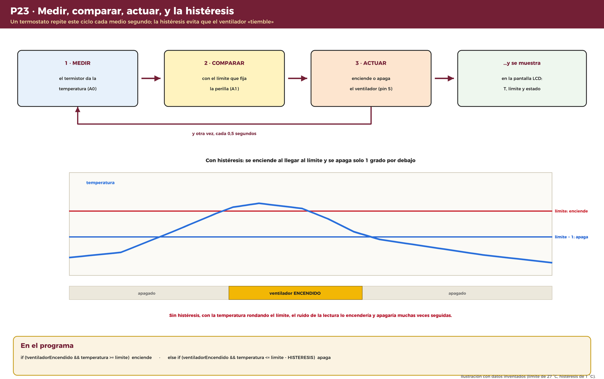
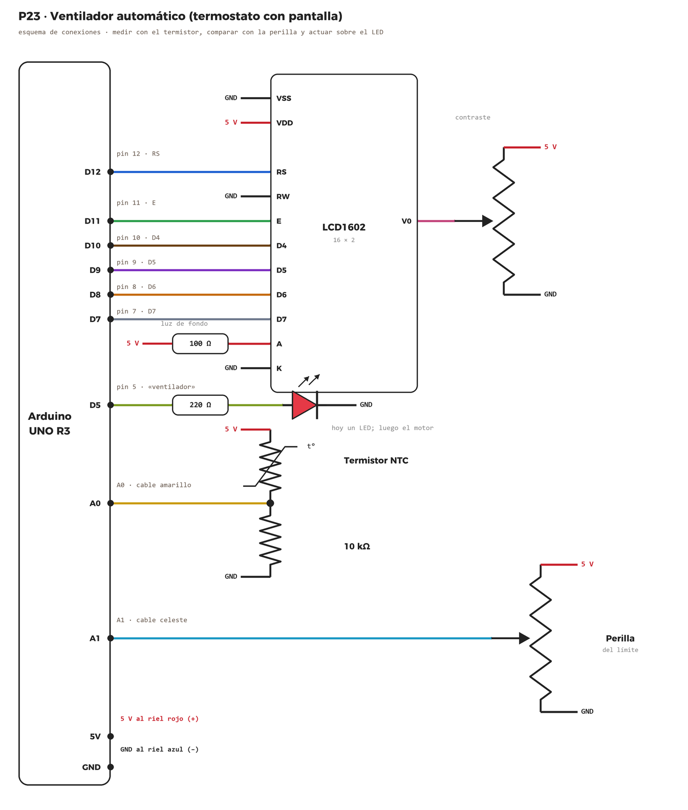
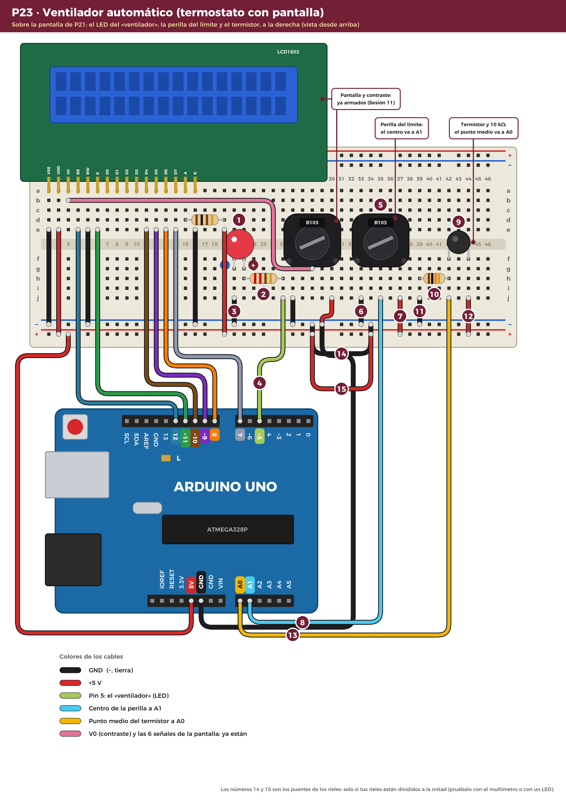

# Sesión 12 · Ventilador automático (integración)

> **El «ventilador» de hoy es un LED.** El motor sigue bloqueado hasta resolver la validación V1 (ver la Sesión 9). La lógica del termostato —medir, comparar, actuar, con histéresis— es **la misma** con el LED y con el motor; cuando el motor se destrabe, se cambia la carga por el circuito de la Sesión 9 en el pin 5 y el programa **no cambia**.

**Guía de práctica para el instructor** (de aquí saldrán después las láminas y las fichas de los alumnos)
**Prácticas y tiempos estimados (120 min):** idea 10 · P23 armado 30 · P23 programa y prueba 30 · retos y fallos 35 · cierre de la visita 15. Anota los tiempos reales en la tabla del final.
**Sketches:** `curso-arduino/sketches/P23_ventilador_automatico/` · soluciones de retos: `P23_velocidad_proporcional/` y `P23_aviso_35/`
**Ideas nuevas de la sesión:** un **sistema de control** completo (**medir → comparar → actuar**, repetido); la **histéresis** (por qué no se apaga exactamente donde se enciende); una **variable de estado** que recuerda lo que se hizo; y la **integración** de lo visto: perilla (Sesión 5), umbral (Sesión 6), carga (Sesión 9), termistor (Sesión 10) y pantalla (Sesión 11). **Reemplaza al «Proyecto 7: Ventilador» del PowerPoint.** Es la segunda sesión del segundo día de la visita 3: **la visita termina con el ventilador automático.**

## Cómo leer los diagramas de esta sesión

| Diagrama | Para qué sirve |
|---|---|
| **Medir, comparar, actuar, y la histéresis** (`P23_control.png`) | El ciclo del termostato y por qué la histéresis evita el «temblor» (ilustración) |
| **Protoboard y cableado de P23** (`P23_ventilador_automatico.png` y `_cableado.png`) | Armar el LED, la perilla del límite y el termistor sobre la pantalla de la Sesión 11 |

## Materiales

Todo sale de las Sesiones 5, 6, 10 y 11. **La pantalla y su contraste siguen armados de la Sesión 11** (si no, primero se hace P21).

| Cantidad | Material |
|---|---|
| 1 | LED rojo y 1 resistencia de **220 Ω** (el «ventilador») |
| 1 | Potenciómetro (la perilla del **límite**) y su desarmador plano pequeño. **El del contraste** de la pantalla ya está armado |
| 1 | Termistor NTC y 1 resistencia de **10 kΩ** (café · negro · naranja) |
| 11 | Cables macho-macho: **negro** (3 al riel, y 1 puente), **rojo** (3 al riel, y 1 puente), **lima** o verde claro (pin 5), **celeste** o azul (A1) y **amarillo** (A0). Los colores son una sugerencia |
| — | *Solo si hay:* un multímetro para probar los rieles |

> **Los rieles y el ancho del protoboard.** Hoy el montaje usa las **46 primeras columnas** del protoboard. Si tus rieles (rojo y azul) se **dividen a la mitad**, hay que unir las dos mitades con un cable en cada riel (los **puentes**, pasos 14 y 15). La hoja del kit sobre protoboards dice que en los grandes puede haber un corte a la mitad: **se prueba** con un LED o con el multímetro antes de armar, o se arma y se revisa si la perilla y el termistor reciben 5 V.

## La idea de la sesión (10 min, en el pizarrón)

1. **Un sistema de control tiene tres pasos que se repiten:** **medir** (el termistor da la temperatura), **comparar** (con el límite que fija la perilla) y **actuar** (encender o apagar el ventilador). El Arduino los repite cada medio segundo.
2. **El límite se fija con la perilla**, entre 20 y 40 °C: `map` convierte la lectura (0 a 1023) en grados (la misma conversión de la Sesión 5).
3. **Histéresis.** Si el ventilador se encendiera y se apagara **exactamente** en el mismo número, cuando la temperatura anduviera rondando el límite el **ruido** de la lectura lo encendería y apagaría muchas veces seguidas: «temblaría». Por eso se **enciende** al llegar al límite y se **apaga** solo cuando baja **1 grado** por debajo: ese grado de margen es la **histéresis**.
4. **Variable de estado.** Para saber si debe encender o apagar, el programa tiene que **recordar** si el ventilador ya está encendido: `ventiladorEncendido` (la de la Sesión 3, otra vez).
5. **Seguridad en el programa.** Si el termistor falla (la lectura es imposible, como en la Sesión 10), el ventilador **se apaga** y la pantalla dice «Revisa termistor». **Un sistema de control debe fallar en un estado seguro.**
6. **Integración.** Nada de lo de hoy es nuevo por separado: es todo lo que ya sabes, trabajando junto.

---

## P23 · Ventilador automático (termostato con pantalla)

### Idea de la práctica

Medir la temperatura con el termistor, compararla con un límite ajustable y encender el «ventilador» (un LED en el pin 5) cuando se llegue al límite. La pantalla muestra la **temperatura**, el **límite** y el **estado**.



### Esquema de conexiones



### Conexión en el protoboard

**Con el USB desconectado.** Se agrega lo **nuevo a la derecha** de la pantalla. Los números del diagrama son los de esta tabla.



| Paso | Qué | De | A |
|---|---|---|---|
| 1 | LED rojo (el «ventilador») | pata **larga (+)** en **g21** | pata corta (−) en **g20** |
| 2 | Resistencia 220 Ω | **h21** | **h25** |
| 3 | Cable negro | **j20** | riel azul **−** (debajo de la columna 20) |
| 4 | Cable lima | **pin 5** de la placa | **j25** |
| 5 | Potenciómetro del **límite** | patas en **f33**, **f35** y **f37** | el centro (f35) es el cursor |
| 6 | Cable negro | **j33** | riel azul **−** (debajo de la columna 33) |
| 7 | Cable rojo (corto) | riel rojo **+** (debajo de la columna 37) | **j37** |
| 8 | Cable celeste | pin **A1** de la placa (hilera de abajo) | **j35** |
| 9 | Termistor NTC (sin polaridad) | una pata en **f42** | la otra en **f44** |
| 10 | Resistencia **10 kΩ** | **h42** | **h39** |
| 11 | Cable negro | **j39** | riel azul **−** (debajo de la columna 39) |
| 12 | Cable rojo (corto) | riel rojo **+** (debajo de la columna 44) | **j44** |
| 13 | Cable amarillo | pin **A0** de la placa (hilera de abajo) | **j42** |
| 14 | Cable negro (**puente** del riel azul) | riel azul **−** (debajo de la columna 28) | riel azul **−** (debajo de la columna 34) |
| 15 | Cable rojo (**puente** del riel rojo) | riel rojo **+** (debajo de la columna 28) | riel rojo **+** (debajo de la columna 34) |

> **Los pasos 14 y 15 son los puentes**: solo hacen falta si tus rieles se dividen en dos. Aunque no se necesiten, no estorban.

**Revisión previa (el instructor mira cada circuito antes de energizar)**

- [ ] La **pantalla** sigue como en P21 (pata 1 en a1, seis señales a los pines 12, 11, 10, 9, 8 y 7, contraste en el potenciómetro de la columna 26 a 30).
- [ ] El **LED** tiene la pata larga hacia la resistencia de 220 Ω y la corta al riel azul; el cable lima va al **pin 5**.
- [ ] La **perilla del límite** tiene el cable **celeste** en el **centro** y los otros dos cables en los extremos.
- [ ] El **termistor** y la resistencia de **10 kΩ** hacen un divisor: el cable **amarillo** va al **punto medio** (j42).
- [ ] Los rieles reciben 5 V y GND también en la **mitad derecha** del protoboard.

### Código

Abre `curso-arduino/sketches/P23_ventilador_automatico/P23_ventilador_automatico.ino`, sube, **gira el potenciómetro del contraste** hasta leer la pantalla y escribe el límite con la perilla del límite.

```cpp
void loop() {
  float temperatura = leerTemperatura();
  int limite = map(analogRead(PIN_PERILLA), 0, 1023, 20, 40);

  if (temperatura < -200.0) {
    // sin lectura válida: por seguridad, el ventilador se apaga
    ventiladorEncendido = false;
    digitalWrite(PIN_MOTOR, LOW);
    ...
    return;
  }

  // Decisión con histéresis
  if (!ventiladorEncendido && temperatura >= limite) {
    ventiladorEncendido = true;
  } else if (ventiladorEncendido && temperatura <= limite - HISTERESIS) {
    ventiladorEncendido = false;
  }

  if (ventiladorEncendido) {
    digitalWrite(PIN_MOTOR, HIGH);
  } else {
    digitalWrite(PIN_MOTOR, LOW);
  }
  ...  // pantalla
}
```

- `leerTemperatura()` es la función de la Sesión 10 (promedia 10 lecturas y devuelve −273 si el termistor falla). `map(…, 20, 40)` convierte la perilla en un límite de 20 a 40 °C (Sesión 5).
- **`return;` dentro de `loop()`** termina esa vuelta antes de tiempo: si la lectura no es válida, ya se apagó el ventilador y se avisó, y no se hace lo demás. Es la primera vez que se usa.
- La **decisión con histéresis** tiene dos casos: si está **apagado** y la temperatura llega al límite, **enciende**; si está **encendido** y la temperatura baja a `limite − HISTERESIS` (un grado menos), **apaga**. En cualquier otro caso, **no cambia nada**: se queda como estaba. Eso lo permite `ventiladorEncendido`.
- `PIN_MOTOR` se llama así por el destino de la sesión; hoy enciende el LED del pin 5.

### Qué debes ver

1. La pantalla muestra, por ejemplo, **`T:24.6C Lim:27`** en la primera fila y **`Ventilador: OFF`** en la segunda.
2. Al girar la perilla del límite, el número después de `Lim:` cambia entre 20 y 40.
3. Si el límite queda **por debajo** de la temperatura, el LED se enciende y la pantalla dice **`Ventilador: ON`**.

### Cómo probarlo (15 min)

La prueba del plan, paso por paso:

1. Con la perilla, pon el **límite 1 o 2 grados por encima** de la temperatura que marca la pantalla.
2. **Sostén el termistor** entre los dedos (sin mojarlo ni calentarlo con flama): la temperatura sube. Al llegar al límite, el LED se **enciende** y la pantalla dice `ON`. Anota la temperatura y los segundos.
3. **Suelta el termistor** y espera: la temperatura baja. Cuando llegue a **un grado por debajo del límite**, el LED se **apaga**. Anota esa temperatura y los segundos.
4. Comprueba que se apagó **1 grado debajo** de donde encendió: esa es la histéresis.

> **Cuidado.** El termistor se calienta con los **dedos** o con aire tibio; nunca con una flama, un encendedor o una resistencia caliente. No lo mojes.

### Explora (10 min)

| Qué probar | Qué anotar |
|---|---|
| Subir la temperatura con los dedos y soltar | A cuántos grados se encendió y a cuántos se apagó el LED (deben diferir en 1) |
| Poner el límite **igual** a la temperatura ambiente | Cómo se comporta el LED cerca del límite con la histéresis puesta |
| Girar la perilla del límite de un tope al otro | El rango de límites que se ve (de 20 a 40) y de cuánto en cuánto cambia |
| Quitar un momento el cable amarillo (con el USB desconectado) y reconectar | Que la pantalla avisa «Revisa termistor» y el LED se apaga |

### Modifica (retos)

1. **Básico:** cambia `HISTERESIS` a **2.0** y a **0.5** y repite la prueba: ¿cuánto cambia el margen entre encender y apagar?
2. **Medio:** que el brillo del LED (la «velocidad») **suba mientras más caliente esté**, de forma proporcional al exceso sobre el límite. Pista: `analogWrite` en el pin 5. *Solución del instructor: `sketches/P23_velocidad_proporcional/`.*
3. **Medio:** que un **zumbador** (pasivo, con su resistencia de 220 Ω, en el **pin 4**) avise si la temperatura pasa de **35 °C**. *Solución del instructor: `sketches/P23_aviso_35/`.*
4. **Desafío:** que la perilla fije el límite entre **24 y 34 °C** (más fino): cambia los dos últimos números de `map`.

### Rompe y arregla

| Fallo plantado | Qué ocurre | Qué se aprende |
|---|---|---|
| **De código:** poner `HISTERESIS = 0.0` y el límite igual a la temperatura ambiente | El LED **«tiembla»**: se enciende y apaga varias veces seguidas porque la lectura sube y baja un poco por el ruido. *Se espera; anota lo que veas* | **La histéresis existe para esto**: sin ella, el ruido hace que el sistema oscile alrededor del límite |
| **De cableado:** con el USB desconectado, **soltar el cable amarillo** (A0) o **quitar la resistencia de 10 kΩ** | La pantalla dice **«Revisa termistor»** y el LED se **apaga** | Un buen sistema **avisa y se pone en estado seguro** cuando un sensor falla, en lugar de seguir con un dato falso |
| **De cableado:** con el USB desconectado, **soltar el cable celeste** (A1) | El **límite cambia solo** y el LED enciende y apaga sin motivo | Una entrada analógica sin conectar «flota» (Sesión 5): también afecta al límite |

### Si no funciona

| Síntoma | Causa probable |
|---|---|
| La pantalla no se lee | Contraste (la perilla de la columna 26 a 30, Sesión 11) |
| «Revisa termistor» siempre | Falta la resistencia de 10 kΩ; el cable amarillo o el rojo (44) están sueltos; los rieles de la mitad derecha no tienen 5 V (revisa los puentes) |
| La perilla del límite no cambia | El cable celeste no llega a A1; el rojo de la columna 37 o el negro de la 33 están sueltos |
| El LED nunca enciende | El límite está por encima de la temperatura; el LED está al revés; el cable lima no llega al pin 5 |
| El LED siempre enciende | El límite está por debajo de la temperatura ambiente |
| La temperatura es absurda | Termistor y resistencia al revés, o una resistencia que no es de 10 kΩ (Sesión 10) |

### Evidencia para la bitácora

- Un **video corto** del ciclo completo (se enciende, se apaga) **con la pantalla visible**.
- El equipo explica **qué es la histéresis**, **qué hace `ventiladorEncendido`** y **por qué el ventilador se apaga si el sensor falla**.
- Un reto resuelto (aunque sea el 1).

---

## Cierre de la visita (15 min)

- En la bitácora: *«qué cambié, qué pasó, por qué»* para P23, y el visto bueno del instructor en los tres puntos (funciona, lo explica, hizo una modificación propia).
- **Demostración de la visita:** cada equipo muestra su **ventilador automático**: pone el límite, calienta el termistor con los dedos y enseña el ciclo completo en la pantalla.
- **Es el final de la visita 3: desarmar y guardar el kit completo.** La **pantalla LCD sin doblar sus patas**, los dos potenciómetros sin forzar, el termistor y el DHT11 en su lugar, los cables macho-hembra en su paquete y el LED con su resistencia. Contar con la hoja de inventario.
- Pregunta de enlace con la Sesión 13: *«El termostato midió algo del aire. ¿Y si lo que hay que medir es la **humedad de la tierra** de una maceta, o el **nivel del agua** de un tinaco?»* (sensores de campo: Sesión 13).

## Tu práctica: anota lo que encuentres

Haz las prácticas como lo haría un alumno y llena esto. Sirve para ajustar la sesión y las láminas.

| Dato | Anota aquí |
|---|---|
| Tiempo real del armado y de las pruebas | |
| ¿Tus rieles están divididos a la mitad? ¿Hicieron falta los puentes (14 y 15)? | |
| ¿Caben todos los componentes en las 46 columnas sin estorbarse (la perilla del límite y el termistor a la derecha)? | |
| ¿Qué temperatura marca la pantalla al encender? ¿Coincide con el termómetro de referencia (si hay)? | |
| Temperatura a la que se **enciende** el LED y a la que se **apaga** (diferencia esperada: 1 grado) | |
| Segundos que tarda el termistor en subir hasta el límite con los dedos y en volver a bajar | |
| ¿Con `HISTERESIS = 0.0` y el límite en la temperatura ambiente, el LED «tiembla»? ¿Cuántas veces cambia en 10 segundos? | |
| ¿La pantalla avisa «Revisa termistor» al soltar el cable amarillo? ¿Se apaga el LED? | |
| ¿Funcionan `P23_velocidad_proporcional` y `P23_aviso_35`? | |
| Dudas o errores que tuviste | |
| Video del ciclo encendido y apagado con la pantalla a la vista | |

## Para recompilar o regenerar

- Los sketches se verifican con `curso-arduino/compilar-sketches.ps1`.
- Los diagramas se generan con `python curso-arduino/diagramas/s11_s13.py P23`. El script **comprueba las conexiones** al dibujar (por ejemplo, que A0 llega al punto medio del termistor, que A1 llega al centro de la perilla, que el LED recibe el pin 5 solo a través de su resistencia, y que cada pata de la pantalla llega al pin indicado) y se detiene si algo no coincide.
- Valores que **no** están verificados: si los rieles de tu protoboard se dividen y cuál es la mejor manera de unirlos, el comportamiento del LED sin histéresis cerca del límite, la histéresis de 1 °C frente al ruido real del termistor, y la separación de las patas del termistor y de la perilla.
