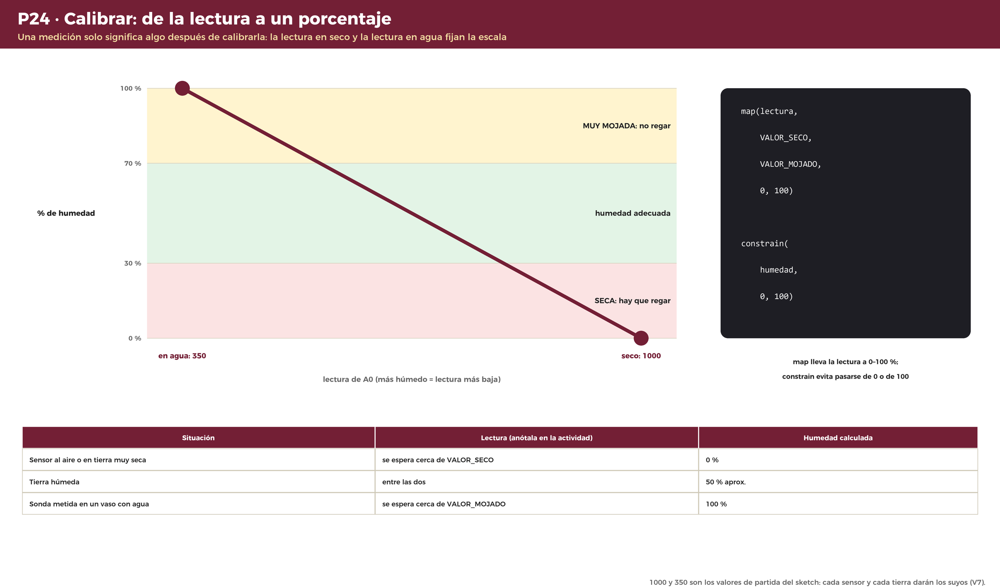
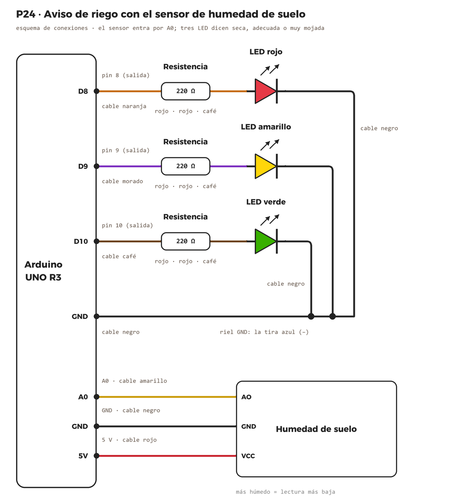
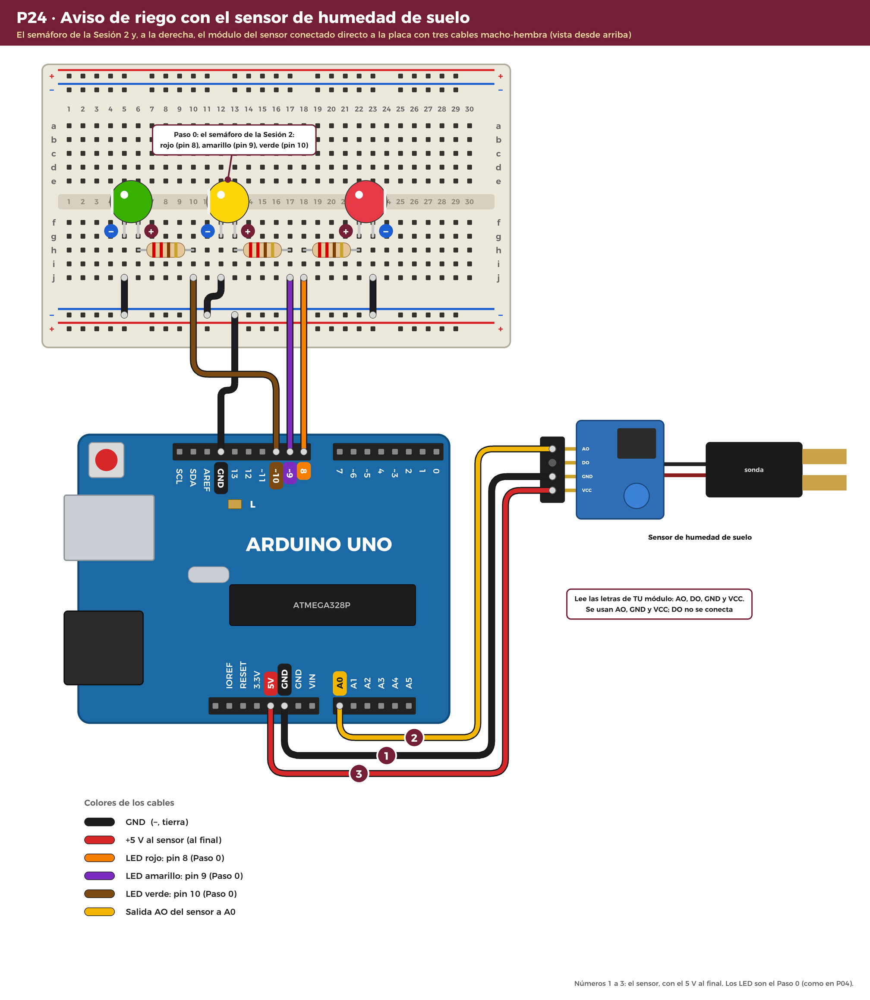
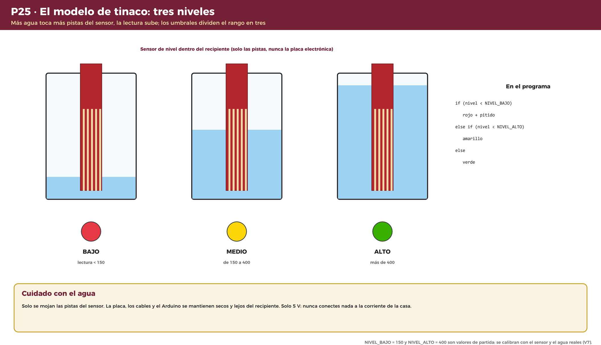
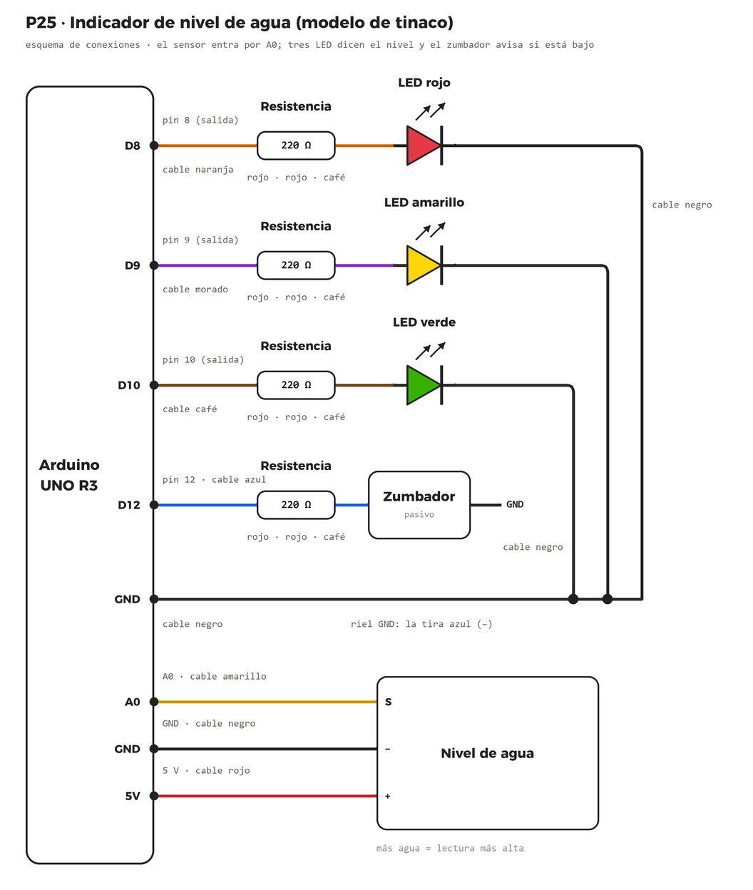
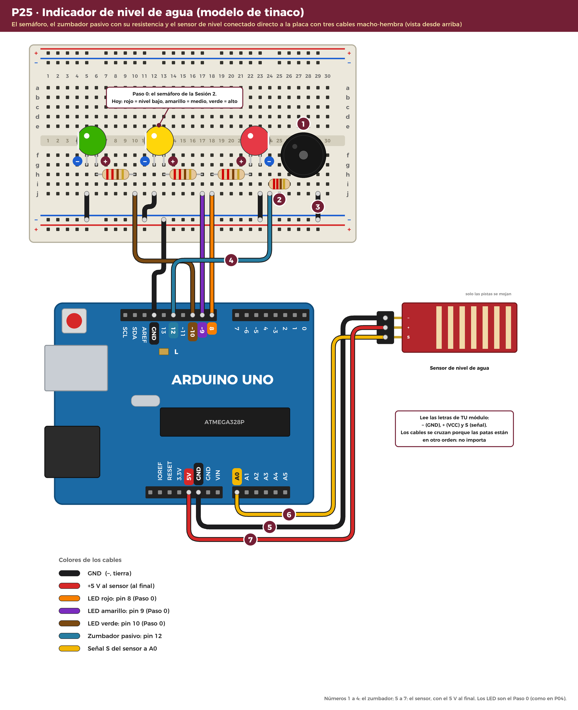

# Sesión 13 · Campo y agua

**Guía de práctica para el instructor** (de aquí saldrán después las láminas y las fichas de los alumnos)
**Prácticas y tiempos estimados (120 min):** Paso 0 semáforo 10 · idea 10 · P24 Aviso de riego (armado 10 + actividad «medimos nuestra tierra» 30 + prueba y retos 10) 50 · P25 Nivel de agua (armado 15 + calibración 15 + prueba y retos 10) 40 · cierre 10. Anota los tiempos reales en la tabla del final.
**Sketches:** `curso-arduino/sketches/P24_humedad_suelo/` · `P25_nivel_agua/` · soluciones de retos: `P24_zumbador_seco/` y `P25_bomba_simulada/`
**Ideas nuevas de la sesión:** un **sensor de campo** (de la tierra y del agua) es solo un voltaje que cambia; **una medición solo significa algo después de calibrarla** (medir los dos extremos y anotarlos); convertir la lectura en un **porcentaje** con `map` (con el rango «al revés») y limitarlo con `constrain`; y que **no todos los sensores suben hacia el mismo lado** (el de suelo baja al mojarse; el de nivel sube). Es la primera sesión de la **visita 4**; después sigue la Sesión 14 (el proyecto) el mismo día. **El kit llega desarmado: se arma todo desde el semáforo.** Cuidado especial: **agua cerca de electrónica** (solo 5 V, pero la placa del sensor, los cables y el Arduino se mantienen secos).

## Cómo leer los diagramas de esta sesión

Hay dos diagramas por circuito (protoboard para **armar**, cableado para **entender**) y dos ayudas para las ideas nuevas:

| Diagrama | Para qué sirve |
|---|---|
| **Calibrar: de la lectura a un porcentaje** (`P24_calibracion.png`) | La recta que convierte la lectura en 0–100 % con los dos extremos (seco y en agua), las tres zonas y las funciones `map` y `constrain` |
| **El modelo de tinaco: tres niveles** (`P25_niveles.png`) | Cómo cambia la lectura con el nivel del agua y qué LED enciende en cada zona |
| **Protoboard y cableado de P24** (`P24_humedad_suelo.png` y `_cableado.png`) | El semáforo y el sensor de suelo con sus tres cables macho-hembra |
| **Protoboard y cableado de P25** (`P25_nivel_agua.png` y `_cableado.png`) | El semáforo, el zumbador pasivo y el sensor de nivel de agua |
| **El semáforo** (`P04_semaforo.png` y `_cableado.png`, de la Sesión 2) | El Paso 0 de esta sesión |

## Materiales

| Cantidad | Material |
|---|---|
| 3 | LED: **rojo**, **amarillo** y **verde** (el semáforo de la Sesión 2) |
| 4 | Resistencias de **220 Ω** (rojo · rojo · café): 3 del semáforo y 1 del zumbador de P25 |
| 1 | Módulo **sensor de humedad de suelo**: la placa azul y la **sonda** de dos pistas, unidas por un cable corto |
| 1 | Módulo **sensor de nivel de agua** (placa roja con pistas) |
| 3 | Cables **macho-hembra** (los mismos para los dos sensores, uno después del otro). El extremo hembra va a las patas del módulo y el macho a la placa |
| 1 | Zumbador **pasivo** (el activo no sirve para `tone`, ver la Sesión 4) |
| 9 | Cables macho-macho: **negros** (4 del semáforo y 1 para el zumbador), **naranja**, **morado** y **café** (los pines 8, 9 y 10), y **azul** (pin 12, P25). Los colores son una sugerencia |
| — | **Por equipo, para la actividad:** 2 vasos desechables con **tierra** de maceta o del patio (una **seca**, que se deja secar al sol el día anterior, y otra **húmeda**), 1 vaso con **agua**, 1 vaso **alto y angosto** para P25, papel o trapo para secar la sonda y una **charola o bolsa** donde apoyar los vasos |
| — | *Si hay:* un desarmador plano pequeño (para la perilla azul del módulo de suelo) y una regla o cinta métrica |

### Paso 0 · Armar el semáforo (10 min)

Con el USB desconectado, arma el **semáforo de la Sesión 2** en el protoboard (hay diagrama: `P04_semaforo.png`). Es lo mismo de siempre; si el equipo ya lo sabe, es un repaso.

| Paso | Qué | De | A |
|---|---|---|---|
| 1 | LED rojo | pata **larga (+)** en **g22** | pata corta (−) en **g23** |
| 2 | Resistencia 220 Ω | **h18** | **h22** |
| 3 | Cable negro | **j23** | riel azul **−** (debajo de la columna 23) |
| 4 | Cable naranja | **pin 8** de la placa | **j18** |
| 5 | LED amarillo | pata **larga (+)** en **g13** | pata corta (−) en **g12** |
| 6 | Resistencia 220 Ω | **h13** | **h17** |
| 7 | Cable negro | **j12** | riel azul **−** (debajo de la columna 11: en la 12 el riel tiene un hueco) |
| 8 | Cable morado | **pin 9** de la placa | **j17** |
| 9 | LED verde | pata **larga (+)** en **g6** | pata corta (−) en **g5** |
| 10 | Resistencia 220 Ω | **h6** | **h10** |
| 11 | Cable negro | **j5** | riel azul **−** (debajo de la columna 5) |
| 12 | Cable café | **pin 10** de la placa | **j10** |
| 13 | Cable negro | **GND** de la hilera de **arriba** de la placa (junto al pin 13) | riel azul **−** (debajo de la columna 13) |

> **Prueba rápida del semáforo:** sube `P04_semaforo` (Sesión 2) y comprueba que los tres LED se encienden. Si no, se arregla **ahora**: no tiene caso calibrar un sensor con un semáforo que no funciona.

## La idea de la sesión (10 min, en el pizarrón)

1. **Un sensor de campo es un voltaje que cambia.** El de suelo y el de nivel de agua se leen con `analogRead`, como la perilla (Sesión 5) y la fotorresistencia (Sesión 6): un número de 0 a 1023.
2. **Los dos suben hacia lados opuestos.** En el módulo de **suelo**, mientras más húmeda está la tierra, la lectura **baja** *(lección 31 del kit: «mojado, el voltaje baja; seco, sube»)*; en el sensor de **nivel**, mientras más agua toca las pistas, la lectura **sube**. No hay que adivinar: se **mide**.
3. **Una medición solo significa algo después de calibrarla.** Una lectura de 700 no dice «húmedo» ni «seco»: depende del sensor, de la tierra y hasta de cuánto se apretó la sonda. **Calibrar** es medir los dos extremos (**seco** y **en agua**) y anotarlos; el programa traza la escala entre ellos. Es la misma idea de `AJUSTE_C` de la Sesión 10: ningún sensor es «la verdad».
4. **De la lectura a un porcentaje.** `map(lectura, VALOR_SECO, VALOR_MOJADO, 0, 100)` es el `map` de la Sesión 5, pero con el rango de entrada **al revés** (el seco es el número grande): también funciona. `constrain(humedad, 0, 100)` corta lo que se pase de 0 o de 100.
5. **Tres zonas, tres LED.** Con `if / else if / else` (Sesión 6): seca (rojo), adecuada (verde) o muy mojada (amarillo). **Dónde ponemos los límites lo decide quien conoce la planta**, no el Arduino.
6. **Las sondas se oxidan.** Las pistas metálicas se corroen si pasan días conectadas con corriente en la tierra mojada: **se conecta el sensor para medir y se desconecta al terminar.**
7. **Agua y electrónica.** Solo se mojan las **pistas**. La placa del sensor (la parte con los pines y las piezas), los cables y el Arduino se mantienen **secos** y lejos del vaso. Todo funciona con los 5 V del kit; **nunca se conecta nada a la corriente de la casa.**

**Datos para el pizarrón** (de las hojas del kit, `Datasheets/` y `Tutorial/English/Lesson 25` y `Lesson 31`)

- **Sensor de humedad de suelo:** 5 V · menos de 20 mA · salida analógica (AO) y digital (DO) · temperatura de trabajo de 10 a 30 °C. El módulo trae una **perilla azul** que solo ajusta el umbral de la salida **digital** (DO), una luz de encendido y una luz de DO; **AO, la que usamos, no se ve afectada por la perilla.** Letras de las patas en la foto del kit: **AO · DO · GND · VCC**.
- **Sensor de nivel de agua:** 5 V · menos de 20 mA · salida analógica · zona de detección de **40 × 16 mm** · temperatura de trabajo de 10 a 30 °C · señal de salida de **0 a 4,2 V** (o sea, una lectura máxima de alrededor de **860**, no de 1023: 4,2 ÷ 5 × 1023). Letras de las patas: **S · + · −**.
- **Contradicciones de las hojas, para comprobar con el kit (V7):** la hoja del suelo dice que mide por «capacitancia», pero las fotos de la lección 31 muestran una sonda con **pistas metálicas al descubierto** (una resistencia que depende de la humedad), y esas **sí se corroen**. La hoja de otra marca del sensor de nivel dice que sumergido da hasta 1023; la del kit dice 4,2 V. **Se miden los extremos reales** y se anotan.

---

## P24 · Aviso de riego con el sensor de humedad de suelo (≈50 min)

### Idea de la práctica

Medir qué tan húmeda está la tierra y avisar con el semáforo: **rojo** si está seca (hay que regar), **verde** si la humedad es adecuada y **amarillo** si está muy mojada (no regar). Lo importante no es el armado, sino la **calibración**: con **tierra real** del equipo.



### Esquema de conexiones



### Conexión en el protoboard

**Con el USB desconectado.** Después del Paso 0. El sensor **no** va al protoboard: se conecta **directo a la placa** con tres cables macho-hembra, como en la lección 31 del kit. **El 5 V se conecta al final.**



| Paso | Qué | De | A |
|---|---|---|---|
| 1 | Cable (macho-hembra) | **GND** del módulo (hembra en la pata GND) | **GND** de la hilera de **abajo** de la placa (el pegado al 5V) |
| 2 | Cable (macho-hembra) | **AO** del módulo | pin **A0** de la placa (hilera de abajo) |
| 3 | Cable (macho-hembra) | **VCC** del módulo | pin **5V** de la placa (el **último**) |

> **Lee las letras de TU módulo** (están impresas junto a las patas). En la foto del kit, de izquierda a derecha, son **AO · DO · GND · VCC**; **DO no se conecta**. En el diagrama el módulo está girado con las patas a la izquierda, así que las lees de arriba abajo: AO, DO, GND, VCC. **Las letras de tu módulo mandan.**

**Revisión previa (el instructor mira cada circuito antes de energizar)**

- [ ] El **semáforo** está como en la Sesión 2 (pines 8, 9 y 10).
- [ ] El cable de **GND** va a la pata **GND** del módulo, **no** a DO ni a AO.
- [ ] El cable que va a **A0** sale de la pata **AO** (no de DO).
- [ ] El cable de **VCC** va a **5V** (y no a 3,3 V ni a VIN).
- [ ] La **sonda** está conectada a la placa azul con su cable y la parte negra de la sonda **no se va a mojar**.

### Código

Abre `curso-arduino/sketches/P24_humedad_suelo/P24_humedad_suelo.ino`, sube y **abre el Monitor Serie** (9600).

```cpp
const int VALOR_SECO = 1000;          // lectura con el sensor seco  (AJUSTA con tu medición)
const int VALOR_MOJADO = 350;         // lectura con el sensor en agua (AJUSTA con tu medición)
const int PORCENTAJE_BAJO = 30;       // menos de esto = seco
const int PORCENTAJE_ALTO = 70;       // más de esto = muy mojada

void loop() {
  int lectura = analogRead(PIN_SENSOR);
  int humedad = map(lectura, VALOR_SECO, VALOR_MOJADO, 0, 100);   // más mojado = lectura menor
  humedad = constrain(humedad, 0, 100);
  ...
  if (humedad < PORCENTAJE_BAJO) {
    // rojo: SECA
  } else if (humedad > PORCENTAJE_ALTO) {
    // amarillo: MUY MOJADA
  } else {
    // verde: humedad adecuada
  }
  delay(500);
}
```

- `VALOR_SECO` y `VALOR_MOJADO` **son supuestos**: hay que reemplazarlos con **tus** mediciones (la actividad de abajo).
- `map(lectura, VALOR_SECO, VALOR_MOJADO, 0, 100)` lleva la lectura a un porcentaje. Con los números del sketch: **1000 → 0 %**, **900 → 15 %**, **825 → 26 %**, **700 → 46 %**, **500 → 76 %**, **350 → 100 %**. Como `map` trabaja con enteros, **corta los decimales**.
- **`constrain(humedad, 0, 100)`** (nuevo): si `humedad` se sale de 0 o de 100 (una lectura de 1100, por ejemplo), la deja en el límite. Sin ella, un sensor al aire podría dar −7 % o 112 %.
- Los tres `if` son los de la Sesión 6, ahora con **porcentajes**.

### Qué debes ver

1. La **luz de encendido** del módulo se prende en cuanto conectas el 5 V.
2. El Monitor Serie muestra una línea cada medio segundo, por ejemplo **`Lectura: 812    Humedad: 28 %    SECA: hay que regar`** *(los números de ejemplo; los tuyos serán otros)*.
3. Con la sonda **al aire**, el semáforo marca **rojo** (o lo que diga tu calibración de partida); al **meterla en agua**, la lectura baja y el LED pasa a **amarillo**.

### Actividad · «Medimos nuestra tierra» (30 min)

**Es el corazón de la sesión.** Cada equipo calibra su sensor con sus muestras.

**Antes de empezar:** pon los vasos sobre la **charola o bolsa**, **lejos del Arduino y de los cables**. La tierra y el agua no se acercan a la placa ni al protoboard. Prueba que el cable de la sonda llegue sin jalar la placa.

1. Con el sketch cargado y el Monitor Serie abierto, **anota la lectura con la sonda al aire**, limpia y seca. Espera a que el número se estabilice (unos 5 segundos) y anótalo.
2. **Mete las pistas** (solo las pistas amarillas, **nunca la parte negra**) en la **tierra seca**. Espera 10 segundos y anota.
3. Pásala a la **tierra húmeda** (la que se sienta como maceta recién regada). Anota.
4. Mete **solo las pistas** en el vaso con **agua**. Anota la lectura.
5. **Entre muestra y muestra, limpia y seca la sonda** con papel. Si no, la humedad de una muestra se queda en la siguiente.
6. Llena la tabla de abajo. Con ella, elige **`VALOR_SECO`** (la lectura de la tierra seca o del aire) y **`VALOR_MOJADO`** (la lectura en agua), escríbelos en el sketch, **sube** y comprueba: **en agua debe decir ≈ 100 %** y en tierra seca **≈ 0 %**.
7. Prueba otra vez las muestras: ¿el porcentaje que da el Arduino **coincide** con lo que sientes al **tocar** la tierra? Si no, anótalo: ¿qué muestra se ve «mal»? ¿Por qué?
8. **Define los umbrales** (`PORCENTAJE_BAJO` y `PORCENTAJE_ALTO`). Discute en el equipo: *«¿a qué porcentaje le diríamos a una persona que riegue su planta?»* No hay una respuesta única: depende de la planta.
9. **Desconecta el sensor** (quita el cable rojo del 5V) al terminar. Seca la sonda.

| Muestra | Lectura | Humedad que calcula el programa (ya calibrado) | LED que enciende | Cómo se siente al tacto |
|---|---|---|---|---|
| Sonda **al aire** (seca) | | | | — |
| Tierra **seca** | | | | |
| Tierra **húmeda** | | | | |
| Sonda en **agua** | | | | — |

| Lo que elegimos | Valor | Por qué |
|---|---|---|
| `VALOR_SECO` | | |
| `VALOR_MOJADO` | | |
| `PORCENTAJE_BAJO` | | |
| `PORCENTAJE_ALTO` | | |

> **Nota para el instructor.** Si la tierra seca da una lectura **menor** que la húmeda (al revés de lo esperado), el sensor o la sonda están **mal conectados**; revisa que AO (no DO) llegue a A0. Si las lecturas **saltan** entre dos valores, el cable amarillo está en DO. **Anota todo lo que veas: es la validación V7 del plan.**

### Cómo probarlo (10 min)

1. Con los valores calibrados, comprueba las **tres zonas**: tierra seca (rojo), húmeda (verde) y muy mojada o agua (amarillo).
2. **Riega la tierra seca** poco a poco con una cucharita de agua mientras miras el Monitor Serie: ¿cuánto tarda en subir el porcentaje? ¿Se reparte de inmediato por toda la tierra?
3. Mueve la sonda dentro de la tierra: ¿cambia la lectura si la **presionas** o la **sacas un poco**? Anota cuánto.

### Explora (10 min)

| Qué probar | Qué anotar |
|---|---|
| Sonda al aire y luego **tocada con un dedo húmedo** | Cuánto cambia la lectura; ¿el sensor «siente» la humedad de la piel? |
| Meter la sonda **a medias** y luego **toda** en la tierra | Si cambia la lectura (la hoja dice que promedia a lo largo de toda la sonda) |
| Girar la **perilla azul** del módulo con un desarmador pequeño y mirar la luz de DO | Que la luz de DO cambia de umbral pero **la lectura de AO en el Monitor Serie no cambia** |
| Esperar 1 minuto con la sonda dentro de la tierra húmeda | Si la lectura **deriva** (se va corriendo poco a poco) |
| Sacar la sonda de la tierra y mirar las pistas | Si hay residuos de tierra o un color distinto: **la oxidación empieza por ahí** |

### Modifica (retos)

1. **Básico:** cambia `PORCENTAJE_BAJO` a **40** y `PORCENTAJE_ALTO` a **60**: ¿en qué muestra cambia el color?
2. **Medio:** que un **zumbador** (pasivo, con su resistencia de 220 Ω, **pin 12**) dé un pitido corto en cada vuelta mientras la tierra esté **seca**. Las conexiones del zumbador son las de P25 (pasos 1 a 4). *Solución del instructor: `sketches/P24_zumbador_seco/`.*
3. **Medio:** que la lectura se **promedie** (10 lecturas, como en la Sesión 10) para que el porcentaje no «brinque».
4. **Desafío:** deja una maceta o un vaso con tierra húmeda y **anota el porcentaje cada 30 minutos** durante la visita: ¿cuánto se seca?

### Rompe y arregla

| Fallo plantado | Qué ocurre | Qué se aprende |
|---|---|---|
| **De código:** **intercambiar** los dos valores (`VALOR_SECO = 350` y `VALOR_MOJADO = 1000`) | **Los colores se invierten**: la tierra seca marca ≈ 100 % (amarillo) y el agua marca ≈ 0 % (rojo). *Determinista* | **Un sensor sin calibrar (o calibrado al revés) miente** con total seguridad: el programa no sabe que está mal |
| **De código:** dejar los valores del sketch (1000 y 350) **sin ajustar** a tu sensor | Los colores **no corresponden** a la realidad: la tierra muy húmeda puede marcar «adecuada», o la seca, «adecuada». *Se espera; anota lo que veas* | **Calibrar es obligatorio**: los números de otra persona no sirven |
| **De cableado:** con el USB desconectado, **soltar el cable amarillo** (AO) y reconectar | La lectura **flota** (números sin sentido que cambian solos) mientras está suelto | Una entrada analógica sin conectar «flota» (Sesión 5) |

### Si no funciona

| Síntoma | Causa probable |
|---|---|
| La luz de encendido del módulo no se prende | VCC o GND mal conectados; el cable rojo no llega al 5V; las letras de tu módulo no son las del diagrama |
| La lectura salta entre ≈ 0 y ≈ 1023 | El cable amarillo está en **DO** (salida digital) en lugar de **AO** |
| La lectura no cambia al meter la sonda en agua | El cable de la sonda está suelto en la placa; la sonda no está metida hasta las pistas |
| Siempre «SECA» o siempre «MUY MOJADA» | Valores sin calibrar o al revés; la sonda no entra en contacto con la tierra |
| Los LED no encienden | El semáforo (Paso 0) está mal: revisa la Sesión 2 |
| La lectura cambia mucho al mover los cables | Cables macho-hembra flojos en las patas del módulo |

### Evidencia para la bitácora

- La **tabla de calibración llena** y los **umbrales elegidos**, con la razón (*«elegimos 35 % porque…»*).
- El equipo explica **qué es calibrar**, **para qué sirve `map`** y **por qué la lectura baja cuando la tierra se moja**.
- Un **video corto** del semáforo cambiando de rojo a verde y a amarillo al meter la sonda en tierra seca, húmeda y agua.
- Un reto resuelto (aunque sea el 1).

---

## P25 · Indicador de nivel de agua (modelo de tinaco) (≈40 min)

### Idea de la práctica

Medir el **nivel del agua** de un vaso y avisarlo con el semáforo: **rojo** y un pitido si está bajo, **amarillo** si está a medio nivel y **verde** si está lleno. Es la versión pequeña de lo que hace un tinaco o una cisterna con una bomba. Aquí el sensor sube cuando hay más agua: **al revés** que el de suelo.



### Esquema de conexiones



### Conexión en el protoboard

**Con el USB desconectado.** **Antes: desconecta y seca el sensor de suelo** (los tres cables macho-hembra se reutilizan). El semáforo se queda como está. El sensor de nivel se conecta **directo a la placa**. **El 5 V se conecta al final.**



| Paso | Qué | De | A |
|---|---|---|---|
| 1 | Zumbador **pasivo** | una pata en **f26** | la otra pata en **f29** |
| 2 | Resistencia 220 Ω | **i24** | **i26** |
| 3 | Cable negro | **j29** | riel azul **−** (debajo de la columna 29) |
| 4 | Cable azul | **pin 12** de la placa | **j24** |
| 5 | Cable (macho-hembra) | **−** (GND) del módulo | **GND** de la hilera de **abajo** de la placa (el pegado al 5V) |
| 6 | Cable (macho-hembra) | **S** del módulo | pin **A0** de la placa (hilera de abajo) |
| 7 | Cable (macho-hembra) | **+** del módulo | pin **5V** de la placa (el **último**) |

> **La resistencia del paso 2 abarca solo 2 agujeros** (de la columna 24 a la 26) y su cuerpo mide más: se coloca **«parada»** (una pata en cada agujero y el cuerpo levantado) o con las patas dobladas hacia afuera. **El zumbador pasivo lleva siempre su resistencia de 220 Ω** (Sesión 4): sin ella pediría unos 300 mA y un pin aguanta 40 mA.

> **Lee las letras de TU módulo.** En el kit son **S · + · −** (señal, positivo y tierra). Los cables se **cruzan** en el diagrama porque en la placa están en otro orden; no importa que se crucen, importa que cada uno llegue a donde dice su letra.

**Revisión previa (el instructor mira cada circuito antes de energizar)**

- [ ] El **semáforo** sigue como en el Paso 0 y el **zumbador** lleva su resistencia.
- [ ] El cable **rojo** va a **5V** y al **+** del módulo; el **negro**, a **GND** y al **−**; el **amarillo**, a **A0** y a **S**. **Nunca al revés.**
- [ ] El **vaso** con agua está **lejos** del Arduino y del protoboard, sobre la charola, y la **placa** del sensor (la parte alta, con los pines) **no** va a mojarse.
- [ ] El sensor se **sostiene** (con una pinza de ropa o apoyado en el borde del vaso) para que **no se caiga** al agua.

### Código

Abre `curso-arduino/sketches/P25_nivel_agua/P25_nivel_agua.ino` y sube.

```cpp
const int NIVEL_BAJO = 150;           // menos de esto = bajo   (AJUSTA con tu medición)
const int NIVEL_ALTO = 400;           // más de esto = alto     (AJUSTA con tu medición)

void loop() {
  int nivel = analogRead(PIN_SENSOR);
  // se apagan los tres LED ...
  if (nivel < NIVEL_BAJO) {
    // rojo + pitido (tone en el pin 12)
  } else if (nivel < NIVEL_ALTO) {
    // amarillo
  } else {
    // verde
  }
  delay(500);
}
```

- Los dos umbrales **dividen el rango en tres**: abajo de `NIVEL_BAJO`, entre los dos y arriba de `NIVEL_ALTO`. Son **supuestos**: hay que calibrarlos.
- **`tone(PIN_ZUMBADOR, 800, 100)`** da un pitido de 100 milisegundos cada vez que se repite el ciclo mientras el nivel esté bajo (Sesión 4). Con el nivel medio o alto, `noTone` lo calla.
- Si el sensor está **seco** (en el aire), la lectura es **baja**: el semáforo marca **rojo** con pitido. Es lo esperado: «sin agua» es nivel bajo.

### Qué debes ver

1. Con el sensor **en el aire**, la lectura es **muy baja** (cerca de 0), el LED **rojo** está encendido y el zumbador da un pitido cada medio segundo.
2. Al meter el sensor poco a poco al agua, la lectura **sube**; pasa por el **amarillo** y llega al **verde**.
3. Al sacarlo, el proceso se invierte.

### Calibración con agua (15 min)

1. Con el sensor **seco**, anota la lectura en el Monitor Serie.
2. Marca con un plumón **tres niveles** en el vaso alto y angosto: **bajo** (1 cm), **medio** (2,5 cm) y **alto** (4 cm). *La zona sensible mide 40 mm: más de 4 cm de agua no cambia la lectura.*
3. Pon el agua en cada nivel (**solo el agua**; el sensor entra poco a poco) y **anota la lectura** de cada uno.
4. **Elige los umbrales**: `NIVEL_BAJO` a mitad de camino entre la lectura de «bajo» y la de «medio»; `NIVEL_ALTO` entre «medio» y «alto». Escríbelos, sube y comprueba que los tres colores aparezcan en el nivel correcto.
5. **Saca el sensor, seca la placa y las pistas** y **desconéctalo** al terminar.

| Nivel | Lectura | LED que enciende |
|---|---|---|
| Sensor **seco** (al aire) | | |
| **Bajo** (1 cm) | | |
| **Medio** (2,5 cm) | | |
| **Alto** (4 cm) | | |
| **Sumergido** hasta el tope de las pistas | | |
| **NIVEL_BAJO** y **NIVEL_ALTO** que elegimos | | |

> **Nota para el instructor.** Según la hoja del kit, la lectura **máxima** debería ser de ≈ 860 (4,2 V); otra hoja dice 1023. **Anota la lectura con el sensor sumergido hasta el tope de las pistas (V7).** Si la lectura **no sube** al meter el sensor, revisa **S** y los cables **+** y **−**; **si el sensor se calienta o la lectura es siempre 0 con la luz apagada, desconecta de inmediato: puede estar con + y − al revés.**

### Cómo probarlo (10 min)

1. Con tus umbrales, **llena el vaso poco a poco** con una jarra y comprueba que el semáforo pase de rojo a amarillo y a verde en los niveles que marcaste.
2. **Vacíalo** (saca el agua con una cuchara o saca el sensor) y comprueba que el zumbador **suene** cuando el nivel vuelve a ser bajo.
3. Pregunta al equipo: *«¿qué pasaría si el tinaco real se quedara en rojo todo el día?»* (alguien tendría que prender la bomba a mano: de ahí la idea del reto 2).

### Explora (5 min)

| Qué probar | Qué anotar |
|---|---|
| Meter el sensor **muy despacio** y mirar el Monitor Serie | Si la lectura sube **poco a poco** o por **escalones** (cada pista que se moja) |
| Sacarlo y mirar la lectura **sin secar** | Si la lectura baja de inmediato o se queda alta un rato (gotas entre las pistas) |
| Probar con **agua del grifo** y con **agua con una pizca de sal** (y **enjuagar y secar** el sensor después: la sal corroe las pistas) | Cuánto cambia la lectura: el agua pura conduce menos |
| Meter solo la **punta** y luego la mitad | Si la lectura es proporcional a lo que está cubierto |

### Modifica (retos)

1. **Básico:** pon `NIVEL_BAJO` mayor que `NIVEL_ALTO` (por ejemplo 400 y 150) y mira qué LED nunca se enciende (ver «Rompe y arregla»).
2. **Medio:** una **bomba simulada** (un LED con resistencia de 220 Ω en el **pin 5**) que **enciende** con nivel bajo y se **apaga solo cuando llega a alto**, con la **histéresis** de la Sesión 12. *Solución del instructor: `sketches/P25_bomba_simulada/`.* Cuando el motor se destrabe (Sesión 9), el LED se cambia por el circuito del transistor y el programa no cambia.
3. **Medio:** que el zumbador también **avise cuando el nivel sea muy alto** (se derrama).
4. **Desafío:** mostrar el nivel como **porcentaje** (0 a 100 %) con `map` y `constrain`, igual que en P24.

### Rompe y arregla

| Fallo plantado | Qué ocurre | Qué se aprende |
|---|---|---|
| **De código:** **`NIVEL_BAJO = 400` y `NIVEL_ALTO = 150`** (los umbrales en desorden) | El **amarillo nunca se enciende**: o está en rojo (menos de 400) o en verde (400 o más). *Determinista* | El orden de los `if` y de los números importa: un programa puede compilar y portarse mal |
| **De código:** dejar los umbrales del sketch (150 y 400) **sin calibrar** | Los colores **no corresponden** al nivel marcado en el vaso. *Se espera; anota lo que veas* | Los números de otro sensor no sirven para el tuyo |
| **De cableado:** con el USB desconectado, **soltar el cable amarillo** (S) | La lectura **flota** y los colores cambian solos | Una entrada analógica sin conectar «flota» (Sesión 5) |

### Si no funciona

| Síntoma | Causa probable |
|---|---|
| La lectura siempre es muy baja | El sensor no entra al agua; **S** o los cables están sueltos; el cable amarillo no llega a A0 |
| La lectura siempre es muy alta | La placa está mojada o hay agua entre las pistas: sécalas; hay una gota de agua en los pines |
| El zumbador no suena | Es un zumbador **activo** (el pasivo es el que cambia de tono); falta la resistencia o el cable azul no llega al pin 12; el nivel no está bajo |
| El zumbador suena todo el tiempo | El nivel siempre es bajo: la calibración no se hizo; el sensor no está en el agua |
| Los LED no encienden | El semáforo (Paso 0) está mal: revisa la Sesión 2 |
| La lectura cambia mucho con los cables | Cables macho-hembra flojos en las patas del módulo |

### Evidencia para la bitácora

- La **tabla de calibración llena** y los **dos umbrales elegidos**.
- El equipo explica **por qué en un sensor la lectura sube y en el otro baja** y **qué hace cada `if`**.
- Un **video corto** del vaso llenándose con el semáforo cambiando de rojo (con pitido) a amarillo y a verde.
- Un reto resuelto (aunque sea el 1).

---

## Cierre de la sesión (10 min)

- En la bitácora: *«qué cambié, qué pasó, por qué»* para P24 y P25, con la **tabla de calibración** pegada, y el visto bueno del instructor en los tres puntos (funciona, lo explica, hizo una modificación propia).
- **Desconectar los sensores, secar las pistas y guardar los módulos en su bolsa** (la placa del sensor de nivel, sin doblar los pines). **No se desarma todo el kit**: sigue la Sesión 14 el mismo día.
- Pregunta de enlace con la Sesión 14: *«Ya saben medir luz, distancia, temperatura, humedad y agua; y mostrar, sonar y mover cosas. ¿Qué problema de su escuela o de su comunidad podrían resolver con lo que ya saben?»* (el proyecto de las Sesiones 14 a 16).

## Tu práctica: anota lo que encuentres

Haz las prácticas como lo haría un alumno y llena esto. Sirve para ajustar la sesión y las láminas. **Cubre la validación V7 del plan.**

| Dato | Anota aquí |
|---|---|
| Tiempo real del Paso 0, de P24 (armado, actividad y retos) y de P25 | |
| Letras impresas en tu módulo de **suelo** (de izquierda a derecha, con las patas hacia ti) y en el de **agua** | |
| ¿La **sonda** de suelo tiene las pistas **al descubierto** (resistiva) o está cubierta (capacitiva)? ¿La hoja y la realidad coinciden? | |
| **Suelo:** lectura con la sonda al aire / en tierra seca / en tierra húmeda / en agua | |
| ¿La lectura de la tierra húmeda baja con respecto a la seca (como dice la lección 31)? | |
| ¿Cuánto tarda la lectura en estabilizarse al meter la sonda? ¿Se «va corriendo» con el tiempo? | |
| ¿La **perilla azul** del módulo cambia la lectura de AO o solo la luz de DO? | |
| **Valores de calibración que elegiste** (`VALOR_SECO`, `VALOR_MOJADO`) y porcentajes elegidos | |
| **Agua:** lectura con el sensor seco / en 1, 2,5 y 4 cm / sumergido hasta el tope. ¿Llega a ≈ 860 o a 1023? | |
| **Umbrales que elegiste** (`NIVEL_BAJO`, `NIVEL_ALTO`) | |
| ¿Se calientan los módulos? ¿Hay algo raro (olor, color) en las pistas después de una hora de uso? | |
| ¿El zumbador pasivo con 220 Ω se oye bien en el salón? | |
| ¿Cabe la resistencia de 220 Ω de 2 agujeros (i24 a i26)? ¿La pusiste parada? | |
| ¿Funcionan `P24_zumbador_seco` y `P25_bomba_simulada`? | |
| Dudas o errores que tuviste | |
| Video del semáforo cambiando con la sonda y con el vaso | |

## Para recompilar o regenerar

- Los sketches se verifican con `curso-arduino/compilar-sketches.ps1`.
- Los diagramas se generan con `python curso-arduino/diagramas/s11_s13.py P24 P25`. El script **comprueba las conexiones** al dibujar (por ejemplo, que A0 llega a la señal del sensor, que el 5V llega a VCC y el GND a GND, que el zumbador recibe el pin 12 solo a través de su resistencia y que cada LED llega a su pin) y se detiene si algo no coincide.
- Valores que **no** están verificados: las lecturas reales de los dos sensores (`VALOR_SECO`, `VALOR_MOJADO`, `NIVEL_BAJO` y `NIVEL_ALTO` son supuestos), si la sonda del kit es de pistas al descubierto, si la lectura máxima del sensor de nivel es 860 o 1023, el **orden de las patas** de tus módulos (el del diagrama sale de las fotos de las lecciones 25 y 31 del kit), la deriva de la lectura con el tiempo, y si la resistencia de 220 Ω cabe en 2 agujeros. Ningún sketch de esta sesión se ha probado en la placa.
